# exp00101: スクラッチのモデルの方式の一次比較

## 目的

2025〜2026 年の有望なインスタンスセグメンテーションの方式を自作し(スクラッチ実装)、同じ backbone・同じ実データ・同じ評価で
比べて、フェーズ C(モデルの構成を詰める実験)の基準にする方式を決める。学習の仕組み(データの読み込み・損失・評価)もここで作る。

- **比べる相手(公式)**: 公式の RF-DETR-Seg(公式のコード vendor/rf-detr 1.12.0 の Small の版の backbone だけを、自作と同じ timm の
  ResNet-50 に差し替えたもの)と、公式の YOLO26-seg(公式のコード vendor/ultralytics 8.4.211 の l の版の backbone だけを同じ R50 に
  差し替えたもの)。公式のコードをそのまま使うのはこの 2 つだけで、自作の精度を近づけ・超えていく目標にする
- **自作**: Mask2Former 系・RF-DETR-Seg 系・YOLO26-seg 系・GTR 系(下の表)。どれも同じ立ち位置で、論文と公式のコード(あれば)を
  参考に仕組みと設定の値を読み取り、自前の学習の仕組み(`lib_common/`)の上に自分で書く(公式の関数を写さない)。
  backbone はどれも timm の ResNet-50 にそろえ、backbone より後の部分の方式を比べる

最初の 2 本(自作の Mask2Former 系・公式の RF-DETR-Seg)は、20 クラス・`coco_train_10pct`(9,528 枚)で学習した。精度が低く
(mask AP 3.6)、1 本に 2〜3 時間かかって比較を何十回も回せないことがわかったので、以降は 8 クラス・学習 2,000 枚
(`coco_train_cls8_2k`)で比べる(経緯は instance_segmentation/README.md の「計画の見直し」)。最初の 2 本の結果は残す。

## 比べる方式

| 方式 | 年 | 入れる理由 |
|---|---|---|
| Mask2Former 系 | 2022(CVPR 2022) | クエリ方式の基本形。最初の基準(以前の検証で良かったため) |
| RF-DETR-Seg 系 | 2026(ICLR 2026。公式のコードは Apache-2.0) | 比べる相手の公式と同じ方式。自作で公式と結果がそろうことを確かめてから、部品を 1 つずつ変えて超えていく(本筋) |
| YOLO26-seg 系 | 2026(arXiv 2606.03748、Ultralytics) | クエリ方式ではない、NMS なしの密な予測の CNN の代表。少ないデータ・短い学習に強い可能性と、速さの軸での比較。自作は論文だけから作る(公式のコードは AGPL)。比べる相手として、公式のコードの backbone だけを差し替えたものも学習する(公式のコードは `vendor/` に置き、GitHub には上げない) |
| GTR 系 | 2026-09(arXiv 2609.26590。公式のコードは MIT) | RF-DETR-Seg より高い mask AP と短い遅延を報告(論文の値。RF-DETR の値には SAM2 の疑似マスクで学習したという注記がある)。論文の新しさの中心は backbone(ゲート付き線形注意の ViT、DINOv3 からの蒸留)だが、ここではほかの方式と同じく R50 にそろえ、backbone より後(3 段の encoder、D-FINE 系の decoder、損失、学習の設定)を比べる。backbone そのものの比較は exp00105 |

候補から外したもの: ProtoSeg(YOLACT 系)・SOLOv2・SparseInst・RTMDet-Ins(2020〜2022 年。古く、報告されている精度も低い)、
Mask DINO(2023。DN 学習・two-stage などの部品は、自作の RF-DETR-Seg 系の部品の比較で扱う)。ViT の backbone が前提の EoMT と、
backbone の蒸留が中心の ECInsSeg は、backbone の比較(exp00105)で扱う。

## 方式ごとの対応と違い(公式・自作)

公式の列は、比べる相手の公式の RF-DETR-Seg(**Small の版の backbone だけを R50 に差し替えたもの**)と、自作の Mask2Former 系が参考にした公式の Mask2Former(COCO 80 クラス・全データで
mask AP 43.7、公式の MODEL_ZOO.md の値。参考)。自作の列は、方式の仕組み・設定の値と、公式から変えた所。

値の確かめ方: 公式の RF-DETR-Seg は vendor のコードと学習で実際に使われた設定(`runs/rfdetr_seg_r50_coco10pct/training_config.json`)、
公式の Mask2Former は公式リポジトリの設定ファイル(`Base-COCO-InstanceSegmentation.yaml`・`maskformer2_R50_bs16_50ep.yaml`)と
detectron2 の既定値(`detectron2/config/defaults.py`)、GTR は公式のコードの `configs/seg`・`configs/det/gtr_base.yml`、
YOLO26 は論文の本文と付録の表(S5〜S9)、自作はコード(`lib_common/`)。

**データ拡張の条件**: この exp はモデルの基本の力を比べる場なので、データ拡張と評価の入力は基本のもの(albumentations の `lsj` と
`eval_transforms`)にそろえる(データ拡張の効果は exp00107 で見る)。公式の RF-DETR-Seg だけは、比べる相手として公式のデータ拡張のまま。
下の表の「データ拡張」の行の自作の RF-DETR-Seg 系・YOLO26-seg 系の方式ごとのデータ拡張は、統一の条件を決める前の学習(旧条件)で
使ったもの。

| 部品 | 公式の RF-DETR-Seg(R50 に差し替え) | 公式の Mask2Former | 自作: Mask2Former 系 | 自作: RF-DETR-Seg 系 | 自作: YOLO26-seg 系 | 自作: GTR 系 |
|---|---|---|---|---|---|---|
| 元にした大きさの版(variant) | **RF-DETR-Seg Small**(`RFDETRSegSmallConfig`)。backbone 以外(特徴をまとめる部分・decoder・マスクの head・損失・学習の設定)は Small のまま。Small から変えたのは backbone(DINOv2 の windowed small → R50)と、それに合わせた特徴の stride(12 → 16)・窓の数(2 → 1)・使う段(R50 の stride 8・16・32 の段)と、入力の大きさ(384 → 512)。Small の COCO の事前学習の重みは使わない | R50 の版(`maskformer2_R50_bs16_50ep.yaml`) | 公式の R50 の版 | 公式と同じ(Small) | 公式の版には合わせていない(neck の幅は下の「backbone の後の特徴」の行) | 公式の `gtr_base.yml` の decoder の設定 |
| 方式の要点 | DETR 系の検出(枠)+ クエリと画素の特徴の内積でマスク | クエリごとに、前の層の予測マスクの中だけを見る注意でマスクを直していく | 公式の Mask2Former と同じ | 公式の RF-DETR-Seg と同じ | NMS なしの密な予測の CNN(位置ごとにクラス・枠・マスクの係数) | D-FINE 系の DETR(4 辺のずれを分布で表し、層ごとに直していく)+ RF-DETR-Seg と同じマスクの head |
| backbone | timm `resnet50.a1_in1k`(ImageNet)。BatchNorm も学習する | torchvision の R-50(ImageNet)。BatchNorm は固定(FrozenBN) | timm `resnet50.a1_in1k`。BatchNorm も学習する | 公式と同じ | 同左(論文は専用の CNN) | 同左(論文はゲート付き線形注意の ViT、DINOv3 からの蒸留) |
| backbone の後の特徴 | stride 8・16・32 の段を stride 16 にそろえてつなげ、C2f(3×3 の組 3 つ)+ LayerNorm で 256 チャンネルの 1 段(P4) | 多重解像度の deformable な注意(6 層)で stride 8〜32 をまとめ、stride 4 まで FPN で上げる | 素直な FPN(**簡略版**。exp00102 で公式の版にする)。マスクの特徴は stride 4、decoder は stride 32・16・8 を順に見る | 公式と同じ | PAN(上から・下からの 2 回、C3k2 のブロック)。最上段に SPPF + C2PSA(自己注意)。出力は stride 8・16・32 の 3 段(256・512・512 チャンネル) | 出力の stride 8・16・32 のそれぞれで、backbone の全部の段をその stride に補間してつなげ、C2f + LayerNorm で 256 チャンネル(論文は 1 段の ViT の 3 つの層を 2・1・0.5 倍にする) |
| クエリ | 100 個(学習では 13 組。Group DETR)。内容は学習する埋め込み。最初の枠は two-stage: P4 の各画素を候補の枠(幅・高さ 0.05)にし、組ごとの Linear + LayerNorm の後、クラスの値の最大が上位 100 個の画素の枠 + 学習する差分 | 100 個(学習する埋め込み) | 公式と同じ | 公式と同じ | なし(3 段の全部の位置。512 なら 5,376 個) | 300 個(学習では 3 組)。two-stage: 3 段の全部の画素を候補の枠(幅・高さ 0.05 × 2^段)にし、組ごとの head でクラスの値の最大が上位 300 個。内容はその画素の特徴。学習では denoising のクエリ(正解の枠とクラスにノイズを入れたもの。最大 100 × 組)も足す |
| decoder | 4 層。組ごとの self-attention(8 ヘッド)→ deformable な cross-attention(16 ヘッド・各 2 点。P4 の 1 段)→ FFN 2048(ReLU)。後置きの LayerNorm。位置の埋め込みは最初の枠の sine の埋め込みを MLP に通したもの(層ごとに作り直さない) | 9 層。予測マスクの中だけを見る cross-attention → self-attention 8 ヘッド → FFN。後置きの LayerNorm | 公式と同じ | 公式と同じ | なし(段ごとの畳み込みの head。クラス・枠・マスクの係数を別々の枝で出す) | 4 層。組ごとの self-attention(8 ヘッド。denoising のクエリは別)→ 3 段の deformable な cross-attention(8 ヘッド、段ごとに 3・6・3 点、値・出力の射影なし)→ Gate(残差の代わりに 2 つの入力をゲートで混ぜる)→ FFN 1024(SiLU)。位置の埋め込みは最初の枠から(層ごとに作り直さない) |
| 枠の予測 | 層ごとに MLP で最初の枠からの差分(中心は幅・高さの割合、幅・高さは exp の倍率)。参照の枠は層ごとに更新しない(`lite_refpoint_refine`) | なし | なし | 公式と同じ(正解の枠はマスクを囲む枠。公式は注釈の枠) | 位置の中心から 4 辺までの距離を直接出す(reg_max = 1、DFL なし) | 最初の層で枠を出し、以後は 4 辺のずれを 33 個の値の分布で表して層ごとに足していく(FDR)。クラスの値に、分布の尖り方から求めた枠の確からしさを足す(LQE) |
| マスクの作り方 | P4 を入力の 1/4 に拡大し、層ごとに ConvNeXt 型のブロック(3×3 の depthwise 畳み込み + LayerNorm + Linear + GELU、残差)を 1 つずつ通した画素の特徴 × クエリの特徴(LayerNorm + 4 倍の MLP、残差)+ バイアス 1 つ | クエリの特徴を MLP に通したもの × stride 4 の特徴の内積 | 公式と同じ | 公式と同じ | 32 枚の原型のマスク(stride 4。3 段を足した特徴から作る)× 位置ごとの係数。予測の枠の外は消す | RF-DETR-Seg と同じ head。画素の特徴は encoder の stride 8 の段 |
| 割り当て | 組ごとにハンガリアン法。費用はクラス(focal)2・枠 L1 5・GIoU 2・マスク BCE 5・Dice 5 | ハンガリアン法。費用はクラス(softmax の確率)2・マスク BCE 5・Dice 5(点 12,544 個) | 公式と同じ | 公式と同じ | TAL(確率^0.5 × IoU^6 の上位)。1 対多の head は上位 10、1 対 1 の head は上位 7 のうちの最大 1。STAL(候補を選ぶときだけ 8 画素より小さい枠を 16 画素に広げる) | 組ごとにハンガリアン法。費用はクラス(focal)2・枠 L1 1・GIoU 1・マスク BCE 5・Dice 5 |
| クラスの損失 | IoU を考えた BCE(sigmoid。重み 1) | softmax の交差エントロピー(重み 2、物体なし 0.1) | 公式と同じ | 公式と同じ | BCE(目標は揃いの値を正規化したもの。重み 0.65) | MAL(目標 = IoU^1.5、負例の重み = 確率^1.5。重み 2) |
| マスクの損失 | BCE 5・Dice 5。点は 1 マスクあたり 1,024 個(128 × 128 / 16。不確かな点を多めに選ぶ) | BCE 5・Dice 5。点は 1 マスクあたり 12,544 個 | 公式と同じ | 公式と同じ | 正解の枠の中の BCE(重み 9.83)。補助: 意味のマスク(クラスごと)の BCE + Dice(重み 1。学習だけの枝) | BCE 5・Dice 5(点の選び方は RF-DETR-Seg と同じ) |
| 補助の損失 | 枠は L1 5・GIoU 2。decoder の全層 + encoder の出力(two-stage)に掛ける | 最初のクエリ + decoder の全層 | 公式と同じ | 公式と同じ | ProgLoss: 1 対多と 1 対 1 の head の損失を 0.8 : 0.2 から 0.1 : 0.9 へ直線で移す。枠は CIoU 9.83 + L1 0.96 | 枠は L1 1・GIoU 1・FGL 0.15(分布を正解のずれの両隣に寄せる)・DDF 1.5(途中の層の分布を最後の層に寄せる)。decoder の全層 + 最初の枠 + encoder の出力 + denoising に掛ける。枠の損失は全部の出力の割り当ての和を使う |
| 最適化 | AdamW 1e-4(backbone 7.35e-5 = 1.5e-4 × 0.7²、decoder 7.0e-5 = 1e-4 × 0.7、ほか 1e-4)、weight decay 1e-4、勾配の上限 0.1 | AdamW 1e-4(backbone 0.1 倍)、weight decay 0.05、勾配の上限 0.01(モデル全体) | AdamW 1e-4(backbone 0.1 倍)、weight decay 0.05(正規化の層・埋め込みは 0)、勾配の上限 0.01 | 公式と同じ | SGD 0.01・momentum 0.937・nesterov、weight decay 5e-4(BN・bias は 0)、勾配の上限 10。**論文は MuSGD(Muon + SGD)だが、混ぜ方の値が論文になく、torch の Muon は畳み込みの 4 次元の重みに使えないので SGD にした** | AdamW 5e-4(backbone 1.5e-5)、weight decay 1e-4(正規化の層・bias は 0)、勾配の上限 0.1 |
| 学習率の変化 | warmup なし、ずっと一定(`lr_scheduler="step"`、10 倍に下げるのは既定の `lr_drop=100` エポック目なので、100 エポックまでは下げない) | warmup 10 回、88.9%・96.3% の時点で 10 倍ずつ下げる | warmup 500 回、poly(0.9 乗)で 0 まで | 公式と同じ | warmup 375 回(3 エポック)、その後 0.01 倍まで直線で下げる | warmup 375 回(2 乗で上げる)、20% まで一定、cosine で 0.5 倍へ、最後の 2/30 は 0.5 倍(公式の 30 エポックの区切りを割合で合わせた) |
| EMA | あり(0.993・tau 100。評価も EMA の重み) | なし | なし | 公式と同じ | あり(0.9999・tau 2000。評価も EMA の重み) | あり(0.9999・tau 1000。評価も EMA の重み) |
| データ拡張 | 左右の反転 + 「正方形にそのまま縮める」か「短い辺を 400〜600 にして 384〜600 の範囲をランダムに切り抜く」(縦横の比は保たない)。batch ごとに 432〜592 の大きさ | LSJ(長い辺 1024 × 0.1〜2.0 倍、切り抜き・埋め)+ 左右の反転 | 基本の `lsj`(長い辺 512 × 0.1〜2.0 倍、切り抜き・埋め)+ 左右の反転 | 基本の `lsj`(旧条件は公式と同じ) | 基本の `lsj`(旧条件は Mosaic(4 枚)+ 拡大縮小 0.5〜1.5 倍・平行移動 ±10% + 色(明るさ 0.4・彩度 0.7・色相 0.015)+ 左右の反転、最後の 10 エポックは Mosaic なし) | 基本の `lsj`(公式は Mosaic・IoU の切り抜き・mixup など) |
| 入力の大きさ | 512(縦横の比を保たない正方形。学習は 432〜592) | 1024(評価は短い辺 800・長い辺 1333 以下) | 512(長い辺を 512 にして埋める) | 公式と同じ | 512(長い辺を 512 にして埋める) | 512(長い辺を 512 にして埋める。公式は 640 の正方形) |
| 計算の型 | 自動の混合精度 | 混合精度(fp16) | bf16 | bf16 | bf16 | bf16(公式は fp32) |
| 推論 | Q × K の sigmoid の上位 100 個 | Q × K の softmax の上位 100 個 × マスクの確からしさ | 公式と同じ | 公式と同じ | 1 対 1 の head だけを使い、位置 × クラスの sigmoid の上位 100 個(NMS なし) | 1 組目のクエリだけを使い、Q × K の sigmoid の上位 100 個 |
| コード | `vendor/rf-detr`(backbone の差し替えと、マスクの損失を速くする処理を足した)・`train_official_rfdetr.py` | (detectron2 のリポジトリ。この repo にはない) | `lib_common/models/mask2former.py`・`lib_common/losses/mask2former_criterion.py` | `lib_common/models/rfdetr_seg.py`・`lib_common/losses/rfdetr_criterion.py` | `lib_common/models/yolo_seg.py`・`lib_common/losses/yolo_criterion.py` | `lib_common/models/gtr_seg.py`・`lib_common/losses/gtr_criterion.py` |
| 学習の長さ・データ | 8 クラス `coco_train_cls8_2k` で 100 エポック(旧条件: 20 クラスで 50、8 クラスで 50) | 368,750 回(16 枚ずつ)・COCO train2017 全部(約 11.8 万枚・80 クラス) | 8 クラスで 100 エポック(旧条件: 20 クラスで 50、8 クラスで 50) | 8 クラスで 100 エポック(旧条件: 50・100) | 8 クラスで 100 エポック(旧条件: 100) | 8 クラスで 100 エポック |
| mask AP(test: coco_val_test_cls8、統一の条件) | 26.3 | 43.7(COCO 80 クラス・全データ・入力 1024。参考) | 6.0 | 27.3 | **30.7** | **30.3** |

**公式の YOLO26-seg(R50 に差し替え)** は上の表に列を設けず、ここにまとめる(値は学習の記録 `runs/yolo26_official_r50_cls8_2k_ep100.log`
の設定の一覧と `vendor/ultralytics` のコードで確かめた):

- **モデル**: 公式の `yolo26-seg.yaml` の l の版(depth 1.0・width 1.0・最大 512 チャンネル)。backbone の段(Conv と C3k2)だけを timm の
  `resnet50.a1_in1k` の stride 8・16・32 の段に差し替え(`yolo26-seg-timm-r50.yaml`、`vendor/ultralytics` に足した `TimmBackbone`)、
  SPPF・C2PSA・neck・head は公式のまま。neck の出力は 256・512・512 チャンネル、C3k2 の繰り返しは 2 で、自作の YOLO26-seg 系と同じ。
  4,798 万のパラメータ。backbone は timm の事前学習の重み、それ以外は初めから学習する(YOLO26 の COCO の事前学習の重みは使わない。
  乱数の種を変えて 2 回作り、backbone は timm の重みと一致し、ほかは種ごとに違うことを確かめた)。backbone の BatchNorm の設定は
  timm のまま(ultralytics は全部の BatchNorm を eps 1e-3・momentum 0.03 にするが、backbone だけ除いた)
- **学習の設定(ultralytics の既定のまま)**: 最適化は `optimizer=auto` の判定で AdamW 8.33e-4(更新の回数が 1 万回より少ないとき。
  多いと MuSGD 0.01)・momentum 0.9、weight decay 5e-4(正規化の層・bias は 0)、勾配の上限 10。**1 回の更新あたり 64 枚**
  (16 枚 × 勾配の累積 4 回。既定の `nbs=64`。warmup の間は 1 回から 4 回へ増やす。ほかの方式は 16 枚)。warmup 3 エポック、
  その後 0.01 倍まで直線で下げる。EMA 0.9999・tau 2000(評価も EMA の重み)。自動の混合精度
- **データ拡張(ultralytics の既定のまま)**: Mosaic(最後の 10 エポックはなし)、拡大縮小 0.5〜1.5 倍・平行移動 ±10%、
  色(色相 0.015・彩度 0.7・明るさ 0.4)、左右の反転
- **最良の重みの選び方**: 毎エポック val(dev の先頭 500 枚)を ultralytics 自身の評価で測り、マスクの AP と枠の AP の和が最大の
  エポック(ほかの方式はマスクの AP だけ)
- **推論**: ultralytics の予測(縦横の比を保って長い辺を 512 にし、512 の正方形になるように両側を埋める)、閾値なしで上位 100 個。マスクは元の画像の大きさで受け取り、
  自作と同じ評価のコードで測る
- コード: `train_official_yolo26.py`(データは公式の `convert_coco` で ultralytics の形式にする)

## データ

- 学習: `coco_train_cls8_2k`(8 クラス・2,000 枚。うち物体のない画像 100 枚。クラスごとの画像の数をそろえて選んだ)。
  最初の 2 本だけ `coco_train_10pct`(20 クラス・9,528 枚)
- val: `coco_val_dev_cls8`(先頭 500 枚で最良の重みを選び、全体で PQ などの閾値を選ぶ。精度としては報告しない)
- test: `coco_val_test_cls8`・`voc_val_cls8`(最終の精度はこの 2 つだけで見る)。旧条件の最初の 2 本(20 クラス)は
  `coco_val_dev`・`voc_val` で評価した。セットの作り方とクラスの内訳は instance_segmentation/README.md
- どの方式も batch 16・入力 512。自作は bf16。公式の RF-DETR-Seg・YOLO26-seg は公式の自動の混合精度で、公式の YOLO26-seg は
  勾配の累積で 1 回の更新あたり 64 枚(ほかは 16 枚)

## 評価の方法

- 途中: 10 エポックごとに、最初の評価のセットの先頭 500 枚で mask と box の AP(AP@[0.5:0.95]・AP50・AP75・APs/m/l・AR100)と、
  クラスごとの mask AP を測り、見本の画像の予測を描く(`results/samples/{名前}/epoch{エポック}/`)
- 最後: 全部の評価のセットで、上の指標と boundary AP・PQ・SQ。PQ などのスコアの閾値は最初のセットで選び、ほかのセットにも使う
- 評価のコードは全部の方式で同じ(`segmentation/instance_segmentation/lib_common/evaluate.py`)。公式の RF-DETR-Seg も、学習した重みで
  予測してから同じコードで測る(学習中の評価の推移だけは RF-DETR 自身の評価のコードの値)
- EMA を使う方式は EMA の重みで評価する
- **セットの役割**: train `coco_train_cls8_2k`(学習)、val `coco_val_dev_cls8`(先頭 500 枚の途中の評価で最良の重みを選び、
  dev 全体で PQ などの閾値を選ぶ。公式の RF-DETR-Seg の `valid` も同じ 500 枚)、test `coco_val_test_cls8`(dev と画像が重ならない)・
  `voc_val_cls8`(最終の精度はこの 2 つだけで見る。何かを選ぶのには使わない)。dev の値は val の値として扱い、精度としては報告しない
- 最後の評価に使う重みは、途中の評価の mask AP が最良だった重み(`best.pt`。公式の RF-DETR-Seg は `checkpoint_best_total.pth`)。
  旧条件の自作の学習(結果の「1.」〜「5.」)は最後の重みで評価している(最良の重みを残していなかった)

## 実行方法

```bash
E=segmentation/instance_segmentation/exp00101_arch_comparison
# 統一の条件(結果の「0.」)。自作はデータ拡張 lsj・評価の変換 pad・100 エポック
.venv/bin/python -u $E/train.py --arch mask2former --name m2f_r50_cls8_2k_ep100 --epochs 100
.venv/bin/python -u $E/train.py --arch rfdetr_seg  --name rfdetr_self_r50_cls8_2k_lsj_ep100 --epochs 100 --augmentation lsj --no-multi-scale --eval-resize pad
.venv/bin/python -u $E/train.py --arch yolo_seg    --name yolo_self_r50_cls8_2k_lsj_ep100 --epochs 100 --augmentation lsj
.venv/bin/python -u $E/train.py --arch gtr_seg     --name gtr_self_r50_cls8_2k_ep100 --epochs 100
.venv/bin/python -u $E/train_official_rfdetr.py --name rfdetr_seg_r50_cls8_2k_ep100 --epochs 100   # 公式: RF-DETR-Seg(公式のデータ拡張)
.venv/bin/python -u $E/train_official_yolo26.py --name yolo26_official_r50_cls8_2k_ep100            # 公式: YOLO26-seg(ultralytics の既定のまま)
.venv/bin/python -u $E/train.py --arch yolo_seg --name yolo_self_r50_cls8_2k_lsj_ep100 --eval-only   # 保存した重みで評価し直す
```

方式ごとの学習の設定(学習率・EMA・データ拡張など)は `--arch` で決まる(`lib_common/train.py` の `RFDETR_RECIPE`・`YOLO_RECIPE`・
`GTR_RECIPE`。Mask2Former 系は `TrainConfig` の既定の値)。`--max-steps 30 --eval-n 20` で動作確認、
`--train-set coco_train_cls8_2k_first16 --eval-sets coco_train_cls8_2k_first16 --eval-n 16 --augmentation none` で 16 枚の過学習の確認。

| 出力 | 中身 | git |
|---|---|---|
| `runs/{名前}/` | 重み(`last.pt`。公式は `checkpoint_best_total.pth`)・設定・学習の記録(`train_log.jsonl`) | 対象外 |
| `results/{名前}.json` | 評価の結果(セットごとの指標・クラスごとの AP・学習中の評価の推移) | 対象 |
| `results/curves/` | 学習曲線、クラスごとの AP、方式どうしの比較の図 | 対象 |
| `results/samples/{名前}/{セット}/` | 最後の見本の画像(元の画像・正解・予測を並べたもの)と、データ拡張の後の学習の画像(`train_inputs.jpg`)。一覧は `results/samples/index.json` | 対象 |
| `results/samples/{名前}/epoch{エポック}/` | 学習の途中の見本の画像。一覧は `results/samples/index_epochs.json` | 対象外 |

## コードの構成

```
segmentation/instance_segmentation/
├── lib_common/                  exp に依存しない処理
│   ├── data.py                  COCO 形式のデータの読み込み(Mosaic 用のデータも)
│   ├── transforms.py            データ拡張と評価の変換(albumentations)
│   ├── train.py                 学習と評価の流れ、方式ごとの学習の設定
│   ├── postprocess.py           方式ごとの予測 → COCO の結果の形式
│   ├── evaluate.py              mask・box・boundary の AP、PQ など
│   ├── samples.py               見本の画像
│   ├── models/                  mask2former.py・rfdetr_seg.py・yolo_seg.py・gtr_seg.py
│   └── losses/                  方式ごとの割り当てと損失
└── exp00101_arch_comparison/
    ├── train.py                 自作の方式の学習(--arch)
    ├── train_official_rfdetr.py 公式の RF-DETR-Seg の学習と評価(vendor/rf-detr)
    ├── train_official_yolo26.py 公式の YOLO26-seg の学習と評価(vendor/ultralytics)
    ├── yolo26-seg-timm-r50.yaml 公式の YOLO26-seg の設計図の backbone を timm の R50 に差し替えたもの
    └── README.md                このレポート
```

## 結果

### 0. 主な結果: 統一の条件での比較(8 クラス・2,000 枚、100 エポック)

統一の条件: train `coco_train_cls8_2k`、val `coco_val_dev_cls8`(先頭 500 枚で 10 エポックごとに評価して最良の重みを選ぶ。PQ の閾値は
dev 全体で選ぶ)、test `coco_val_test_cls8`・`voc_val_cls8`(精度はこの 2 つだけで見る)。自作はどれもデータ拡張 `lsj`・評価の変換は
長い辺を 512 にして埋める・100 エポック・batch 16、学習の設定(最適化・学習率・EMA・損失)は方式ごと(上の表)。公式の RF-DETR-Seg と
YOLO26-seg は比べる相手として公式のまま(データ拡張・学習の設定・最良の重みの選び方も公式。公式の YOLO26-seg は毎エポック評価し、
1 回の更新あたり 64 枚)。どれも学習は 1 回だけで、同じ条件での学習のやり直しのぶれは 1 前後
(下の「4.」の公式の 2 本)なので、1 前後の差は差とみなさない。

| test のセット | 方式 | mask AP | AP50 | AP75 | APs / APm / APl | AR100 | box AP | boundary AP | PQ | SQ | 最良の重み |
|---|---|---|---|---|---|---|---|---|---|---|---|
| coco_val_test_cls8 | 公式: RF-DETR-Seg | 26.3 | 44.7 | 27.7 | 4.6 / 28.2 / 45.5 | 39.0 | 28.6 | 11.7 | 37.8 | 79.0 | 90 エポック目 |
| coco_val_test_cls8 | 公式: YOLO26-seg | **30.5** | 49.2 | 33.0 | 6.9 / 33.9 / 47.6 | 40.7 | 34.1 | 13.7 | 41.6 | 80.5 | 71 |
| coco_val_test_cls8 | 自作: RF-DETR-Seg 系 | 27.3 | 45.3 | 29.8 | 4.0 / 29.9 / 46.8 | 39.2 | 29.3 | 11.0 | 37.9 | 79.5 | 100 |
| coco_val_test_cls8 | 自作: YOLO26-seg 系 | **30.7** | 48.0 | 33.1 | 5.9 / 34.5 / 48.7 | 43.2 | 33.6 | 14.8 | 42.0 | 80.7 | 90 |
| coco_val_test_cls8 | 自作: GTR 系 | **30.3** | 48.1 | 32.8 | 6.6 / 32.5 / 50.1 | 42.9 | 32.0 | 12.8 | 39.7 | 81.2 | 100 |
| coco_val_test_cls8 | 自作: Mask2Former 系(FPN) | 6.0 | 11.7 | 5.9 | 0.9 / 4.5 / 9.4 | 18.1 | 5.2 | 0.9 | 12.1 | 69.0 | 90 |
| coco_val_test_cls8 | 自作: Mask2Former 系(msdeform) | 26.8 | 42.0 | 29.2 | 4.2 / 26.9 / 48.4 | 42.8 | 27.8 | 12.6 | 36.8 | 79.2 | 90 |
| coco_val_test_cls8 | 自作: Mask2Former 系(UNet) | 5.1 | 10.7 | 4.4 | 0.4 / 4.9 / 8.7 | 23.2 | 4.3 | 1.6 | 12.1 | 62.7 | 90 |
| voc_val_cls8 | 公式: RF-DETR-Seg | 31.9 | 53.3 | 33.8 | 5.9 / 27.4 / 44.8 | 46.1 | 39.2 | 8.0 | 44.8 | 79.1 | 90 エポック目 |
| voc_val_cls8 | 公式: YOLO26-seg | 32.8 | 53.3 | 35.2 | 5.5 / 27.4 / 43.8 | 41.8 | 45.6 | 6.6 | 45.1 | 77.3 | 71 |
| voc_val_cls8 | 自作: RF-DETR-Seg 系 | 32.6 | 53.4 | 35.2 | 6.6 / 27.6 / 46.4 | 45.4 | 41.0 | 7.3 | 43.8 | 78.8 | 100 |
| voc_val_cls8 | 自作: YOLO26-seg 系 | **35.7** | 55.4 | 37.8 | 15.2 / 30.4 / 48.6 | 49.1 | 45.1 | 11.0 | 47.5 | 79.2 | 90 |
| voc_val_cls8 | 自作: GTR 系 | **36.1** | 56.3 | 39.5 | 10.0 / 28.5 / 50.5 | 47.9 | 45.7 | 7.7 | 47.2 | 79.1 | 100 |
| voc_val_cls8 | 自作: Mask2Former 系(FPN) | 7.2 | 14.3 | 6.8 | 0.2 / 4.6 / 10.4 | 22.6 | 7.1 | 0.7 | 13.4 | 69.0 | 90 |
| voc_val_cls8 | 自作: Mask2Former 系(msdeform) | 34.3 | 52.4 | 37.0 | 9.0 / 26.6 / 52.5 | 48.9 | 41.8 | 11.0 | 44.3 | 79.3 | 90 |
| voc_val_cls8 | 自作: Mask2Former 系(UNet) | 5.9 | 11.8 | 5.6 | 1.3 / 3.5 / 9.1 | 26.2 | 7.1 | 1.0 | 11.4 | 69.0 | 90 |

val の推移(coco_val_dev_cls8 の先頭 500 枚の mask AP。公式の YOLO26-seg は毎エポック評価しているが、図と表はほかと同じ
10 エポックごとの値だけを載せる。公式は RF-DETR・ultralytics 自身の評価のコード、自作は自前の評価のコード。先頭 500 枚は
小さい物体の AP が dev のほかの 2,000 枚より高く出るので、値は test より高い):

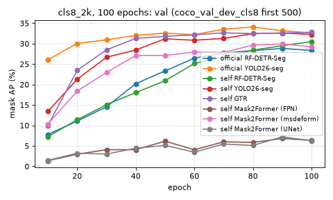

| エポック | 10 | 20 | 30 | 40 | 50 | 60 | 70 | 80 | 90 | 100 |
|---|---|---|---|---|---|---|---|---|---|---|
| 公式: RF-DETR-Seg | 7.8 | 11.1 | 14.6 | 20.2 | 23.3 | 26.5 | 27.7 | 28.3 | 28.8 | 28.3 |
| 公式: YOLO26-seg | 26.1 | 30.0 | 30.9 | 32.0 | 32.6 | 32.2 | 33.5 | 34.1 | 33.1 | 32.6 |
| 自作: RF-DETR-Seg 系 | 7.3 | 11.4 | 15.1 | 18.0 | 20.9 | 25.2 | 26.7 | 28.4 | 29.5 | 30.5 |
| 自作: YOLO26-seg 系 | 13.4 | 21.3 | 26.7 | 28.4 | 31.2 | 30.8 | 31.3 | 32.4 | 32.6 | 32.2 |
| 自作: GTR 系 | 9.9 | 23.5 | 28.5 | 31.3 | 31.8 | 32.1 | 32.6 | 32.4 | 32.6 | 32.8 |
| 自作: Mask2Former 系(FPN) | 1.3 | 3.0 | 4.0 | 4.1 | 6.1 | 4.1 | 6.0 | 5.8 | 6.8 | 6.4 |
| 自作: Mask2Former 系(msdeform) | 10.3 | 18.4 | 22.9 | 27.1 | 27.1 | 27.9 | 27.8 | 29.7 | 29.9 | 29.2 |
| 自作: Mask2Former 系(UNet) | 1.5 | 3.2 | 3.0 | 4.4 | 5.1 | 3.5 | 5.4 | 5.1 | 7.2 | 6.3 |

クラスごとの mask AP(coco_val_test_cls8):

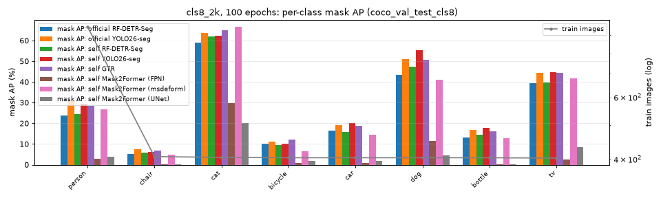

| クラス | 公式: RF-DETR-Seg | 公式: YOLO26-seg | 自作: RF-DETR-Seg 系 | 自作: YOLO26-seg 系 | 自作: GTR 系 | 自作: Mask2Former 系(FPN / msdeform / UNet) |
|---|---|---|---|---|---|---|
| person | 23.9 | **30.6** | 24.3 | 29.3 | 28.5 | 2.9 / 26.8 / 3.7 |
| bicycle | 10.2 | 11.0 | 9.5 | 10.3 | **12.2** | 0.7 / 6.4 / 1.7 |
| car | 16.4 | 19.2 | 15.7 | **20.1** | 18.7 | 0.8 / 14.5 / 1.9 |
| cat | 58.9 | 63.5 | 61.9 | 62.2 | 65.0 | 29.9 / **66.6** / 20.3 |
| dog | 43.3 | 50.8 | 47.2 | **55.4** | 50.7 | 11.5 / 41.1 / 4.5 |
| bottle | 13.1 | 16.9 | 14.3 | **17.6** | 16.2 | 0.1 / 12.7 / 0.2 |
| chair | 5.0 | **7.6** | 5.7 | 6.3 | 6.8 | 0.1 / 4.9 / 0.2 |
| tv | 39.4 | 44.4 | 39.8 | **44.5** | 44.3 | 2.4 / 41.7 / 8.6 |

- **YOLO26-seg 系と GTR 系が並んで最も高い**(test 30.7 と 30.3、voc 35.7 と 36.1。差はぶれの範囲)。公式の RF-DETR-Seg より
  test で 4.0〜4.4、voc で 3.8〜4.2 高い。どちらも val は 40〜50 エポックでほぼ上がりきり、RF-DETR-Seg 系(90〜100 エポックまで
  上がり続ける)より立ち上がりが早い
- **公式の YOLO26-seg(R50)は、test では自作の YOLO26-seg 系・GTR 系と並んだ**(test 30.5。自作 30.7・30.3)。voc は 32.8 で、
  自作の YOLO26-seg 系(35.7)・GTR 系(36.1)より 3 前後低く、公式の RF-DETR-Seg(31.9)と同じ程度。val は 10 エポックで 26.1 と
  立ち上がりが最も早い(毎エポックの評価と、勾配の累積で 1 回の更新あたり 64 枚であることなど、学習の設定が自作と違う)。
  自作の YOLO26-seg 系は、test では公式と同じ程度の精度に届いている
- **自作の RF-DETR-Seg 系は公式とそろった**(test 27.3 と 26.3、voc 32.6 と 31.9)。自作はデータ拡張が基本の lsj、公式は公式の
  データ拡張なので、データ拡張を lsj にしても下がらないことも分かる
- **自作の Mask2Former 系は、pixel decoder を公式と同じ deformable な注意の encoder(msdeform)にすると、ほかの方式と並んだ**
  (test 26.8、voc 34.3。公式の RF-DETR-Seg と同じ程度)。簡略版の FPN(test 6.0)と UNet(5.1)では学習が進まない
  (UNet は学習率・weight decay・勾配の上限・位置の埋め込みを変えても test 4.6〜6.8)。
  切り分けは下の「Mask2Former 系が学習できなかった原因の切り分け」
- 学習の速さ(開始からの平均): 自作の RF-DETR-Seg 系 44.6 枚/秒、Mask2Former 系 38.7、GTR 系 30.3、YOLO26-seg 系 27.0
  (GPU をほかの学習と分けて使った時間を含むので、方式どうしの速さの比較には使えない)

#### Mask2Former 系が学習できなかった原因の切り分け

モデル(transformer decoder)・損失・割り当ては、公式のコード(facebookresearch/Mask2Former の
`mask2former_transformer_decoder.py`・`criterion.py`・`matcher.py`)と照らし合わせて同じだった(違いは、注意と FFN の重みの
初期値が公式は xavier、自作は PyTorch の既定であることだけ)。そこで、設定の値と pixel decoder を 1 つずつ変えて 20 エポック学習した
(ほかは統一の条件と同じ。val = coco_val_dev_cls8 の先頭 500 枚の mask AP):

| 変えたもの | 5 エポック | 10 | 15 | 20 |
|---|---|---|---|---|
| なし(FPN、勾配の上限 0.01、lr 1e-4、backbone 0.1 倍) | 0.2 | 0.8 | 3.0 | 3.7 |
| 勾配の上限 0.01 → 1.0 | 1.6 | 3.5 | 4.0 | 5.0 |
| backbone の学習率 0.1 倍 → 1.0 倍 | 0.6 | 1.1 | 1.9 | 2.5 |
| 全部の学習率 1e-5(backbone も) | 0.5 | 0.2 | 0.8 | 1.1 |
| **pixel decoder を msdeform に** | **5.7** | **10.2** | **14.8** | **16.6** |
| pixel decoder を UNet に + 画素の特徴に位置の埋め込み(`--mask-pos sine`) | 2.3 | 5.4 | 5.1 | 5.6 |

- 原因は pixel decoder。設定の値を変えても 5 以下だが、pixel decoder を公式と同じ構成(stride 8・16・32 の全部の画素を
  トークンにして、deformable な注意を 6 層。`lib_common/models/mask2former.py` の `DeformablePixelDecoder`)にすると
  ほかの方式と同じ速さで学習が進む
- UNet の pixel decoder(セマンティックセグメンテーションでよく使う UNet の decoder の形。`UnetPixelDecoder`)も FPN と同じく
  学習が進まない(100 エポックで test 5.1)。FPN・UNet は畳み込みだけで、画素の特徴に場所の情報がほとんどない。Mask2Former の
  マスクは「クエリ · 画素の特徴」で作り、クエリは場所を持たない埋め込みから始まるので、同じ見た目の物体どうしを分けられない
  のではないか、と考えた(msdeform の encoder は位置の埋め込みを足した注意で画像全体を混ぜるので、場所の情報が入る)。
  マスクを作る画素の特徴に sine の位置の埋め込みを足す版(`--mask-pos sine`。足す前の 1×1 の畳み込みは 0 で初期化)で確かめた
- UNet で、位置の埋め込みと学習の設定を変えて 100 エポック学習した(ほかは統一の条件と同じ):

| pixel decoder | 位置の埋め込み | 学習率(backbone 以外) | backbone の倍率 | weight decay | 勾配の上限 | 最良のエポック | test | voc |
|---|---|---|---|---|---|---|---|---|
| UNet | なし | 1e-4 | 0.1 | 0.05 | 0.01 | 90 | 5.1 | 5.9 |
| UNet | なし | 5e-5 | 0.1 | 0.05 | 0.01 | 10 | 4.6 | 5.7 |
| UNet | sine | 5e-5 | 0.1 | 0.05 | 0.01 | 30 | 6.8 | 6.9 |
| UNet | sine | 5e-5 | 1.0 | 0.01 | 1.0 | 90 | 4.9 | 5.1 |
| (参考)msdeform | なし | 1e-4 | 0.1 | 0.05 | 0.01 | 90 | 26.8 | 34.3 |

  val(10 エポックごと)の推移:

| 学習 | 10 | 20 | 30 | 40 | 50 | 60 | 70 | 80 | 90 | 100 |
|---|---|---|---|---|---|---|---|---|---|---|
| UNet、1e-4 | 1.5 | 3.2 | 3.0 | 4.4 | 5.1 | 3.5 | 5.4 | 5.1 | 7.2 | 6.3 |
| UNet、5e-5 | 5.2 | 4.7 | 4.2 | 4.6 | 5.0 | 3.0 | 3.6 | 5.2 | 4.5 | 5.0 |
| UNet + sine、5e-5 | 3.9 | 6.2 | 7.0 | 3.2 | 5.7 | 4.6 | 3.8 | 4.5 | 4.7 | 5.8 |
| UNet + sine、5e-5・backbone 1.0 倍・wd 0.01・上限 1.0 | 1.3 | 0.7 | 3.1 | 3.4 | 3.6 | 4.2 | 5.2 | 4.7 | 5.7 | 5.4 |
| (参考)msdeform、1e-4 | 10.3 | 18.4 | 22.9 | 27.1 | 27.1 | 27.9 | 27.8 | 29.7 | 29.9 | 29.2 |

- 結果: UNet はどの組み合わせでも test 5〜7 で、msdeform(26.8)との差は縮まらない。学習率・weight decay・勾配の上限・
  backbone の学習率は主な原因ではない。位置の埋め込みは 5e-5 どうしで test 4.6 → 6.8 だが、val は 10 エポックごとに 3〜7 を
  上下しており、差はその振れ幅と同じ程度なので、効いたとは言えない。「位置の情報がないこと」だけでは説明できない
- クラスの損失(エポックの平均。1 / 5 / 10 / 20 / 50 / 100 エポック): 学習率 1e-4 は 1.41 / 0.77 / 0.94 / 0.80 / 0.68 / 0.57、
  5e-5 は 1.49 / 0.64 / 0.64 / 0.66 / 0.77 / 0.61。1e-4 は 5〜10 エポックで一度上がり、5e-5 も途中で上がる。どちらも最後は
  下がるが、val の AP は上がらない
- 残る違いは、画素どうしで画像全体の情報をやり取りする層(msdeform の deformable な注意 6 層)があるかどうか(原因かは未確認)
- **追記(exp00102)**: 上の見立ては違っていた。FPN を公式と同じ構成(横からの 1×1 に GN、下の段へ 3×3 + GN + ReLU を通した後の値を
  渡すなど)にすると、注意の層なしでも test 21.7・voc 25.0 になった。UNet も、decoder に渡す特徴を 3×3 + GN でそろえると test 12.1 に
  上がった。詳しくは [exp00102 の README](../exp00102_close_impl_gaps/README.md)

以下の「1.」〜「5.」は、統一の条件を決める前に学習したもの(旧条件)の記録。旧条件の違い: 最終の精度を val の dev で報告していた、
自作は最後の重みで評価していた、自作の RF-DETR-Seg 系と YOLO26-seg 系は方式ごとのデータ拡張、Mask2Former 系は 50 エポック。
旧条件の学習も、保存してある重みで test を測り直してある(`results/{名前}.json` の `coco_val_test_cls8`)。

### 1. 20 クラス: 自作の Mask2Former 系(COCO train 10%、50 エポック)

`results/m2f_r50_coco10pct.json`。学習は 29,750 回、平均 40.6 枚/秒(合成データの生成と GPU を共有して動かした)。

途中の評価(`coco_val_dev` の先頭 500 枚の mask AP):

| エポック | 10 | 20 | 30 | 40 | 50 |
|---|---|---|---|---|---|
| mask AP | 1.5 | 2.7 | 3.0 | 4.2 | 4.7 |

最後の評価(PQ などのスコアの閾値は `coco_val_dev` で選んだ 0.3):

| セット | mask AP | AP50 | AP75 | APs / APm / APl | AR100 | box AP | boundary AP | PQ | SQ | RQ | 最良の IoU の平均 | semantic mIoU |
|---|---|---|---|---|---|---|---|---|---|---|---|---|
| coco_val_dev | 3.6 | 7.5 | 3.3 | 0.2 / 1.6 / 6.7 | 16.5 | 3.4 | 0.6 | 8.5 | 70.2 | 11.5 | 31.1 | 21.4 |
| voc_val | 5.7 | 12.4 | 4.6 | 1.4 / 2.8 / 8.5 | 26.5 | 6.1 | 0.6 | 10.6 | 69.4 | 14.5 | 47.1 | 20.2 |

参考(exp00001。公開の重みで、COCO 全部で学習済み): `coco_val_dev` の mask AP は RF-DETR nano 44.0・2xlarge 53.3、SAM 3 49.7。

クラスごとの mask AP(学習の画像の数の多い順。学習の画像・小さい物体の割合は `coco_train_10pct`):

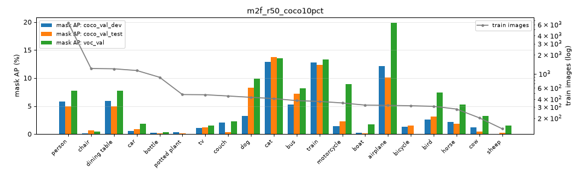


| クラス | 学習の画像 | 小さい物体の割合 | coco_val_dev | voc_val |
|---|---|---|---|---|
| person | 6,393 | 42% | 5.9 | 7.6 |
| chair | 1,213 | 39% | 0.1 | 0.5 |
| dining table | 1,201 | 12% | 5.9 | 8.1 |
| car | 1,128 | 63% | 0.5 | 1.7 |
| bottle | 883 | 61% | 0.2 | 0.4 |
| potted plant | 471 | 30% | 0.5 | 0.0 |
| tv | 468 | 9% | 1.2 | 1.5 |
| couch | 447 | 1% | 2.3 | 2.2 |
| dog | 426 | 15% | 3.3 | 9.7 |
| cat | 407 | 3% | 13.0 | 13.8 |
| bus | 378 | 11% | 5.0 | 7.0 |
| train | 367 | 5% | 13.0 | 13.9 |
| motorcycle | 347 | 29% | 1.7 | 8.7 |
| boat | 321 | 49% | 0.2 | 1.6 |
| airplane | 318 | 20% | 12.1 | 19.4 |
| bicycle | 314 | 43% | 1.3 | 0.0 |
| bird | 307 | 58% | 2.7 | 7.2 |
| horse | 278 | 25% | 2.3 | 5.0 |
| cow | 202 | 40% | 1.2 | 3.2 |
| sheep | 136 | 48% | 0.1 | 1.6 |

- クラスごとの coco_val_dev の AP の順位は、学習の画像の数の順位とはほぼ関係がなく(順位相関 0.03)、小さい物体の割合の順位と負の関係がある
  (順位相関 −0.62)。AP が高い cat・train・airplane は小さい物体が少ない(3〜20%)クラス、AP がほぼ 0 の chair・car・bottle・boat・sheep は
  小さい物体が多い(39〜63%)クラス。どの要因が効いているかは、この相関だけでは決められない(要因を分ける実験は exp001xx で行う)
- SQ(対応が付いた組の IoU の平均)は 70 あるが、RQ(対応が付く割合)が 11.5 と低い。対応が付いた物体のマスクの形はある程度合っているが、
  IoU 0.5 を超えて対応が付く物体が少ない(AR100 も 16.5)
- 小さい物体はほとんど取れていない(APs 0.2)。輪郭の正確さを見る boundary AP は 0.6
- 見本の画像(「元の画像 | 正解 | 予測」を並べたもの。スコア 0.3 以上の予測): `results/samples/m2f_r50_coco10pct/{coco_val_dev,voc_val}/`。
  見本 18 枚の(正解の数, 予測の数)は、coco_val_dev が (3, 0) (1, 0) (2, 10) (2, 11) (4, 16) (1, 10) (6, 4) (1, 3) (1, 11) (2, 11) (7, 22) (8, 0)、
  voc_val が (1, 0) (1, 2) (2, 1) (2, 3) (1, 0) (1, 0)。予測が 1 つもない画像と、正解の数倍の予測を出す画像に分かれる
- データ拡張の後の学習の画像と正解: `results/samples/m2f_r50_coco10pct/train_inputs.jpg`

学習曲線(左から: 損失の合計、最終層の損失の内訳、decoder の学習率、途中の評価の mask AP):

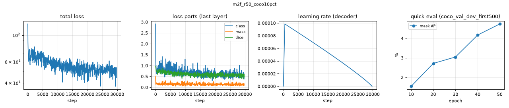
- この学習では、途中の評価で mask AP しか記録しておらず、途中の見本の画像もない(学習の後に、途中の評価に AP50・AP75・box AP などと
  見本の画像・学習曲線を加えた。上の見本と図は、学習の後に保存した重み・記録から作った)

### 2. 20 クラス: 公式の RF-DETR-Seg(COCO train 10%、50 エポック)

`train_official_rfdetr.py --name rfdetr_seg_r50_coco10pct`、`results/rfdetr_seg_r50_coco10pct.json`。自作の Mask2Former 系と同じデータ・クラス・入力・
エポック数(batch 16 × 29,750 回)、同じ評価のコード。評価の重みは、学習中の評価で最良だった EMA の重み(`checkpoint_best_total.pth`)。
学習は 1 エポック約 4 分(マスクの損失の計算を速くした後。vendor の `models/criterion.py` に足した処理。結果は公式の処理と同じ)。

学習中の評価(RF-DETR 自身の評価のコード、coco_val_dev の先頭 500 枚、EMA の重み。`runs/rfdetr_seg_r50_coco10pct/metrics.csv`):

| エポック | 10 | 20 | 30 | 40 | 50 |
|---|---|---|---|---|---|
| mask AP | 14.3 | 24.9 | 26.7 | 28.2 | 30.3 |
| box AP | 17.3 | 28.5 | 32.2 | 33.3 | 35.4 |

- 50 エポックでもまだ上がり続けていて、学習し切っていない。評価に使った重みは、最良だった 50 エポック目のもの
  (RF-DETR は `best_model_metric="map"` で mask AP の最良を選ぶ)
- 学習中に評価されたのは EMA の重みだけ(EMA なしの重みは評価されていない。metrics.csv の EMA なしの列には EMA の値が入っている)
- 20 エポックの重みを自前の評価のコードで測ると 25.6(RF-DETR 自身の評価では 24.9)で、評価のコードの違いによる差は小さい

最後の評価(PQ などのスコアの閾値は `coco_val_dev` で選んだ 0.4):

| セット | 方式 | mask AP | AP50 | AP75 | APs / APm / APl | AR100 | box AP | boundary AP | PQ | SQ | RQ | 最良の IoU の平均 | semantic mIoU |
|---|---|---|---|---|---|---|---|---|---|---|---|---|---|
| coco_val_dev | 公式: RF-DETR-Seg | **28.8** | 48.4 | 29.4 | 5.0 / 26.8 / 46.0 | 42.8 | 34.0 | 12.5 | 41.9 | 79.6 | 52.1 | 58.2 | 52.3 |
| coco_val_dev | 自作: Mask2Former 系 | 3.6 | 7.5 | 3.3 | 0.2 / 1.6 / 6.7 | 16.5 | 3.4 | 0.6 | 8.5 | 70.2 | 11.5 | 31.1 | 21.4 |
| voc_val | 公式: RF-DETR-Seg | **40.1** | 66.2 | 42.2 | 10.6 / 31.2 / 51.6 | 54.8 | 50.6 | 11.5 | 53.5 | 79.7 | 65.9 | 70.4 | 62.6 |
| voc_val | 自作: Mask2Former 系 | 5.7 | 12.4 | 4.6 | 1.4 / 2.8 / 8.5 | 26.5 | 6.1 | 0.6 | 10.6 | 69.4 | 14.5 | 47.1 | 20.2 |

クラスごとの mask AP(coco_val_dev。棒 = mask AP、灰色の線 = 学習データでそのクラスを含む画像の数(右の軸、対数)。
クラスは学習の画像の数の多い順):

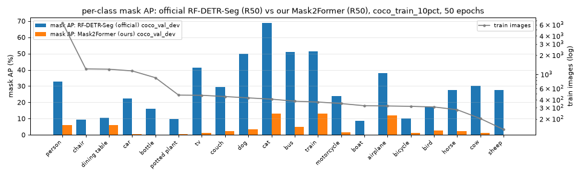

| クラス | 公式: RF-DETR-Seg | 自作: Mask2Former 系 |
|---|---|---|
| person | 32.8 | 5.9 |
| chair | 9.4 | 0.1 |
| dining table | 10.6 | 5.9 |
| car | 22.5 | 0.5 |
| bottle | 16.1 | 0.2 |
| potted plant | 9.9 | 0.5 |
| tv | 41.5 | 1.2 |
| couch | 29.4 | 2.3 |
| dog | 50.0 | 3.3 |
| cat | 68.7 | 13.0 |
| bus | 51.1 | 5.0 |
| train | 51.2 | 13.0 |
| motorcycle | 23.8 | 1.7 |
| boat | 8.7 | 0.2 |
| airplane | 37.9 | 12.1 |
| bicycle | 10.1 | 1.3 |
| bird | 17.2 | 2.7 |
| horse | 27.7 | 2.3 |
| cow | 30.0 | 1.2 |
| sheep | 27.4 | 0.1 |

- 同じ backbone・データ・クラス・入力・エポック数で、公式は自作の 8 倍(28.8 と 3.6)。差はどのクラスでも大きい
- 公式でも、chair・dining table・potted plant・boat・bicycle は 10 前後と低い(小さい物体・一部だけ見える物体・細い部品が多いクラス)。
  cat・bus・train・dog は 50 以上
- 見本の画像: `results/samples/rfdetr_seg_r50_coco10pct/{coco_val_dev,voc_val}/`(スコア 0.4 以上の予測)

### 3. 8 クラス・2,000 枚: 公式の RF-DETR-Seg と自作の Mask2Former 系(50 エポック)

比較の実験の基本の条件(`coco_train_cls8_2k`。instance_segmentation/README.md の「計画の見直し」)。どちらも 16 枚ずつ 6,250 回の更新。
`results/rfdetr_seg_r50_cls8_2k.json`・`results/m2f_r50_cls8_2k.json`。自作の学習の設定は 20 クラスのときと同じ(LSJ、warmup 500 回)。

| セット | 方式 | mask AP | AP50 | AP75 | APs / APm / APl | AR100 | box AP | boundary AP | PQ | SQ | RQ | 最良の IoU の平均 | semantic mIoU |
|---|---|---|---|---|---|---|---|---|---|---|---|---|---|
| coco_val_dev_cls8 | 公式: RF-DETR-Seg | **20.1** | 35.7 | 20.2 | 2.2 / 22.2 / 32.8 | 38.4 | 22.0 | 8.1 | 30.2 | 78.2 | 37.8 | 51.4 | 36.7 |
| coco_val_dev_cls8 | 自作: Mask2Former 系 | 3.5 | 7.5 | 3.3 | 0.0 / 0.9 / 5.5 | 12.3 | 2.5 | 0.2 | 7.5 | 57.6 | 10.6 | 20.6 | 15.9 |
| voc_val_cls8 | 公式: RF-DETR-Seg | **26.0** | 43.7 | 27.2 | 9.8 / 24.8 / 35.1 | 47.3 | 29.9 | 6.9 | 36.8 | 77.8 | 45.0 | 64.9 | 44.2 |
| voc_val_cls8 | 自作: Mask2Former 系 | 4.5 | 10.4 | 3.8 | 0.0 / 1.8 / 6.5 | 16.5 | 4.6 | 0.2 | 9.5 | 56.3 | 13.4 | 35.8 | 16.8 |

PQ などのスコアの閾値は coco_val_dev_cls8 で選んだ値(公式 0.4、自作 0.45)。

学習中の評価(coco_val_dev_cls8 の先頭 500 枚。公式は RF-DETR 自身の評価のコード・EMA の重み、自作は自前の評価のコード):

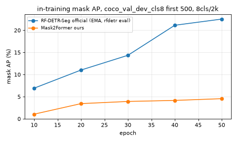

| エポック | 10 | 20 | 30 | 40 | 50 |
|---|---|---|---|---|---|
| 公式: RF-DETR-Seg | 6.9 | 11.0 | 14.3 | 21.1 | 22.5 |
| 自作: Mask2Former 系 | 1.0 | 3.4 | 3.9 | 4.2 | 4.6 |

クラスごとの mask AP(coco_val_dev。8 クラスのそれぞれの AP は、そのクラスの予測と正解だけで決まり、20 クラスの評価のセットと
同じ画像・同じ正解なので、20 クラスで学習した公式の値とも並べられる):

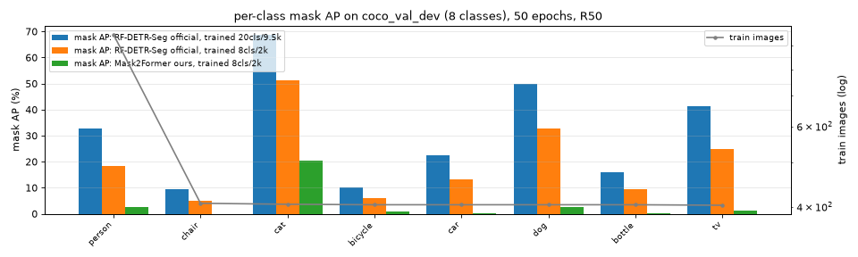

| クラス | 学習の画像(8 クラス・2,000 枚 / 20 クラス・9,528 枚) | 公式(20 クラス・9,528 枚で学習) | 公式(8 クラス・2,000 枚) | 自作(8 クラス・2,000 枚) |
|---|---|---|---|---|
| person | 953 / 6,393 | 32.8 | 18.2 | 2.5 |
| bicycle | 404 / 314 | 10.1 | 6.0 | 1.0 |
| car | 404 / 1,128 | 22.5 | 13.1 | 0.2 |
| cat | 405 / 407 | 68.7 | 51.3 | 20.4 |
| dog | 404 / 426 | 50.0 | 32.7 | 2.6 |
| bottle | 404 / 883 | 16.1 | 9.6 | 0.1 |
| chair | 407 / 1,213 | 9.4 | 4.8 | 0.0 |
| tv | 403 / 468 | 41.5 | 24.7 | 1.2 |

- 8 クラス・2,000 枚でも、公式と自作の差は大きい(20.1 と 3.5)。自作は cat(20.4)以外ほぼ取れていない
- 公式は、20 クラス・9,528 枚で学習したときより、どのクラスも 4 割ほど低い。学習の画像の数がほぼ同じ cat・tv や、増えた bicycle でも
  下がっているので、クラスごとの画像の数では説明できない。更新の回数(29,750 回 → 6,250 回)と、画像の種類(全体の画像の数)が
  減ったことのどちらが効いているかは、まだ切り分けていない
- 公式は 50 エポックの時点でもまだ上がっている(40 → 50 エポックで +1.4)。学習率は最後まで下げていない(既定の設定)。
  100 エポックの学習(`rfdetr_seg_r50_cls8_2k_ep100`)で、どこまで伸びるかを確かめる
- 自作は 30 エポック以降ほぼ横ばい(3.9 → 4.6)
- 自作の Mask2Former 系が公式の RF-DETR-Seg より大きく低い原因の候補(どれも未確認。1 つずつ切り分ける。16 枚の過学習では
  学習の画像の mask AP 75.4 まで上がるので、実装が全く学べないのではなく、学び方が遅いと見ている):
  - 学習の仕方: RF-DETR は学習率が一定で下げず、EMA で評価し、勾配の上限が 10 倍緩い(0.1)。Mask2Former 系は公式の長い学習
    (12 倍の回数)向けの設定(勾配の上限 0.01・weight decay 0.05)をそのまま使っている
  - クエリの多さ: RF-DETR は 13 組のクエリそれぞれに正解を割り当てるので、1 回の更新で 13 倍の割り当てから学ぶ(Group DETR)
  - データ拡張: LSJ(0.1〜2.0 倍)は RF-DETR の拡大縮小よりずっと幅が広い
  - 枠の予測・two-stage: RF-DETR は枠も学習し、encoder の出力から物体のありそうな位置でクエリを始める
  - backbone の学習率: RF-DETR は 7 倍
- 学習の速さ: 自作 73.3 枚/秒(開始からの平均)、公式 約 40 枚/秒(2.5 回/秒 × 16 枚)
- 見本の画像: `results/samples/{rfdetr_seg_r50_cls8_2k,m2f_r50_cls8_2k}/{coco_val_dev_cls8,voc_val_cls8}/`、
  自作の途中の見本 `results/samples/m2f_r50_cls8_2k/epoch{010〜050}/`

自作の学習曲線(左から: 損失の合計、最終層の損失の内訳、decoder の学習率、途中の評価):

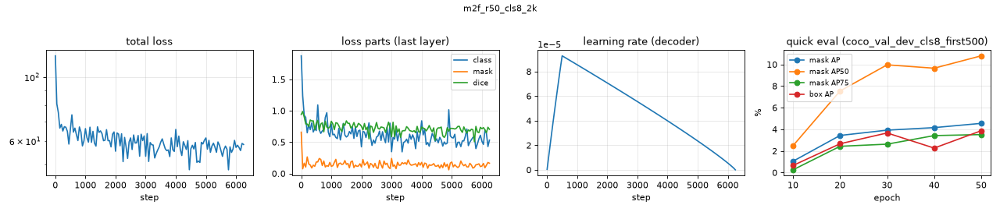

### 4. 8 クラス・2,000 枚: RF-DETR-Seg の学習の長さ(公式 50・100 エポック)と、自作の RF-DETR-Seg 系

公式は `train_official_rfdetr.py --name rfdetr_seg_r50_cls8_2k_ep100 --epochs 100`(学習率は最後まで一定。既定の `lr_drop=100` エポック
なので 100 エポックでも下がらない)。自作は `train.py --arch rfdetr_seg --name rfdetr_self_r50_cls8_2k`(学習の設定は公式と同じ。
`lib_common/train.py` の `RFDETR_RECIPE`)。最後の評価に使った重みは、公式は途中の評価で最良のもの(100 エポックでは 90 エポック目)、
自作は最後のもの(どちらも EMA)。

| セット | 方式 | mask AP | AP50 | AP75 | APs / APm / APl | AR100 | box AP | boundary AP | PQ | SQ | RQ |
|---|---|---|---|---|---|---|---|---|---|---|---|
| coco_val_dev_cls8 | 公式 50 エポック | 20.1 | 35.7 | 20.2 | 2.2 / 22.2 / 32.8 | 38.4 | 22.0 | 8.1 | 30.2 | 78.2 | 37.8 |
| coco_val_dev_cls8 | 公式 100 エポック | **25.8** | 44.3 | 26.4 | 5.3 / 26.9 / 41.8 | 38.7 | 29.1 | 10.6 | 37.8 | 79.2 | 46.8 |
| coco_val_dev_cls8 | 自作 50 エポック | 19.1 | 33.9 | 19.4 | 3.4 / 21.4 / 29.9 | 38.8 | 21.3 | 7.6 | 28.9 | 77.4 | 36.5 |
| coco_val_dev_cls8 | 自作 100 エポック | 25.2 | 43.6 | 26.1 | 6.1 / 24.5 / 42.4 | 38.3 | 28.3 | 9.9 | 37.3 | 78.9 | 46.4 |
| voc_val_cls8 | 公式 50 エポック | 26.0 | 43.7 | 27.2 | 9.8 / 24.8 / 35.1 | 47.3 | 29.9 | 6.9 | 36.8 | 77.8 | 45.0 |
| voc_val_cls8 | 公式 100 エポック | 31.9 | 53.3 | 33.8 | 5.9 / 27.4 / 44.8 | 46.1 | 39.2 | 8.0 | 44.8 | 79.1 | 54.8 |
| voc_val_cls8 | 自作 50 エポック | 24.5 | 41.1 | 25.6 | 8.7 / 23.0 / 32.8 | 46.6 | 27.4 | 6.7 | 33.7 | 77.3 | 41.4 |
| voc_val_cls8 | 自作 100 エポック | **32.7** | 54.0 | 34.8 | 5.6 / 28.0 / 45.4 | 45.7 | 40.6 | 8.4 | 45.8 | 78.4 | 56.2 |

学習中の評価(coco_val_dev_cls8 の先頭 500 枚。公式は RF-DETR 自身の評価のコード、自作は自前の評価のコード。どちらも EMA の重み):

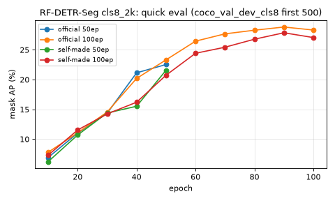

| エポック | 10 | 20 | 30 | 40 | 50 | 60 | 70 | 80 | 90 | 100 |
|---|---|---|---|---|---|---|---|---|---|---|
| 公式 50 エポック | 6.9 | 11.0 | 14.3 | 21.1 | 22.5 | | | | | |
| 公式 100 エポック | 7.8 | 11.1 | 14.6 | 20.2 | 23.3 | 26.5 | 27.7 | 28.3 | 28.8 | 28.3 |
| 自作 50 エポック | 6.2 | 10.7 | 14.4 | 15.5 | 21.6 | | | | | |
| 自作 100 エポック | 7.3 | 11.5 | 14.2 | 16.2 | 20.7 | 24.4 | 25.4 | 26.8 | 27.9 | 27.1 |

クラスごとの mask AP(coco_val_dev_cls8):

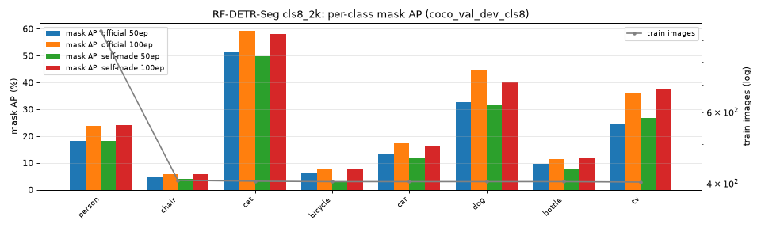

| クラス | 公式 50 エポック | 公式 100 エポック | 自作 50 エポック | 自作 100 エポック |
|---|---|---|---|---|
| person | 18.2 | 23.8 | 18.2 | 24.1 |
| bicycle | 6.0 | 7.8 | 3.0 | 7.8 |
| car | 13.1 | 17.2 | 11.7 | 16.4 |
| cat | 51.3 | 59.2 | 49.8 | 58.0 |
| dog | 32.7 | 44.9 | 31.5 | 40.2 |
| bottle | 9.6 | 11.4 | 7.7 | 11.5 |
| chair | 4.8 | 5.7 | 4.0 | 5.9 |
| tv | 24.7 | 36.3 | 26.9 | 37.3 |

- 公式は 50 エポックではまだ学習しきれていない。50 → 90 エポックで途中の評価が 23.3 → 28.8 と伸び、100 エポックでは止まる。
  全部のクラスで上がった(dog +12.2、tv +11.6 が大きく、bicycle・chair は低いまま)。RF-DETR 系の基本の学習の長さは、
  このデータの設定では 100 エポックにする(学習の長さは方式ごとに学習曲線を見て決める)
- 同じ設定の 2 本(公式 50 と公式 100 の 50 エポック目まで。学習率が一定なので同じ条件)の途中の評価の差は 0.1〜0.9。
  学習のやり直しによるばらつきはこの程度
- 自作の RF-DETR-Seg 系は公式とほぼそろった(50 エポックで 19.1 と 20.1、voc 24.5 と 26.0、box AP 21.3 と 22.0)。差は 1 前後で、
  上のばらつきより少し大きい程度。途中の評価も 40 エポック目(15.5 と 21.1)以外はそろっている。違いとして残っているのは、
  正解の枠をマスクから作っていること(公式は注釈の枠)と、データ拡張の拡大縮小の補間(公式は torchvision の antialias あり、
  自作は cv2 の線形)
- 学習の速さ: 自作 50.1 枚/秒(開始からの平均。compile なし)、公式 約 40 枚/秒
- 自作の 16 枚の過学習の確認(データ拡張なし、600 回): 学習の画像での mask AP が 200・400・600 回で 6.7・40.8・51.3 と上がり、
  損失も下がり続けた(実装の確認。結果のファイルは残していない)
- 自作の 100 エポック(`rfdetr_self_r50_cls8_2k_ep100`、最後の重み): coco_val_dev_cls8 で mask AP **25.2**(AP50 43.6・AP75 26.1・
  box AP 28.3)、voc_val_cls8 で **32.7**(box AP 40.6)。公式の 100 エポック(25.8・31.9。90 エポック目の重み)とそろった。
  途中の評価: 7.3・11.5・14.2・16.2・20.7・24.4・25.4・26.8・27.9・27.1(10〜100 エポック)。公式と同じく 90 エポック目が最良
- 自作の 100 エポックの最初の試み(VRAM の上限 18 GB)は 10 エポックの後に VRAM の上限で止まった(確保 13.5 GB + 断片化で
  使えない 4.3 GB。入力の大きさが 11 通りに変わるため)。上限 22 GB と `PYTORCH_CUDA_ALLOC_CONF=expandable_segments:True` でやり直した

### 5. 8 クラス・2,000 枚: 自作の YOLO26-seg 系(100 エポック)

`train.py --arch yolo_seg --name yolo_self_r50_cls8_2k_ep100 --epochs 100`(学習の設定は `lib_common/train.py` の `YOLO_RECIPE`。
方式の中身は上の表の「自作: YOLO26-seg 系」の列)。最後の重み(EMA)で評価。

| セット | 方式(100 エポック) | mask AP | AP50 | AP75 | APs / APm / APl | AR100 | box AP | PQ |
|---|---|---|---|---|---|---|---|---|
| coco_val_dev_cls8 | 公式: RF-DETR-Seg | 25.8 | 44.3 | 26.4 | 5.3 / 26.9 / 41.8 | 38.7 | 29.1 | 37.8 |
| coco_val_dev_cls8 | 自作: RF-DETR-Seg 系 | 25.2 | 43.6 | 26.1 | — | — | 28.3 | — |
| coco_val_dev_cls8 | 自作: YOLO26-seg 系 | **29.3** | 47.3 | 30.6 | 5.3 / 30.3 / 47.4 | 43.1 | 33.4 | 41.6 |
| voc_val_cls8 | 公式: RF-DETR-Seg | 31.9 | 53.3 | 33.8 | 5.9 / 27.4 / 44.8 | 46.1 | 39.2 | 44.8 |
| voc_val_cls8 | 自作: RF-DETR-Seg 系 | 32.7 | 54.0 | 34.8 | — | — | 40.6 | — |
| voc_val_cls8 | 自作: YOLO26-seg 系 | **34.0** | 52.7 | 36.5 | — | — | 43.3 | 46.3 |

学習中の評価(coco_val_dev_cls8 の先頭 500 枚):

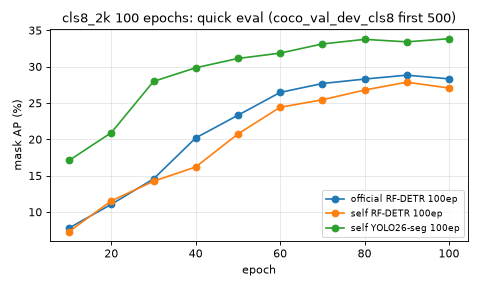

| エポック | 10 | 20 | 30 | 40 | 50 | 60 | 70 | 80 | 90 | 100 |
|---|---|---|---|---|---|---|---|---|---|---|
| 公式: RF-DETR-Seg | 7.8 | 11.1 | 14.6 | 20.2 | 23.3 | 26.5 | 27.7 | 28.3 | 28.8 | 28.3 |
| 自作: RF-DETR-Seg 系 | 7.3 | 11.5 | 14.2 | 16.2 | 20.7 | 24.4 | 25.4 | 26.8 | 27.9 | 27.1 |
| 自作: YOLO26-seg 系 | 17.1 | 20.9 | 28.0 | 29.9 | 31.1 | 31.9 | 33.1 | 33.8 | 33.4 | 33.9 |

クラスごとの mask AP(coco_val_dev_cls8):

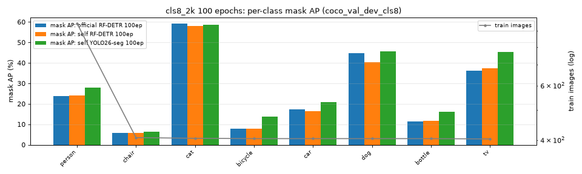

| クラス | 公式: RF-DETR-Seg | 自作: RF-DETR-Seg 系 | 自作: YOLO26-seg 系 |
|---|---|---|---|
| person | 23.8 | 24.1 | **27.9** |
| bicycle | 7.8 | 7.8 | **13.7** |
| car | 17.2 | 16.4 | **20.7** |
| cat | **59.2** | 58.0 | 58.6 |
| dog | 44.9 | 40.2 | **45.6** |
| bottle | 11.4 | 11.5 | **16.2** |
| chair | 5.7 | 5.9 | **6.4** |
| tv | 36.3 | 37.3 | **45.2** |

- 自作の YOLO26-seg 系が、同じ backbone・データ・入力 512・100 エポックで、公式の RF-DETR-Seg を mask AP で 3.5(dev)・2.1(voc)、
  box AP で 4.3・4.1 上回った。cat 以外の全部のクラスで上。とくに bicycle(+5.9)・tv(+8.9)・bottle(+4.8)
- 学習の立ち上がりがずっと早い(10 エポックで 17.1。RF-DETR は 7.8)。少ないデータ・短い学習に強いという見込みのとおり
- 途中の評価は 80 エポックあたりから横ばい(33.8・33.4・33.9。最後の 10 エポックは Mosaic なし)。学習の長さは 100 エポックで足りている
- 違いの候補(どれも未確認): データ拡張の差(Mosaic と色の揺らしは RF-DETR にはない。exp00107 で切り分けられる)、
  密な予測と割り当て(TAL)、評価の入力の作り方(YOLO は長い辺を 512、RF-DETR は縦横の比を保たない正方形)
- 学習の速さ: 34.1 枚/秒(開始からの平均。compile の時間を含む)。GPU の使用率が低く(約 15%)、損失の中の画像ごとの
  割り当ての Python のループと GPU と CPU の同期が律速と見ている(未計測)
- 16 枚の過学習の確認(データ拡張なし、600 回): 学習の画像での mask AP が 47.7・64.4・67.0(200・400・600 回)
- 論文から変えたこと: 最適化を MuSGD から SGD に(上の表)、backbone を R50 に。論文に値がなく、ここで決めたもの: マスクの損失の
  重み(枠と同じ 9.83)、意味のマスクの損失の重み(1.0)、原型の数(32)、neck のチャンネル(256・512・512)。
  学習の途中で、面積 0 の予測の枠の IoU と CIoU が 0/0 で NaN になったので、IoU は 0 に、CIoU には最小の幅・高さを入れた
