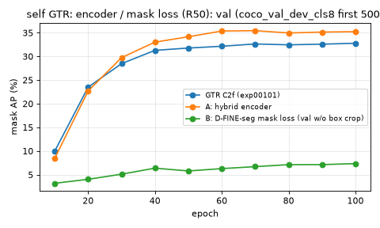
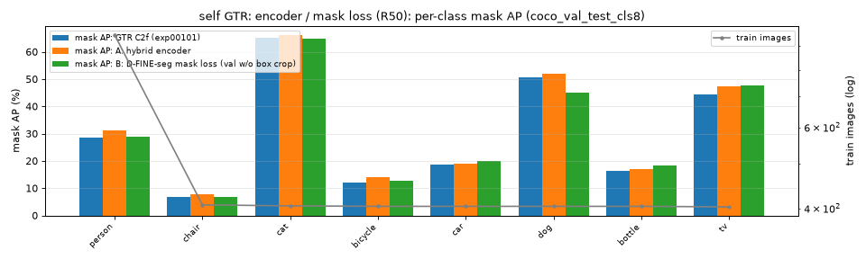
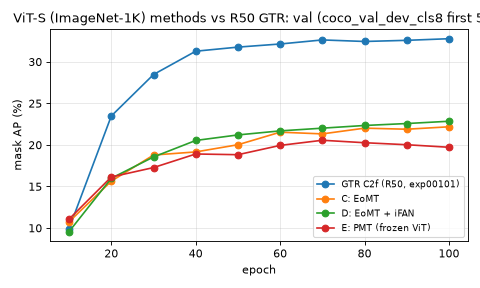
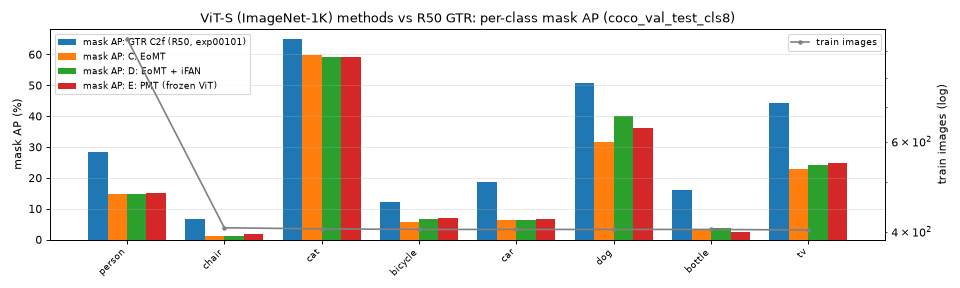

# exp00103: 最新の手法の比較

## 目的

着手した時点(2026-11)で最新の、有望なインスタンスセグメンテーションの手法を調べ直し、exp00101 でまだ扱っていないものを
スクラッチで実装して、exp00101 と同じ条件で比べる。最新の手法の良し悪しを、同じデータ・同じ学習の長さで確かめ、フェーズ C の
基準の方式を決める材料にする。

## 下調べ(2026-11)

値は各論文・公式の報告で、こちらでは確かめていない。

| 手法 | 出どころ | 中身 | 報告(COCO の mask AP) | exp00101 との関係 |
|---|---|---|---|---|
| RF-DETR-Seg | ICLR 2026 | DINOv2 + DETR 系の decoder + 軽いマスクの head | 40.3(N)〜49.9(2XL) | 自作済み(test 27.3) |
| YOLO26-seg | arXiv 2606.03748 | NMS なしの密な予測の CNN | YOLO11 から最大 +3.7 | 自作済み(test 30.7) |
| GTR | arXiv 2609.26590 | ゲート付きの線形注意の ViT + D-FINE 系の decoder | 各大きさで最も高いと報告 | 自作済み(test 30.3。backbone は R50) |
| ECInsSeg(EdgeCrafter) | arXiv 2603.18739 | 蒸留した小さい ViT(ECViT)+ RT-DETR の hybrid encoder(最も粗い段だけ自己注意(AIFI)+ 段をまたいで混ぜる畳み込み(CCFF))+ DETR 系の decoder(300 クエリ・4 層、D-FINE の損失)+ stride 8 の特徴とクエリの内積のマスクの head | S 43.0・M 45.2・L 47.1・X 48.4 | 論文の中心は backbone の蒸留(蒸留で初期化すると S で 38.0 → 42.8)。backbone より後は自作の GTR 系とほぼ同じで、違いは encoder(hybrid encoder) |
| EoMT | CVPR 2025(arXiv 2503.19108) | Mask2Former の pixel decoder・transformer decoder を取り除き、ViT の最後の数層(ViT-S・B は 3 層)にクエリ(200 個)を入れて ViT の自己注意だけで処理する。マスクは ViT の出力を 2×2 の転置畳み込みで stride 4 まで上げた特徴とクエリの内積。学習中だけマスクで絞った注意を使い、確率を 1 → 0 に下げていく(mask annealing) | ViT-L(DINOv2): 入力 640 で 45.2、1280 で 48.8(ViT-Adapter + Mask2Former は 47.6・51.4) | 未実装。ViT が前提。論文は、小さい ViT(ViT-S で panoptic の PQ が 5.8 低い)と弱い事前学習(ImageNet-1K で 6.1 低い)で大きく下がると報告 |
| iFAN | arXiv 2608.03216 | EoMT のような「decoder のないマスクの transformer」の学習だけに足す 2 つの仕組み(マスクの質でクエリを順位づける損失、途中の層の予測を最後の層に蒸留)。推論は変わらない | COCO・ADE20K・Cityscapes の平均で +1.3 | EoMT の上に足す |
| D-FINE-seg | arXiv 2602.23043 | D-FINE の検出 + 軽いマスクの head。マスクの損失を枠で切り抜いて計算、denoising のクエリにもマスクの損失 | COCO の値は報告なし(TACO で YOLO26 より高い F1) | backbone より後は自作の GTR 系に近い。違いはマスクの損失の掛け方 |
| Poly-DETR | arXiv 2603.09245 | マスクの代わりに、クエリごとに始点と 32 本の放射状の距離の多角形で物体を表す DETR(Deformable DETR が基) | R50・36 エポックで test-dev 40.8(多角形の方式の中で最も高い)。著者自身の同じ条件のマスクの版より低い(下の「扱わないもの」) | 表し方が違う系統 |
| PMT | arXiv 2603.25398(CVPR 2026 Workshop) | 固定した ViT の上に、6 層の素直な transformer の decoder(クエリと画像のトークンを 1 つの並びにして自己注意で処理。ViT の途中の層からの横のつながり、学習中だけマスクで絞った注意)を載せる。EoMT は ViT を固定すると大きく下がるが、PMT は固定したまま近い精度 | DINOv3-L(固定)・640 で 45.4(ViT-Adapter + Mask2Former は 45.9)。ViT-S や ImageNet-1K の事前学習でも報告あり | 未実装。EoMT と同じ ViT-S で比べられる |

## 比べるもの(計画)

exp00101 の統一の条件(train `coco_train_cls8_2k`、val `coco_val_dev_cls8` の先頭 500 枚で最良の重みを選ぶ、test
`coco_val_test_cls8`・`voc_val_cls8`、データ拡張 `lsj`、100 エポック、batch 16、入力 512)で学習する。

| 番号 | 中身 | 基準 | 確かめること |
|---|---|---|---|
| A | 自作の GTR 系の encoder を、ECInsSeg と同じ RT-DETR の hybrid encoder(AIFI + CCFF)にする(backbone は R50 のまま) | 自作の GTR 系(test 30.3) | ECInsSeg の backbone より後の部分の効果 |
| B | 自作の GTR 系に、D-FINE-seg のマスクの損失の掛け方(枠で切り抜いた BCE・Dice、denoising のクエリへのマスクの損失)を足す | 自作の GTR 系 | D-FINE-seg の効果 |
| C | EoMT を、R50 と同じ程度の大きさの ViT-S/16(timm `deit3_small_patch16_224.fb_in1k`。2,170 万のパラメータ、ImageNet-1K で事前学習。R50 の `resnet50.a1_in1k` は 2,350 万・ImageNet-1K)で作る。クエリを入れるのは最後の 3 層(論文の ViT-S と同じ)。下の注 | exp00101 の自作の方式(R50) | EoMT の「decoder のない構成」の良し悪し |
| D | C に iFAN の 2 つの仕組みを足す | C | iFAN の効果 |
| E | PMT を、C と同じ ViT-S/16(ImageNet-1K)で作る。論文どおり ViT は固定し、decoder だけを学習する | C(EoMT) | 「固定した ViT + 素直な decoder」の良し悪し(ViT を学習する EoMT との比較) |
| F | 公式の RF-DETR-Seg(`vendor/rf-detr`)の backbone を、C〜E と同じ ViT-S/16(ImageNet-1K)にする(公式はもともと DINOv2 の ViT。exp00101 では R50 に差し替えた)。使う層は公式の Small と同じ位置(12 層のうち 3・6・9・12 層目)、特徴の stride 16(窓に分けない)。GPU のメモリを抑えるため 4 枚 × 4 回の勾配の累積(1 回の更新あたり 16 枚) | 公式の RF-DETR-Seg(R50、exp00101。test 26.3) | C〜E が R50 の方式より低いのが ViT の backbone のためか(同じ ViT-S で、ViT 前提ではない方式も下がるか) |
| (未定) | Mask R-CNN(torchvision の実装、backbone は timm の R50) | - | 古典の方式の参考の値。採用の候補ではない。入れるかは未定 |

扱わないもの:

- ECInsSeg の backbone の蒸留: 論文の中心は backbone(小さい ViT を DINOv3 系の先生から蒸留して作る)で、backbone の作り方の比較に
  あたるので、backbone を比べる exp00104 で扱う(backbone より後の部分は A で確かめる)
- Poly-DETR: 著者自身が同じ条件で比べたマスクの版より、多角形の版の精度が低い(自前の Deformable DETR 系、R50・12 エポック・COCO val で
  37.8 と 39.8、RF-DETR-M で 43.2 と 44.6)。多角形の版の利点として挙げているのは高い解像度でのメモリと速さ(Cityscapes 1024×2048 で
  メモリ 46.5% 減、10 → 15 FPS)で、入力 512 のこの exp の条件では、精度が下がって利点が出ない見込みのため。高い解像度での推論の
  速さを比べるときに(フェーズ D)改めて考える

C の注:

- EoMT は「事前学習した ViT の最後の数層に、そのままクエリを入れる」のが方式の中心で、R50 のような CNN の backbone には
  クエリを入れる層がない。そこで backbone は R50 そのものではなく、R50 と同じ程度の大きさで、事前学習のデータも同じ(ImageNet-1K)
  ViT-S にする。ほかの方式とは backbone の種類(CNN と ViT)が違うので、差には backbone の違いも含まれる
- 論文は、EoMT は小さい ViT と弱い事前学習で大きく下がると報告している(COCO の panoptic の PQ で、ViT-Adapter + Mask2Former との差が
  ViT-L では 1.1 だが ViT-S では 5.8。ViT-L の事前学習を DINOv2 から ImageNet-1K にすると、差が 1.1 から 6.1 に広がる)。
  この exp の ViT-S・ImageNet-1K はその下がる条件にあたるので、結果が低くても EoMT 本来の良し悪し(大きく強い事前学習の ViT での
  良し悪し)とは言えない
- DINOv3 など強い事前学習の backbone は exp00104(backbone の比較)で扱うので、ここでは使わない
- E(PMT)も同じ注意があてはまる。論文は、PMT も小さい ViT・弱い事前学習で下がると報告している(COCO の panoptic の PQ で、
  ViT-S は ViT-Adapter + Mask2Former より 4.3 低い。ViT-L の事前学習を ImageNet-1K にすると 44.6 と 47.0)

## 進め方

1. A・B を実装して、動作確認の後に 1 本ずつ学習(1 本あたり 1.5〜3.5 時間。GPU をほかの学習と分け合うと長くなる)。
   A の実装は `lib_common/models/hybrid_encoder.py`(`--arch gtr_seg --gtr-encoder hybrid`。既定は今までの `c2f`)
2. C(EoMT、ViT-S)を学習。実装は `lib_common/models/eomt.py`(`--arch eomt`)。学習の設定は公式の既定の値
   (`lib_common/train.py` の `EOMT_RECIPE`): クエリ 200 個、クエリを入れるのは最後の 3 層、AdamW 1e-4・weight decay 0.05、ViT の層ごとの
   学習率の減衰 0.8、2 段の warmup(最初の 500 回は backbone を止めて他を上げ、次の 1,000 回で backbone を上げる)の後 poly、
   勾配の大きさの上限 0.01、注意のマスクを使う確率は層ごとに学習の 0.2〜0.4・0.5〜0.7・0.8〜1.0 で 1 → 0、損失は Mask2Former と同じ。
   データ拡張・評価の変換は統一の条件(lsj・pad)
3. D(EoMT + iFAN、`--arch eomt --ifan`)と E(PMT、`--arch pmt`)を学習。どれも 1 本ずつ順に、GPU のメモリの上限 12GB

## 実装の注意(公式との違い)

公式から変えた所は、学習の結果を変えないものか、R50 にそろえるために避けられないものだけにした。

- A(hybrid encoder、`lib_common/models/hybrid_encoder.py`): 公式(EdgeCrafter の `hybrid_encoder.py`、L の版の設定)と同じ構成。
  位置の埋め込みは公式と同じ並べ方(公式は格子を (横, 縦) の順に作るので、正方形の入力では前半のチャンネルが縦の位置になる)。
  違い: (1) R50 の段を 256 チャンネルにする 1×1 + BN を足した(ECInsSeg の backbone は 256 チャンネルを出すので不要だが、R50 には
  要る。元の RT-DETR と同じ作り)、(2) 推論のために畳み込みと BN を 1 つにまとめる処理は入れていない(学習の計算は同じ)
- B(D-FINE-seg のマスクの損失、`--gtr-mask-loss box_crop`): 公式(D-FINE-seg の `dfine_criterion.py`・`matcher.py`・`configs.py`)と
  同じく、損失は「正解の枠の中の全部の画素の BCE(枠の面積で割る)と Dice、重み 1・1」、割り当てのマスクの費用は「全部の画素の
  focal の形の費用(α 0.25・γ 2、画素の数で割る)1・Dice 1」、正解のマスクは予測の大きさに双線形で縮める。D-FINE-seg のクラス・枠の
  損失と費用(VFL、枠 5・GIoU 2)は使わず、自作の GTR 系のまま(B で確かめるのはマスクの損失の掛け方だけ)。denoising のクエリと
  途中の層へのマスクの損失は、自作の GTR 系にもともと入っている
- A・B の学習は、ほかの学習と GPU を分け合うため、GPU のメモリを 12GB 以内にする。そのために 2 つを使う:
  (1) 8 枚ずつ 2 回に分けて勾配をためる(`--grad-accum 2`。1 回の更新あたり 16 枚・更新の回数は基準と同じ。BatchNorm の統計と、
  損失を正解の数で割る単位が 8 枚ずつになる点だけが、exp00101 の GTR 系(基準。16 枚を 1 度に通した)と違う)、
  (2) gradient checkpointing(`--grad-checkpoint`。backbone・マスクの head のブロック・マスクの損失で、途中の値を残さず勾配を
  計算するときに計算し直す。計算の結果は同じ。乱数をそろえて損失と勾配が一致することを確かめた)。
  16 枚を 1 度に通すと、gradient checkpointing を使っても上限 14GB で足りなかった(物体の多いまとめで止まる)
- C(EoMT、`lib_common/models/eomt.py`): 公式(`models/eomt.py`・`scale_block.py`・`lightning_module.py`)と同じ構成と学習の設定。
  違い: 公式は 16 ビットの混合精度、自作は bf16(ほかの自作の方式と同じ)。ViT の drop path は通していない(この ViT の既定では
  drop path の率が 0 なので計算は同じ)
- D(iFAN、`lib_common/losses/ifan_criterion.py` と EoMT の `quality_head`): 公式の学習のコードはまだ公開されていない(公式の
  リポジトリは推論のコードだけ)ので、論文の式と値(γ 2、N_H 10、APMR の重み 0.1、CLSD の重み 0.4、CLSD は学習の 1/3 から)で書いた。
  マスクの質の head(全部の層・クエリで共有の Linear 1 つ + sigmoid)、質の BCE(割り当てたクエリは soft-IoU、ほかは 0)、APMR(勾配は
  質の head だけ)、CLSD(最後の層より前の 3 つの予測のうち soft-IoU が最も高い層を先生にし、最後の層より高いときだけ一方向のヒンジ)、
  推論の点数 (質 × クラスの確率)^2 × マスクの点数。論文に値がなく、こちらで決めたもの: 質の BCE の重み 1、質の BCE と APMR は
  全部の予測に掛ける、紛らわしい外れのクエリは正解のマスクの中の点数の平均が高い順、CLSD の重みは学習の 1/3 から最後に 0 へ直線で
  下げる(論文は「4 エポック目から始め、その後は直線で下げる」)、soft-IoU と点数の地図は予測のマスクの大きさ(stride 4)で計算
- E(PMT、`lib_common/models/pmt.py`、`PMT_RECIPE`): 公式(`image/models/pmt.py`・`pmd.py`・`layers.py`、`configs/coco/panoptic/
  pmt_s_640.yaml`)と同じ構成と学習の設定: ViT は固定、ViT の 2・5・8・11 番目の層からの横のつながり(BatchNorm → 残差つきの
  2 層の MLP → チャンネルごとの倍率)、decoder 6 層(MLP 384、LayerScale 1、鍵の射影は bias なし、画像のトークンにだけ 2 次元の
  RoPE(θ 100、学習のときは座標を 1/2〜2 倍))、クエリ 200 個、AdamW 2e-4・weight decay 0.05、warmup の後 cosine、勾配の上限 0.01、
  注意のマスクを使う確率を下げる区間も公式と同じ割合。違い: 公式の warmup 6,000 回(全部 73,910 回の 8.1%)を、この学習の
  12,500 回に割合で合わせて 1,015 回にした。BatchNorm は 1 枚の GPU なので同期しない普通の BatchNorm

## 結果

### A: 自作の GTR 系の encoder を RT-DETR の hybrid encoder(ECInsSeg と同じ)にする

| test のセット | encoder | mask AP | AP50 | AP75 | APs / APm / APl | box AP | PQ | SQ | 最良の重み |
|---|---|---|---|---|---|---|---|---|---|
| coco_val_test_cls8 | C2f(exp00101 の GTR 系) | 30.3 | 48.1 | 32.8 | 6.6 / 32.5 / 50.1 | 32.0 | 39.7 | 81.2 | 100 エポック目 |
| coco_val_test_cls8 | **hybrid encoder** | **31.8** | 49.3 | 35.1 | 6.8 / 35.6 / 53.1 | 34.4 | 41.2 | 81.7 | 70 |
| voc_val_cls8 | C2f(exp00101 の GTR 系) | 36.1 | 56.3 | 39.5 | 10.0 / 28.5 / 50.5 | 45.7 | 47.2 | 79.1 | 100 |
| voc_val_cls8 | **hybrid encoder** | **38.4** | 58.3 | 42.1 | 11.9 / 31.5 / 53.3 | 48.7 | 48.4 | 79.5 | 70 |

val の推移(10 エポックごと): C2f 9.9・23.5・28.5・31.3・31.8・32.1・32.6・32.4・32.6・32.8、
hybrid encoder 8.4・22.7・29.7・33.0・34.1・35.4・35.4・35.0・35.1・35.2。
クラスごとの mask AP(test、hybrid encoder): person 31.2・bicycle 14.0・car 19.0・cat 66.1・dog 52.1・bottle 17.1・chair 7.9・tv 47.5。
学習の速さ: 21.3 枚/秒(gradient checkpointing と 8 枚 × 2 回の勾配の累積を使い、GPU をほかの学習と分け合った時間を含む)。

val の推移(A と B を、基準の GTR 系と並べる。B の val は学習中に枠で切り抜かずに測った値なので低い。下の B の節):

クラスごとの mask AP(test。B は枠で切り抜いた評価):

- **hybrid encoder で test +1.5、voc +2.3**(ぶれ 1 前後を超える)。box AP も +2.4・+3.0。中くらい・大きい物体(APm・APl)で
  上がり、小さい物体(APs)はほぼ同じ。40 エポック以降の val が C2f より 2〜3 高い
- 学習の条件の違い(8 枚 × 2 回の勾配の累積、上の「実装の注意」)も含んだ差だが、この程度の条件の違いで 2 前後の差が出るとは
  考えにくいので、主に encoder の差と見る(確かめてはいない)

### B: 自作の GTR 系のマスクの損失を D-FINE-seg の掛け方にする

| test のセット | マスクの損失 | 推論でマスクを予測の枠で切り抜く | mask AP | AP50 | AP75 | APs / APm / APl | box AP | PQ | SQ |
|---|---|---|---|---|---|---|---|---|---|
| coco_val_test_cls8 | 点で取る BCE・Dice(exp00101 の GTR 系) | なし | 30.3 | 48.1 | 32.8 | 6.6 / 32.5 / 50.1 | 32.0 | 39.7 | 81.2 |
| coco_val_test_cls8 | 枠の中の全部の画素の BCE・Dice(D-FINE-seg) | なし | 6.8 | 12.8 | 6.6 | 0.0 / 0.5 / 12.3 | 34.4 | 13.7 | 62.1 |
| coco_val_test_cls8 | 枠の中の全部の画素の BCE・Dice(D-FINE-seg) | あり(D-FINE-seg と同じ) | 30.5 | 48.8 | 33.5 | 7.1 / 34.4 / 49.5 | 34.4 | 41.1 | 80.4 |
| voc_val_cls8 | 点で取る BCE・Dice(exp00101 の GTR 系) | なし | 36.1 | 56.3 | 39.5 | 10.0 / 28.5 / 50.5 | 45.7 | 47.2 | 79.1 |
| voc_val_cls8 | 枠の中の全部の画素の BCE・Dice(D-FINE-seg) | なし | 10.7 | 19.6 | 10.3 | 0.0 / 1.7 / 16.8 | 47.6 | 20.2 | 69.6 |
| voc_val_cls8 | 枠の中の全部の画素の BCE・Dice(D-FINE-seg) | あり(D-FINE-seg と同じ) | 34.8 | 55.8 | 37.2 | 9.3 / 29.0 / 48.0 | 47.4 | 46.2 | 78.2 |

最良の重みは 100 エポック目(学習中の val は切り抜きなしで測ったので 3.2〜7.3 と低いが、最後のエポックが最良だった)。
クラスごとの mask AP(test、切り抜きあり): person 28.9・bicycle 12.7・car 19.8・cat 64.7・dog 45.2・bottle 18.3・chair 6.9・tv 47.6。

- D-FINE-seg の損失は正解の枠の中だけを学習するので、枠の外のマスクの値は学習されず、推論で予測の枠で切り抜かないと使えない
  (切り抜きなしは test 6.8)。D-FINE-seg は推論・評価で枠の外を 0 にしている(公式の `cleanup_masks`)ので、それに合わせると 30.5
- 切り抜きありで、点で取る損失(30.3・36.1)と比べて test は同じ、voc は 1.3 低い。box AP は test +2.4・voc +1.7。マスクの精度では
  効果は見られない(枠の精度が上がっても、マスクの精度に結びついていない)
- 切り抜きなしの評価は、最初に推論の処理を D-FINE-seg に合わせていなかったときの結果(切り抜きの処理を足して、保存した重みで
  評価し直した)

### D: EoMT に iFAN を足す

| test のセット | 方式 | mask AP | AP50 | AP75 | APs / APm / APl | box AP | PQ | SQ | 最良の重み |
|---|---|---|---|---|---|---|---|---|---|
| coco_val_test_cls8 | EoMT(C) | 18.2 | 30.2 | 19.3 | 1.5 / 12.5 / 36.4 | 19.5 | 28.0 | 76.4 | 100 エポック目 |
| coco_val_test_cls8 | EoMT + iFAN | 19.5 | 32.7 | 20.5 | 1.9 / 12.0 / 38.2 | 20.1 | 27.9 | 75.5 | 100 |
| voc_val_cls8 | EoMT(C) | 26.4 | 41.7 | 28.3 | 2.6 / 14.7 / 43.4 | 33.7 | 37.5 | 77.5 | 100 |
| voc_val_cls8 | EoMT + iFAN | 26.6 | 43.0 | 28.3 | 3.6 / 14.5 / 41.5 | 33.9 | 37.8 | 77.4 | 100 |

val の推移: EoMT 10.8・15.6・18.8・19.2・20.0・21.5・21.3・22.0・21.9・22.2、EoMT + iFAN 9.6・16.0・18.6・20.5・21.2・21.7・22.0・22.3・22.6・22.8。

- iFAN で test +1.3(論文の COCO の +1.2〜1.8 と同じ程度)、voc +0.2(ぶれの範囲)。val は 40 エポック以降 0.5〜1 高い。
  EoMT の低さ(R50 の方式より 10 前後低い)を埋めるほどではない

### E: PMT(ViT-S/16・ImageNet-1K を固定)

| test のセット | 方式 | 学習する重み | mask AP | AP50 | AP75 | APs / APm / APl | box AP | PQ | SQ | 最良の重み |
|---|---|---|---|---|---|---|---|---|---|---|
| coco_val_test_cls8 | EoMT(C。ViT も学習) | 2,370 万 | 18.2 | 30.2 | 19.3 | 1.5 / 12.5 / 36.4 | 19.5 | 28.0 | 76.4 | 100 エポック目 |
| coco_val_test_cls8 | PMT(ViT は固定) | 760 万 | 19.1 | 31.7 | 20.2 | 1.2 / 13.9 / 36.3 | 19.5 | 28.2 | 75.4 | 70 |
| voc_val_cls8 | EoMT(C) | 2,370 万 | 26.4 | 41.7 | 28.3 | 2.6 / 14.7 / 43.4 | 33.7 | 37.5 | 77.5 | 100 |
| voc_val_cls8 | PMT | 760 万 | 26.0 | 41.2 | 28.8 | 0.9 / 13.1 / 41.8 | 32.6 | 35.4 | 76.3 | 70 |

val の推移: 11.1・16.1・17.3・18.9・18.8・19.9・20.6・20.3・20.0・19.7。学習の速さ 59.6 枚/秒。
クラスごとの mask AP(test): person 15.0・bicycle 7.0・car 6.6・cat 59.1・dog 36.1・bottle 2.6・chair 1.7・tv 24.8。

val の推移(C・D・E を、参考の R50 の GTR 系と並べる):

クラスごとの mask AP(test):

- ViT を固定したまま、ViT も学習する EoMT と同じ程度(test 19.1 と 18.2、voc 26.0 と 26.4。差はぶれの範囲)。学習する重みは
  1/3。論文の「固定した ViT でも、ViT を学習する EoMT に近い精度」と同じ傾向
- R50 の方式(26〜32)よりは大きく低い。小さい物体(APs 1.2)が特に低いのは EoMT と同じ(stride 16 の 1 段の特徴から作るため、と
  見ている。未確認)

## まとめ

| 方式 | backbone | test | voc |
|---|---|---|---|
| **自作の GTR 系 + hybrid encoder(A)** | R50 | **31.8** | **38.4** |
| 自作の YOLO26-seg 系(exp00101) | R50 | 30.7 | 35.7 |
| 自作の GTR 系 + D-FINE-seg のマスクの損失(B、枠で切り抜く) | R50 | 30.5 | 34.8 |
| 自作の GTR 系(exp00101) | R50 | 30.3 | 36.1 |
| EoMT + iFAN(D) | ViT-S(ImageNet-1K) | 19.5 | 26.6 |
| PMT(E。ViT は固定) | ViT-S(ImageNet-1K) | 19.1 | 26.0 |
| EoMT(C) | ViT-S(ImageNet-1K) | 18.2 | 26.4 |

- 2026-11 時点の候補のうち、効いたのは ECInsSeg の hybrid encoder(A)だけで、自作の GTR 系に入れると test +1.5・voc +2.3 で
  最も高くなった。フェーズ C の基準の方式の候補は「自作の GTR 系 + hybrid encoder」
- D-FINE-seg のマスクの損失(B)は、マスクの精度では効果なし(box AP は上がる)
- ViT が前提の方式(EoMT・PMT、iFAN)は、R50 と同じ程度の大きさ・同じ事前学習のデータの ViT-S では、R50 の方式より 10 前後低い。
  論文が「小さい ViT・弱い事前学習で大きく下がる」と報告している条件なので、方式そのものの良し悪しとは言えない。強い事前学習の
  ViT(DINOv3 など)では exp00104 で改めて比べる。その中では、iFAN は +1.3(論文と同じ程度)、PMT は ViT を固定しても EoMT と同じ程度
- 学習の速さは ViT の方式が速い(EoMT 72.7 枚/秒、PMT 59.6 枚/秒。R50 の方式は 13〜45 枚/秒。ただし GPU をほかの学習と分け合った
  時間を含み、A・B は gradient checkpointing と勾配の累積も使っているので、正確な比較ではない)

### C: EoMT(ViT-S/16、ImageNet-1K)

| test のセット | 方式 | mask AP | AP50 | AP75 | APs / APm / APl | box AP | PQ | SQ | 最良の重み |
|---|---|---|---|---|---|---|---|---|---|
| coco_val_test_cls8 | EoMT(ViT-S) | 18.2 | 30.2 | 19.3 | 1.5 / 12.5 / 36.4 | 19.5 | 28.0 | 76.4 | 100 エポック目 |
| coco_val_test_cls8 | (参考)自作の GTR 系(R50、exp00101) | 30.3 | 48.1 | 32.8 | 6.6 / 32.5 / 50.1 | 32.0 | 39.7 | 81.2 | 100 |
| coco_val_test_cls8 | (参考)自作の Mask2Former 系(R50・msdeform、exp00101) | 26.8 | 42.0 | 29.2 | 4.2 / 26.9 / 48.4 | 27.8 | 36.8 | 79.2 | 90 |
| voc_val_cls8 | EoMT(ViT-S) | 26.4 | 41.7 | 28.3 | 2.6 / 14.7 / 43.4 | 33.7 | 37.5 | 77.5 | 100 |
| voc_val_cls8 | (参考)自作の GTR 系(R50、exp00101) | 36.1 | 56.3 | 39.5 | 10.0 / 28.5 / 50.5 | 45.7 | 47.2 | 79.1 | 100 |
| voc_val_cls8 | (参考)自作の Mask2Former 系(R50・msdeform、exp00101) | 34.3 | 52.4 | 37.0 | 9.0 / 26.6 / 52.5 | 41.8 | 44.3 | 79.3 | 90 |

val の推移: 10 エポックごとに 10.8・15.6・18.8・19.2・20.0・21.5・21.3・22.0・21.9・22.2。
クラスごとの mask AP(test): person 14.7・bicycle 5.6・car 6.3・cat 59.9・dog 31.5・bottle 3.2・chair 1.2・tv 23.0。
学習の速さ: 72.7 枚/秒(開始からの平均。exp00101 の自作の方式は 27〜45 枚/秒)。

- EoMT(ViT-S・ImageNet-1K)は test 18.2・voc 26.4 で、R50 の自作の方式(GTR 系 30.3・Mask2Former 系 26.8)より低い。
  特に小さい・中くらいの物体(APs 1.5、APm 12.5)が低く、大きい物体(APl 36.4)との差が大きい。ViT-S/16 は stride 16 の 1 段の特徴
  だけから stride 4 まで上げてマスクを作るので、細かい物体に弱いと見られる(未確認)
- 上の「C の注」のとおり、この条件(小さい ViT・ImageNet-1K の事前学習)は論文で EoMT が大きく下がると報告されている条件で、
  backbone の種類(ViT と CNN)も違う。EoMT 本来の良し悪しとは言えない。強い事前学習の ViT での比較は exp00104 で行う
- 学習は最も速い(72.7 枚/秒)。pixel decoder・transformer decoder がない構成の効果
- val は 100 エポック目が最良で、まだ少し上がっている
