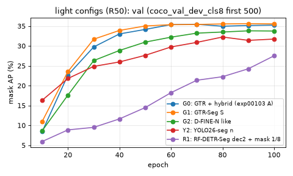
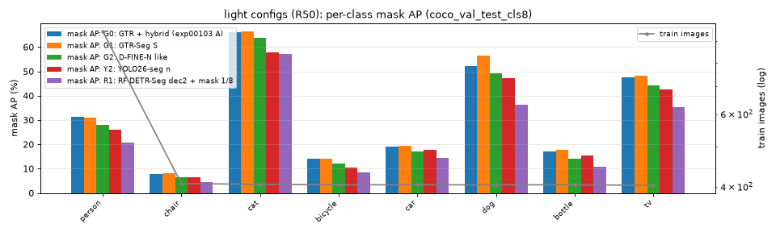

# exp00104: CPU 向けの軽い構成(backbone は R50 に固定)

## 目的

これまで精度の高かった方式(exp00101〜00103)の **backbone より後の部分**を、各方式の公式の小さい版の考え方で小さくし、CPU で動かしやすい
構成で、どの方式がどこまで精度を保てるかを比べる。想定する CPU は、エッジ機器(GPU のない小さな機器)とブラウザ(exp00304 のデモの WASM)の
両方。backbone は R50 に固定して、backbone より後ろの違いだけを見る。ここで決めた方式と構成の上で、exp00105 の速度バランス型で軽い
backbone を比べる。

背景: 今の構成は、backbone より後ろだけで 13〜31 GMACs あり(下の表)、軽い backbone にしても全体は半分程度にしかならない。
CPU での例: R50 の GTR 系 + hybrid encoder は、ブラウザの WASM(8 スレッド)で 1 コマ約 1 秒かかる(exp00304)。

## 共通の条件

- exp00101 の統一の条件(train `coco_train_cls8_2k`、val `coco_val_dev_cls8` の先頭 500 枚で最良の重みを選ぶ、test
  `coco_val_test_cls8`・`voc_val_cls8`、データ拡張 `lsj`、100 エポック、batch 16、入力 512)
- backbone は R50(`resnet50.a1_in1k`)。学習の設定は方式ごとに今までと同じ(`GTR_RECIPE`・`YOLO_RECIPE`・`RFDETR_RECIPE`)
- 基準: 今の構成の結果(GTR 系 + hybrid encoder 31.8、YOLO26-seg 系 30.7、RF-DETR-Seg 系 27.3)。学習し直さない
- R50 だけで 21.4 GMACs あるので、ここでは backbone より後ろを軽くする効果(と、そのときの精度)を比べる。エッジ機器の CPU で使える速さそのものは、
  exp00105 の軽い backbone と組み合わせて目指す

## 今の構成の計算量

入力 512 × 512、R50。GMACs(掛け算と足し算の組の回数 × 10⁹)は `torch.utils.flop_counter` で数えた値。マスクを作る部分の多くは
モジュールの外で呼ぶ計算なので、全体から引いた残りで出した。

| 方式 | 全体 | backbone | 特徴をまとめる部分 | マスクを作る部分(入力の 1/4 = 128 × 128) | decoder・head |
|---|---|---|---|---|---|
| GTR 系 + hybrid encoder | 40.2 | 21.4 | encoder 7.5 | 約 8.7 | 約 2.6 |
| YOLO26-seg 系 | 52.5 | 21.4 | neck 14.5 | proto 13.5 | 3.2 |
| RF-DETR-Seg 系 | 34.5 | 21.4 | projector 2.0 | decoder と合わせて 11.1 | (左に含む) |

どの方式も、入力の 1/4 の解像度でマスクを作る部分が大きい。

## 公式の小さい版(下調べ)

| 方式 | 小さい版の作り方(公式の設定) |
|---|---|
| GTR-Seg(`configs/seg/coco_seg_finetune`) | S: 幅 192・FFN 512、M: 幅 256・FFN 1024(今の自作は M にあたる)。どちらも decoder 4 層・クエリ 300・マスクは入力の 1/4。S より小さい版はない |
| D-FINE(GTR の decoder の元。`configs/dfine`) | N: 幅 128・FFN 512、encoder を細く浅く(expansion 0.34・depth 0.5)、decoder 3 層、特徴は stride 16・32 の 2 段だけ。S: 幅 256、encoder(expansion 0.5・depth 0.34)、decoder 3 層 |
| YOLO26-seg(ultralytics `yolo26-seg.yaml`) | 深さ・幅の倍率: n 0.50・0.25、s 0.50・0.50、m 0.50・1.00、l 1.00・1.00(公式の 640 での GFLOPs: n 10.5、s 37.4、l 150.9) |
| RF-DETR-Seg(`vendor/rf-detr` の config) | Nano・Small・Medium は幅 256・backbone(ViT-S)は同じで、主に入力の解像度(312・384・432)・decoder の層(4〜5)・クエリ(100〜200)で変える |

## 下調べ: backbone より後ろの処理が軽い方式(2026-11)

値は各論文・公式の報告で、こちらでは確かめていない。backbone の工夫(DEIMv2 の HGNetV2 を削った版、ECInsSeg の蒸留した ViT など)は
exp00105 で扱う。

| 方式 | 出どころ | backbone より後ろの作り | 扱い |
|---|---|---|---|
| D-FINE-N | D-FINE の公式の設定 | 幅 128 の encoder(stride 16・32 の 2 段だけ)+ 3 層の decoder。COCO の検出で 42.8 AP、全体 7 GFLOPs(640) | G2 の元 |
| YOLO26-seg n | arXiv 2606.03748、ultralytics | 幅 0.25 倍の neck + 原型のマスク(stride 4)。COCO の mask AP 33.9、CPU の ONNX で約 53 ms(640。紹介の記事の値) | Y2 の元 |
| RF-DETR-Seg | ICLR 2026 | encoder の 1 段の特徴を入力の 1/4 に拡大し、軽い射影でマスクの画素の特徴にする(多重解像度の特徴を使わない)。Nano は入力 312 | R1 の元。入力の解像度の比べ(下の I1)の根拠 |
| D-FINE-seg | arXiv 2602.23043 | D-FINE + クエリの埋め込みと入力の 1/4 の特徴の内積のマスクの head | 自作の GTR 系のマスクの head と同じ形(exp00103 の B で損失の掛け方は確かめ済み) |
| ECInsSeg | arXiv 2603.18739 | decoder はそのままで、depthwise の畳み込み + MLP でマスクの画素の特徴を作る軽い head | 自作の GTR 系のマスクの head と同じ形 |
| MOBIUS | ICCV 2025(arXiv 2510.15026) | 端末向け。pixel decoder を細くし(bottleneck)、decoder を削る。pixel decoder の計算量 −55%、decoder −75%。MobileNetV4-Conv-M でスマホで 1 秒に約 10 コマ | 多くの種類の入力(文など)を扱う universal な方式で、そのまま作るのは重い。pixel decoder を細くする考え方は G2 と同じ |
| DEIMv2 | arXiv 2509.20787 | 検出だけ。最小の版(Pico・Femto・Atto)は backbone を削り、後ろも小さくする | マスクがないので比べる対象にしない(backbone は exp00105) |
| SparseInst・FastInst・RTMDet-Ins | 2022〜2023 | 1 段の特徴 + 物体ごとの活性の地図(SparseInst)など、後ろが軽い | RF-DETR-Seg の論文で、Nano が FastInst より 5.4 高く約 10 倍速いと報告。最近の方式に置き換わっているので扱わない |

## 比べる構成

各方式の公式の小さい版に合わせた構成を作り、計算量を測った(下の「結果」の 1)。「目標の大きさ」(backbone より後ろ 約 3 GMACs 以下)に
入る構成を学習する。構成の値は学習のスクリプトの `--model-kwargs` で渡す。

| 番号 | 方式 | 構成(`--model-kwargs`) | 公式との対応 | backbone より後ろ(R50) |
|---|---|---|---|---|
| G1 | GTR 系 + hybrid encoder | `{"dim": 192, "ffn": 512}` | GTR-Seg の S | 10.8(目標を超える。公式の版との比べのために 1 本だけ) |
| G2 | GTR 系 + hybrid encoder | `{"dim": 128, "ffn": 512, "enc_expansion": 0.34, "enc_depth": 2, "enc_ffn": 512, "dec_layers": 3}` | D-FINE の N の考え方(特徴の段は 3 段のまま) | 3.5 |
| Y2 | YOLO26-seg 系 | `{"widths": [64, 128, 256], "depth": 1, "proto": 64}` | YOLO26 の n | 2.4 |
| R1 | RF-DETR-Seg 系 | `{"dec_layers": 2, "mask_stride": 8}` | RF-DETR の Nano(検出)の decoder 2 層 + マスクを 1/8 で作る | 4.1(幅 256 のままでは目標を少し超える) |

YOLO26-seg 系の s(`{"widths": [128, 256, 512], "depth": 1, "proto": 128}`、8.1)は目標を超え、比べのための公式の版は G1 で足りるので学習しない。

### 精度をほぼ落とさずに計算を減らす方法(G1 の上で)

マスクを作る解像度・入力の解像度・層の数を減らす方法は、精度をそのまま速さと引き換えにするので採らない(解像度を下げると、出力の
マスクの細かさがそのまま落ちる)。代わりに、計算の仕方を効率の良い形に変える方法、使わない計算を省く方法だけを試す。基準は、精度の
釣り合いが良かった G1(結果の 2)。

| 番号 | 中身 | 精度 | 学習 |
|---|---|---|---|
| E1 | 推論で使わない計算を省く: (1) クラスの値の最大が上位 100 個のクエリだけのマスクを作る(後処理は (クエリ, クラス) の組の上位 100 個を選ぶので、その組に入るクエリは必ずこの 100 個に含まれる)、(2) マスクの head の材料(画素の特徴・クエリの特徴の変換)は、推論で使う最後の層の分だけ作る | 同じ(確かめた。結果の 4) | 要らない(書き出しの `--mask-topk 100`、(2) はモデルの推論の形) |
| E2 | マスクを作る画素の特徴の次元を、拡大する前に 192 → 64 に落とす(`"mask_dim": 64`)。解像度は入力の 1/4 のまま。YOLACT・YOLO 系が原型のマスクを 32 チャンネルで作るのと同じ考え方(細かい解像度の計算は細い幅で行う) | 学習して確かめる | 要る |
| E3 | hybrid encoder の融合のブロックの中の 3×3 の普通の畳み込みを、depthwise 3×3 + pointwise 1×1 に分ける(`"enc_block": "dw"`。MobileNet の depthwise separable な畳み込み)。幅は変えない | 学習して確かめる | 要る |
| E4 | 推論のときに、hybrid encoder の RepVGG 型のブロックの 2 つの枝(3×3 + BN、1×1 + BN)を 1 つの 3×3 の畳み込みにまとめる(re-parameterization)。E3 を入れると RepVGG 型のブロックはすべて depthwise + pointwise に置き換わるので、E3 と一緒には使えない(E3 を入れない構成でだけ効く) | 同じ(確かめた) | 要らない(書き出しの `--fuse-rep`) |

E2・E3 は 1 つずつ G1 に入れたものと、両方を入れたものを学習する。あわせて、G0 → G1 で幅を小さくしても精度が落ちなかったので、
decoder の層の数(4 → 2)を減らしたときの精度も G1 の上で確かめる(層の数を減らすのは精度と引き換えになりうる方法だが、どれだけ
変わるかを知るため)。

## 実装の注意

- 自作のモデルの幅・層の数・マスクを作る解像度を、引数で変えられるようにした(`GTRSeg` の `dim`・`ffn`・`enc_expansion`・`enc_depth`・
  `enc_ffn`・`dec_layers`・`mask_stride`、`YOLOSeg` の `widths`・`depth`・`proto`、`RFDETRSeg` の `dec_layers`・`mask_stride`)。
  **既定の値は今のまま**で、exp00103・exp00101 の学習済みの重みをそのまま読めて(`strict=True`)、前に書き出した ONNX と出力が同じ
  (差の最大 1.2e-4)ことを確かめた
- YOLO26-seg 系の幅・深さは、公式の倍率を neck・head・原型のマスクの幅と、ブロックの繰り返しの数に掛けた値(backbone は R50 なので変えない)
- E2・E3 は `GTRSeg` の `mask_dim`・`enc_block`(既定は今のまま)。E1 の (1) と E4 は書き出しの `export_onnx.py --mask-topk 100 --fuse-rep`
  (学習し直さずに、学習済みのモデルに使える)。E1 の (2) はモデルの推論の形そのもの(学習のときは今までどおり全部の層の分を作る)
- 入力の大きさだけを変える評価は `eval_size.py`(結果は `results/{名前}_eval{一辺}.json`。学習のときの結果と見本の画像は変えない)

## 測るもの

- 精度: test(`coco_val_test_cls8`・`voc_val_cls8`)の mask AP・box AP・PQ、クラスごとの mask AP、val の推移
- 大きさ: パラメータの数、GMACs(全体と、backbone より後ろ)
- CPU での 1 コマの時間(学習の前にも、重みなしの構成で測れる):
  - ONNX Runtime の CPU(fp32 と INT8)。スレッドの数を 1・4 にして、エッジ機器に近い条件でも測る(手元の PC の CPU での値なので、
    エッジ機器そのものの値ではない。機器ごとの差は後で実機で確かめる)
  - ブラウザ: exp00301 の `--webgpu` で書き出し、exp00302 の重みだけの INT8 にして、exp00304 のデモで WASM(8 スレッド)と WebGPU
- 学習の速さ(枚/秒)

## 進め方

| 段 | 中身 | 目安の時間 |
|---|---|---|
| 1 | 幅などを引数で変えられるようにする(既定は今のまま。今の構成で出力が変わらないことを確かめる) | — |
| 2 | 全部の構成の計算量(結果の 1)と、CPU(ONNX Runtime・ブラウザ)での 1 コマの時間を測る(学習なし。ほかの学習で CPU が混んでいない時に) | 1〜2 時間 |
| 3 | G1・G2・Y2・R1 を 1 本ずつ学習 | 1 本 0.6〜1.6 時間(動作確認で測った速さから)、計 約 5 時間 |
| 4 | 学習済みの G1・G2 を、学習し直さずに入力 384 で評価する(入力を小さくしたときの精度の下がり方。`eval_size.py`) | 1 本 数分 |
| 5 | E1〜E4 を実装し、E1・E4 は結果が変わらないことを確かめ、G1 の上で E2・E3・E2 + E3 を学習 | 1 本 約 1.5 時間、計 約 4.5 時間 |

## 目標の大きさ

exp00105 で軽い backbone に替えたときに、**backbone より後ろが計算量の大半を占めない**大きさにする。

- 目標: backbone より後ろ(マスクを作る部分を含む)を **約 3 GMACs 以下**(入力 512)。今の GTR 系 + hybrid encoder(18.8)の 1/6 程度
- 理由: exp00105 の速度バランス型の backbone の候補は 1.1〜16.6 GMACs で、多くは 3〜8 GMACs(MobileNetV4-Conv-M 4.3、HGNetV2-B2 5.9、
  FastViT-SA12 7.7 など)。backbone より後ろが 3 GMACs なら、これらの backbone で全体の半分以下になる
- 公式の小さい版との比べ(入力 512 に直した見積もり): D-FINE-N(検出だけ)は backbone より後ろが約 0.6 GMACs、D-FINE-S は約 6.3 GMACs。
  マスクを作る部分を足すので、D-FINE の N と S の間の大きさになる
- 今は入力の 1/4 でマスクを作る部分だけで約 8.7 GMACs(GTR 系)ある。マスクを作る解像度は下げない(出力の細かさが落ちる)ので、
  計算の仕方の工夫(上の E1〜E4)で減らす
- G1(GTR-Seg の S)のように目標を超える公式の版も、目標の版との比べのために学習する
- backbone より後ろの計算量は、backbone の出す特徴のチャンネルの数で入口の部分が少し変わる(R50 は 512・1,024・2,048 と多い)。R50 と
  軽い backbone(MobileNetV4-Conv-M)の両方で測る
- CPU での 1 コマの時間は、目標を決める条件にはせず、測って記録する(ONNX Runtime の CPU のスレッド 1・4 と、ブラウザ)

## 結果

### 1. 構成ごとの計算量(学習なし)

入力 512 × 512。GMACs は `torch.utils.flop_counter` で数えた値(重みは読まずに作った)。backbone より後ろ = 全体 − backbone
(R50 21.4、MobileNetV4-Conv-M 4.3)。パラメータは backbone より後ろの分。

| 構成 | R50: 全体 | R50: backbone より後ろ | MobileNetV4-M: 全体 | MobileNetV4-M: backbone より後ろ | backbone より後ろのパラメータ(R50) |
|---|---|---|---|---|---|
| 今の GTR 系 + hybrid encoder | 40.2 | 18.8 | 22.4 | 18.1 | 1,250 万 |
| G1(GTR-Seg の S) | 32.1 | 10.8 | 14.5 | 10.2 | 700 万 |
| G1 + マスク 1/8 | 28.4 | 7.1 | 10.8 | 6.5 | 700 万 |
| **G2**(D-FINE の N の考え方) | 24.8 | **3.5** | 7.4 | **3.1** | 260 万 |
| **G2 + マスク 1/8**(M1) | 23.6 | **2.2** | 6.1 | **1.8** | 260 万 |
| 今の YOLO26-seg 系(l にあたる) | 52.5 | 31.2 | 34.4 | 30.1 | 2,340 万 |
| YOLO26-seg 系の s | 29.4 | 8.1 | 11.8 | 7.5 | 900 万 |
| **Y2**(YOLO26-seg 系の n) | 23.7 | **2.4** | 6.4 | **2.1** | 280 万 |
| 今の RF-DETR-Seg 系 | 34.5 | 13.1 | 16.8 | 12.5 | 1,210 万 |
| RF-DETR-Seg 系の decoder 2 層 | 29.5 | 8.2 | 11.9 | 7.6 | 900 万 |
| **R1**(decoder 2 層 + マスク 1/8) | 25.4 | **4.1** | 7.8 | **3.5** | 900 万 |

- 目標(約 3 GMACs 以下)に入るのは、GTR 系の G2 と、YOLO26-seg 系の n(Y2)。マスクを 1/8 にする版(G1 + マスク 1/8、G2 + マスク
  1/8、R1)は、出力のマスクの細かさが落ちるので採らない(R1 の学習の結果は、この妥協を含んだ値として残す)
- RF-DETR-Seg 系は幅 256 のままなので、decoder を減らしマスクを 1/8 にしても 4.1(R50)で、目標を少し超える
- backbone より後ろの計算量は、backbone によって入口の部分が変わる分だけ違う(R50 と MobileNetV4-M で 0.3〜1.1 の差)

### 2. 軽い構成の学習の結果(backbone は R50)

| 構成 | backbone より後ろ(GMACs) | test mask AP | AP50 / AP75 | APs / APm / APl | box AP | PQ | voc mask AP | 最良の重み | 学習の速さ(枚/秒) |
|---|---|---|---|---|---|---|---|---|---|
| G0: 今の GTR 系 + hybrid encoder(exp00103 の A) | 18.8 | 31.8 | 49.3 / 35.1 | 6.8 / 35.6 / 53.1 | 34.4 | 41.2 | **38.4** | 70 エポック目 | 21.3 |
| **G1**: GTR-Seg の S(幅 192・FFN 512) | 10.8 | **32.7** | 50.2 / 35.8 | 6.5 / 36.3 / 54.4 | 35.2 | 41.3 | 37.1 | 90 | 34.7 |
| G2: D-FINE の N の考え方 | 3.5 | 29.3 | 46.4 / 32.3 | 6.0 / 32.1 / 49.8 | 29.6 | 38.8 | 35.3 | 90 | 54.0 |
| Y2: YOLO26-seg 系の n | 2.4 | 27.9 | 44.6 / 30.2 | 5.5 / 31.9 / 43.9 | 30.5 | 38.6 | 32.0 | 80 | 38.7 |
| R1: RF-DETR-Seg 系の decoder 2 層 + マスク 1/8 | 4.1 | 23.4 | 40.0 / 25.1 | 3.8 / 25.9 / 40.4 | 25.5 | 36.4 | 29.0 | 100 | 86.1 |
| (参考)今の YOLO26-seg 系(exp00101) | 31.2 | 30.7 | 48.0 / 33.1 | 5.9 / 34.5 / 48.7 | 33.6 | 42.0 | 35.7 | 90 | 27.0 |
| (参考)今の RF-DETR-Seg 系(exp00101) | 13.1 | 27.3 | 45.3 / 29.8 | 4.0 / 29.9 / 46.8 | 29.3 | 37.9 | 32.6 | 100 | 44.6 |

val の推移(10 エポックごと): G1 11.0・23.5・31.7・33.9・35.0・35.3・35.4・35.5・35.6・35.5、G2 8.6・17.6・26.3・28.9・31.0・32.2・33.2・
33.5・33.8・33.7、Y2 16.3・21.8・24.8・26.0・27.6・29.7・30.9・32.2・31.4・31.7、R1 5.9・8.9・9.5・11.6・14.5・18.2・21.4・22.2・24.2・27.5。
学習の速さは GPU をほかの学習と分け合っていない時の値(G1 だけ gradient checkpointing を使う。結果は変わらない)。

- **G1 は backbone より後ろの計算量が G0 の 57% で、test は G0 と同じ程度**(32.7 と 31.8、+0.9)。voc は −1.3。同じ条件での学習の
  やり直しのぶれは測っていないので、test の +0.9 が本当の差かは分からない。幅 256 が 2,000 枚のデータには大きすぎた可能性もあるが、
  確かめていない
- G2(後ろ 3.5)は G0 から test −2.5・voc −3.1。Y2(後ろ 2.4)は G2 よりさらに test −1.4・voc −3.3 で、同じくらいの計算量なら GTR 系の方が高い
- R1 は大きく下がる(test 23.4)。RF-DETR-Seg 系はもとから低く(27.3)、decoder を減らしマスクを 1/8 にした分さらに下がった
- 小さくしたときに下がるのは、主に中くらい・大きい物体(G0 → G2 で APm −3.5、APl −3.3。APs は −0.8)

### 3. 入力を小さくしたときの精度(学習し直さずに入力 384 で評価)

512 で学習した重みのまま、評価の入力だけを 384 にした(`eval_size.py`。計算量は約 0.56 倍になる)。

| 構成 | 入力 | test mask AP | APs / APm / APl | box AP | PQ | voc mask AP |
|---|---|---|---|---|---|---|
| G1 | 512 | 32.7 | 6.5 / 36.3 / 54.4 | 35.2 | 41.3 | 37.1 |
| G1 | 384 | 29.3(−3.4) | 4.6 / 29.4 / 52.2 | 31.0 | 37.9 | 36.3(−0.8) |
| G2 | 512 | 29.3 | 6.0 / 32.1 / 49.8 | 29.6 | 38.8 | 35.3 |
| G2 | 384 | 26.4(−2.9) | 3.7 / 26.2 / 48.0 | 25.6 | 35.7 | 34.2(−1.1) |

- test で 3 前後下がる。下がるのは主に小さい・中くらいの物体(G1 で APs −1.9、APm −6.9)で、大きい物体はほとんど変わらない(APl −2.2)
- voc の下がり方が小さい(−0.8〜−1.1)のは、voc の物体が大きいものが多いため(voc の APl の重みが大きい)と見ている(確かめていない)
- 入力を小さくするのも、細かい物体の精度をそのまま速さと引き換えにする方法なので、この exp では採らない

### 4. 精度をほぼ落とさずに計算を減らす方法の計算量(G1 の上で)

推論の形(書き出しと同じ `GTRExport`、batch 1・入力 512)で数えた。最後に全部のクエリのマスクを作る計算(1.3 GMACs)を含むので、
G1 は結果の 1 の値(10.8)より大きい。E1 の (2)(最後の層の分だけ材料を作る)は下の値に含まれていない(さらに約 0.5 減る)。
G0 は、結果の 1 の値(R50 18.8、MobileNetV4-M 18.1)に、全部のクエリのマスクを作る計算(1.3)を足した値。

| 構成 | R50: 全体 | R50: backbone より後ろ | 後ろの G1 比 | R50: 全体の G1 比 | MobileNetV4-M: 全体 | MobileNetV4-M: backbone より後ろ | MobileNetV4-M: 全体の G1 比 |
|---|---|---|---|---|---|---|---|
| (基準)G0: 今の GTR 系 + hybrid encoder | 41.5 | 20.1 | +72% | +25% | 23.7 | 19.4 | +53% |
| G1 | 33.1 | 11.7 | 0% | 0% | 15.5 | 11.1 | 0% |
| G1 + E1(上位 100 個のクエリだけのマスク) | 32.4 | 11.1 | −5% | −2% | 14.8 | 10.5 | −5% |
| G1 + E1 + E4(RepVGG の枝と BN をまとめる) | 32.2 | 10.9 | −7% | −3% | 14.6 | 10.3 | −6% |
| G1 + E2(マスクの画素の特徴の次元 64) | 28.1 | 6.7 | −43% | −15% | 10.5 | 6.2 | −32% |
| G1 + E2(次元 32) | 27.5 | 6.1 | −48% | −17% | 9.9 | 5.6 | −36% |
| G1 + E3(encoder を depthwise + pointwise に) | 31.3 | 9.9 | −15% | −5% | 13.7 | 9.4 | −12% |
| G1 + E2(64) + E3 | 26.3 | 4.9 | −58% | −21% | — | — | — |
| **G1 + E1 + E2(64) + E3** | **26.1** | **4.8** | **−59%** | **−21%** | **8.5** | **4.2** | **−45%** |
| G1 + E1 + E2(32) + E3 | 25.6 | 4.3 | −63% | −23% | 8.0 | 3.7 | −48% |

- E2 が最も効く(解像度 1/4 のまま、backbone より後ろの −43%)。E3 は −15%、E1 は −5%
- E4 は −2%(全体の −0.6〜1%)で、計算量の上では誤差の程度。枝を 1 つにまとめると計算の回数とメモリの読み書きが減るので、実際の時間では
  計算量の比より効く場合があるが、測っていない。E3 と一緒には使えない(E3 で RepVGG 型のブロックがなくなる)
- E1・E2・E3 を全部入れると、G1 の backbone より後ろが 11.7 → 4.8(−59%)、G0 の 20.1 からは −76%。backbone が R50 だと全体では
  −21% にとどまり、軽い backbone(MobileNetV4-M)と組むと全体で −45%
- CPU の時間(ONNX Runtime、fp32、結果の 5 と同じ測り方。全体 / backbone より後ろ、括弧は G1 の後ろに対する割合):
  G1 520 / 238 ms、G1 + E1 510 / 227 ms(−4%)、G1 + E1 + E4 500 / 218 ms(−8%)(1 スレッド)。4 スレッドでは 158 / 85、149 / 77(−10%)、
  152 / 80 ms(−7%)。E1・E4 とも、減る時間は数 % で小さい
- E1 の (2)(最後の層の分だけ材料を作る)は、ONNX に書き出すときには使われない計算が消されるので、書き出した後のグラフは (2) の
  有無で同じ(PyTorch のまま動かすときだけ計算が減る)。書き出した後で効くのは (1)(上位 100 個のクエリだけのマスク)だけ
- E4 で、書き出した後の畳み込みの数は 128 → 104 個にまとまる
- E1・E4 で結果が変わらないことの確かめ: 学習済みの G1 の、test の先頭の 20 枚の後処理の予測(2,000 個)を、E1 + E4 なしと比べた。
  予測の並び(クラス)は全部同じで、スコアの差の最大は 1.6e-6、マスクの IoU は全部 0.99 以上(IoU が低く見えた 198 個は、どちらも
  空のマスク)。E1 の (2) を入れた後も、既定の構成で前に書き出した ONNX と出力が同じ(差の最大 9.2e-5)
### 5. 精度をほぼ落とさずに計算を減らす方法の精度と、decoder の層の数(G1 の上で、1 つずつ変える)

backbone より後ろの計算量は、どの行も結果の 4 と同じ推論の形で数えた値(E1・E4 を入れる前、全部のクエリのマスクを作る計算を含む)。この方式は decoder の層ごとにマスクの head のブロックが 1 つあるので(公式と同じ)、decoder を 2 層にすると
マスクの head のブロックも 4 → 2 に減る。G0 の値(20.1)は、結果の 1 の値(18.8)に、全部のクエリのマスクを作る計算(1.3)を足したもの
(G1 の 11.7 も同じく 10.8 + 0.9)。括弧の中の差は G1 との差。

| 構成 | backbone より後ろ(GMACs) | CPU 1 スレッド: 全体 / 後ろ(ms) | CPU 4 スレッド: 全体 / 後ろ(ms) | test mask AP | AP50 / AP75 | APs / APm / APl | box AP | PQ | voc mask AP | 最良の重み | 学習の速さ(枚/秒) |
|---|---|---|---|---|---|---|---|---|---|---|---|
| (基準)G0: 今の GTR 系 + hybrid encoder(exp00103 の A) | 20.1 | 663 / 381(+60%) | 197 / 124(+46%) | 31.8 | 49.3 / 35.1 | 6.8 / 35.6 / 53.1 | 34.4 | 41.2 | **38.4** | 70 エポック目 | 21.3(勾配の累積・GPU の共有あり) |
| G1 | 11.7 | 520 / 238 | 158 / 85 | **32.7** | 50.2 / 35.8 | 6.5 / 36.3 / 54.4 | **35.2** | 41.3 | 37.1 | 90 | 34.7 |
| G1 + E2(マスクの画素の特徴の次元 64) | 6.7 | 400 / 118(−50%) | 121 / 48(−43%) | 31.8(−0.9) | 48.9 / 34.4 | 6.9 / 35.4 / 53.0 | 34.6 | 41.3 | **37.3**(+0.2) | 80 | 35.9 |
| G1 + E3(encoder を depthwise + pointwise に) | 9.9 | 470 / 188(−21%) | 151 / 78(−8%) | 30.9(−1.8) | 48.2 / 33.8 | 6.0 / 34.9 / 52.0 | 32.8 | 40.9 | 37.0(−0.1) | 90 | 35.6 |
| G1 + E2(64) + E3 | 4.9 | 389 / 107(−55%) | 121 / 48(−43%) | 31.4(−1.3) | 48.5 / 34.4 | 6.3 / 35.0 / 53.0 | 33.8 | 40.3 | 37.0(−0.1) | 90 | 36.6 |
| G1 + decoder 2 層 | 8.5 | 442 / 160(−33%) | 129 / 57(−33%) | 31.6(−1.1) | 48.5 / 34.6 | 6.1 / 34.9 / 53.1 | 32.5 | 40.8 | 36.9(−0.2) | 100 | 50.8 |
| (参考)G2 | 3.5 | 389 / 107(−55%) | 123 / 51(−40%) | 29.3 | 46.4 / 32.3 | 6.0 / 32.1 / 49.8 | 29.6 | 38.8 | 35.3 | 90 | 54.0 |

CPU の時間: ONNX Runtime 1.32.0 の CPU、fp32、batch 1・入力 512、モデルだけ(前後の処理を含まない)。exp00301 の書き出しと同じ推論の形で
ONNX にし、3 回を捨てて 15 回の中央値(`bench_cpu.py`、`results/cpu_latency.json`)。後ろ = 全体 − R50 だけの時間(1 スレッド 282 ms、
4 スレッド 72 ms。同じ回に測った値)。括弧の中は G1 の後ろの時間に対する割合。手元の PC の CPU(Intel Core Ultra 7 265K。エッジ機器
そのものではない)。

- CPU の時間(backbone より後ろ、G1 に対して): E2 は 1 スレッド −50%・4 スレッド −43% で、計算量(−43%)とほぼ同じだけ速くなる。
  E3 だけは 1 スレッド −21%・4 スレッド −8% で、スレッドを増やすと効き方が小さい
- E2 の上に E3 を足したとき(G1 + E2 → G1 + E2 + E3): 計算量は 6.7 → 4.9(−27%)、時間は 1 スレッドで後ろが 118 → 107 ms(−10%。全体では
  400 → 389 ms で −3%)、4 スレッドで 48 → 48 ms(変わらない)
- decoder 2 層は、計算量が −27% で、時間は 1・4 スレッドとも −33%(計算量より効く)
- 計算量と時間は比例しない: G2 は計算量が G1 の −70% だが、時間は −55%・−40%。後ろが小さくなるほど、計算量に比例しない部分(演算の
  呼び出し・メモリの読み書きなど)の割合が大きくなると見ている(確かめていない)
- 計測の間違いの記録: 初めは、計算量の表と同じ「E1 の (2) を入れる前の形」にするためにマスクの head の処理を差し替えて書き出していたが、
  差し替えた形では推論で 1 層目の材料が使われ、書き出しのときに残り 3 段のマスクの head のブロックが使われない計算として消えていた。
  E1 を入れない行の時間が本来より短く出ていたので、差し替えをやめて測り直した(上の値)

val の推移(10 エポックごと): G1 + E2 11.3・24.9・30.3・33.8・35.1・36.1・36.3・36.6・36.4・36.4、G1 + E2 + E3 11.7・23.9・29.9・32.4・
33.6・34.4・34.9・35.1・35.2・35.1、G1 + decoder 2 層 10.3・20.8・25.9・30.1・33.0・34.2・34.4・34.6・34.6・34.7(G1 は 35.6 が最良)。

- E2 は backbone より後ろの計算量を −43%(11.7 → 6.7)にして、test −0.9・voc +0.2(val の最良は 36.6 で、G1 の 35.6 より高い)。
  マスクの解像度は 1/4 のまま
- E3 だけは test −1.8・voc −0.1、E2 + E3 は test −1.3・voc −0.1。E3 を足して下がる量が、G1 の上では test −1.8、E2 の上では −0.4 と
  食い違う。E3 の効き方がこの 2 つで本当に違うとは考えにくいので、同じ条件での学習のやり直しのぶれが少なくともこのくらい(1 前後)
  あると見る(ぶれそのものは測っていない)。減らした計算量あたりの test の下がり方は、E2(G1 → G1 + E2)が 1 GMACs あたり約 0.18、
  E3(G1 + E2 → G1 + E2 + E3)が約 0.22 で、同じ程度
- E3 だけの学習は、GPU のメモリの上限 12GB では 6,050 回目の更新(48 エポック目)で 2 回止まった(学習のデータの順は乱数の種で決まるので、
  毎回同じ物体の多いまとめで約 11.7GB が要る。E2 がないとマスクの head の幅が 192 のままで、depthwise + pointwise は途中の値を多く持つ)。
  ほかに GPU を使う学習がない時に、上限を 30GB にしてやり直した(計算の結果は変わらない)
- decoder を 2 層にすると、マスクは test −1.1・voc −0.2 と小さいが、**枠(box AP)は −2.7 と大きく下がる**。D-FINE 系の decoder は枠を
  層ごとに直していくので、その段の数が減るためと見ている(確かめていない)
- どの差も、同じ条件での学習のやり直しのぶれ(測っていない)と同じくらいの大きさで、はっきりした差とは言えない
