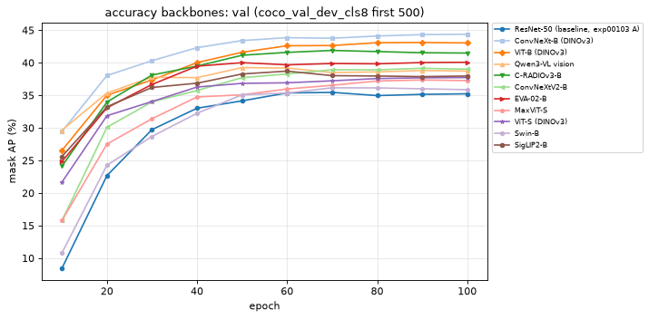
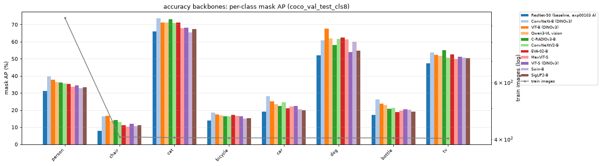
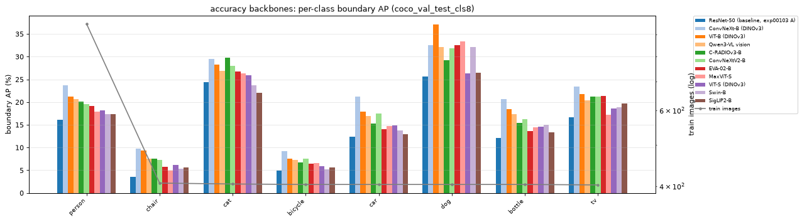
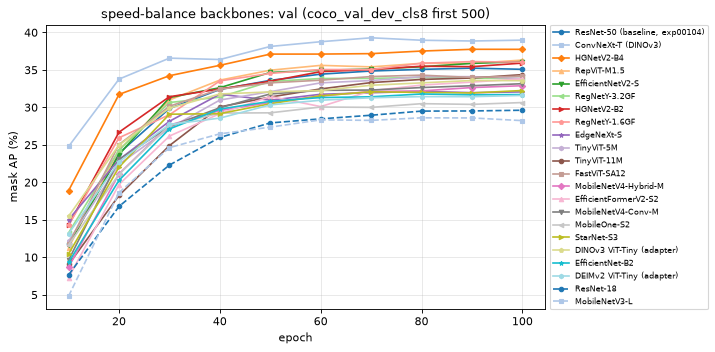
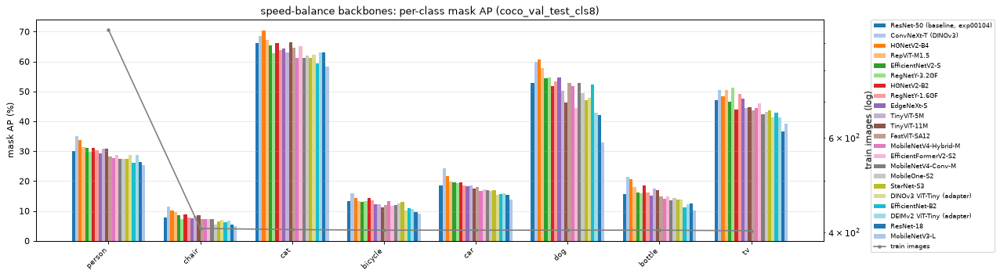

# exp00105: backbone の比較

## 目的

backbone だけを差し替え、**backbone のアーキテクチャごとの効果**を比べる。アーキテクチャの差を見るため、事前学習は原則として
ImageNet の重みにそろえる。DINOv3 などの別の事前学習の重みは、参考の比べとして一部だけ入れる。次の 2 つのカテゴリに分ける。

- **精度重視**: 大きめ(Base 程度)の backbone。exp00103 で最良だった方式(自作の GTR 系 + hybrid encoder。R50 で test 31.8)の上で、
  どのアーキテクチャでどこまで上がるか(DINOv3 などの別の事前学習は参考)
- **速度バランス型**: CPU(エッジ機器・ブラウザ)でも動かせる軽い backbone。**exp00104 で決める軽い構成の上で**比べる。今の GTR 系の構成は
  backbone より後ろだけで約 19 GMACs あり、軽い backbone にしても全体は R50 のときの半分程度にしかならない(下の「候補」)ので、
  先に exp00104(backbone は R50 に固定)で、方式ごとに backbone より後ろを軽くした構成を比べて決める。速度バランス型の候補の表は、
  exp00104 の結果を見て直す

## 共通の条件

exp00101 の統一の条件で学習する(train `coco_train_cls8_2k`、val `coco_val_dev_cls8` の先頭 500 枚で最良の重みを選ぶ、test
`coco_val_test_cls8`・`voc_val_cls8`、データ拡張 `lsj`、100 エポック、batch 16、入力 512)。

- 方式と学習の設定は、exp00103 の A(`--arch gtr_seg --gtr-encoder hybrid`、`GTR_RECIPE`)のまま。**変えるのは backbone だけ**
  (backbone の学習率は、ほかの部分の 0.03 倍のまま。ViT 系で合わないと分かったら、層ごとの学習率の減衰を足す版を 1 本だけ別に足す)
- backbone は全部の層を学習する(backbone を固定する・LoRA は、下の「後の段階」)
- 基準: R50(`resnet50.a1_in1k`)の exp00103 の A(test 31.8・voc 38.4)。同じ条件なので学習し直さない
- 古典の方式との比べ: 精度重視の最良の backbone(と、時間があれば 2〜3 番目)で、Mask R-CNN(exp00103 の G。R50 で test 29.6)も
  学習する。R50 では最新の方式との差が 2 前後と小さかったので、強い backbone で差が開くかを見る

## 候補

パラメータの数と計算量(GMACs: 掛け算と足し算の組の回数 × 10⁹)は、入力 512 × 512 で backbone だけを測った値(timm で重みを読まずに作り、
`torch.utils.flop_counter` で数えた)。stride は backbone が出す特徴の、入力に対する縮小の倍率。

GTR 系 + hybrid encoder の backbone より後の部分(encoder・decoder・マスクの head)は、backbone によらずパラメータ約 1,200 万・
約 19 GMACs ある(R50 のとき全体 3,600 万・40.2 GMACs、MobileNetV4-M のとき 1,910 万・22.4 GMACs)。

### 精度重視

| 候補 | timm の名前(重み) | 事前学習 | パラメータ | GMACs | stride | 注意 |
|---|---|---|---|---|---|---|
| (基準)ResNet-50 | `resnet50.a1_in1k` | ImageNet-1K | 2,350 万 | 21.4 | 2〜32 | 比べる基準。結果は exp00103 の A(GTR 系 + hybrid encoder、test 31.8)を使い、学習し直さない |
| ConvNeXt-B(DINOv3) | `convnext_base.dinov3_lvd1689m` | DINOv3(自己教師あり、LVD-1689M)から蒸留 | 8,760 万 | 80.2 | 4〜32 | DINOv3 の ConvNeXt は V2 ではなく元の ConvNeXt の形(DINOv3 の公開の重みに V2 はない) |
| ConvNeXt V2-B | `convnextv2_base.fcmae_ft_in22k_in1k` | FCMAE(自己教師あり)→ ImageNet-22K → 1K | 8,770 万 | 80.2 | 4〜32 | ConvNeXt-B(DINOv3)と同じ大きさで、事前学習だけが違う |
| Swin-B | `swin_base_patch4_window7_224.ms_in22k_ft_in1k` | ImageNet-22K → 1K | 8,670 万 | 86.8 | 4〜32 | 特徴が (B, h, w, C) の並びで出るので並べ替える |
| ViT-B/16(DINOv3) | `vit_base_patch16_dinov3.lvd1689m` | DINOv3 | 8,560 万 | 88.0 | 16 だけ | 1 段の特徴しかない(下の「実装の注意」) |
| MaxViT-S | `maxvit_small_tf_512.in1k` | ImageNet-1K(入力 512 で調整済み) | 6,780 万 | 66.9 | 2〜32 | Base(1 億 1,850 万・137.4)は重く学習に約 10 時間かかるので、Small にする |
| EVA-02-B/16 | `eva02_base_patch16_clip_224.merged2b` | EVA-CLIP(画像と文の対応、Merged-2B) | 8,650 万 | 87.7 | 16 だけ | EVA-02 の MIM の版はパッチ 14 で、512 が割り切れない(36.6 個)ので、パッチ 16 の CLIP の版にする |
| Qwen3-VL の画像の部分 | (timm ではない)`Qwen/Qwen3-VL-2B-Instruct` の vision encoder | Qwen3-VL の学習(画像と文) | 約 3 億 | 約 360(層の幅と数からの見積もり) | 16 だけ | 24 層・幅 1024・パッチ 16(2B と 4B で同じ)。5・11・17 層目の特徴を言語モデルに渡す作り(DeepStack)なので、その層の特徴を使える。ViT-L に近い大きさで、学習が最も遅い(1 本 約 20 時間以上)。最後に回し、学習するかはそれまでの結果を見て決める |
| (足す)SigLIP2-B/16 | `vit_base_patch16_siglip_512.v2_webli` | SigLIP2(画像と文の対応、WebLI。入力 512) | 8,640 万 | 87.6 | 16 だけ | 画像と文の対応で学習した ViT の Base の版。Qwen3-VL の画像の部分(幅 1024・24 層は SigLIP2-L と同じ大きさ。Qwen3-VL が SigLIP2 から作ったかは確かめていない)と比べて、VLM として学習した効果の目安にする |
| (足す)ViT-S/16(DINOv3) | `vit_small_patch16_dinov3.lvd1689m` | DINOv3 | 2,160 万 | 22.2 | 16 だけ | R50 と同じ大きさ。exp00103 の ViT-S(ImageNet-1K の DeiT3)と比べると、同じ大きさの ViT で事前学習だけの差が見られる |
| (足す・余裕があれば)C-RADIOv3-B | `vit_base_patch16_radio_v3.c_radio` | 複数の先生(DINOv2・SigLIP・SAM など)からの蒸留 | 8,650 万 | 88.3 | 16 だけ | 密な予測(セグメンテーションなど)向けに作られた backbone。ライセンスは NVIDIA の独自のもの |

### 速度バランス型

| 候補 | 重み(timm の名前、または出どころ) | 事前学習 | パラメータ | GMACs | stride | 注意 |
|---|---|---|---|---|---|---|
| (基準)ResNet-50 | `resnet50.a1_in1k` | ImageNet-1K | 2,350 万 | 21.4 | 2〜32 | 比べる基準。結果は exp00104 の G1 + E2(64) + E3(同じ方式、test 31.4)を使い、学習し直さない |
| MobileNetV4-Conv-M | `mobilenetv4_conv_medium.e500_r256_in1k` | ImageNet-1K | 720 万 | 4.3 | 2〜32 | 畳み込みだけの最新の MobileNet(V5 は下) |
| MobileNetV4-Hybrid-M | `mobilenetv4_hybrid_medium.e500_r224_in1k` | ImageNet-1K | 860 万 | 5.6 | 2〜32 | 注意の層(Mobile MQA)を含む版 |
| MobileNetV3-L | `mobilenetv3_large_100.ra4_e3600_r224_in1k` | ImageNet-1K | 300 万 | 1.1 | 2〜32 | 古典の軽い backbone の参考。正規化は平均・標準偏差 0.5 |
| EfficientNet-B2 | `efficientnet_b2.ra_in1k` | ImageNet-1K | 720 万 | 3.3 | 2〜32 | |
| EfficientNetV2-S | `tf_efficientnetv2_s.in21k_ft_in1k` | ImageNet-21K → 1K | 1,980 万 | 14.8 | 2〜32 | 正規化は平均・標準偏差 0.5 |
| RegNetY-1.6GF | `regnety_016.tv2_in1k` | ImageNet-1K | 1,030 万 | 8.4 | 2〜32 | |
| RegNetY-3.2GF | `regnety_032.tv2_in1k` | ImageNet-1K | 1,790 万 | 16.6 | 2〜32 | R50 に近い計算量で、どちらが良いか |
| FastViT-SA12 | `fastvit_sa12.apple_dist_in1k` | ImageNet-1K(蒸留) | 1,040 万 | 7.7 | 4〜32 | 推論のときに畳み込みをまとめられる作り(re-parameterize) |
| HGNetV2-B2 / B4 | `hgnetv2_b2.ssld_stage2_ft_in1k` / `hgnetv2_b4.ssld_stage2_ft_in1k` | ImageNet-22K → 1K(蒸留) | 600 万 / 1,360 万 | 5.9 / 14.3 | 4〜32 | D-FINE・DEIM など最近の速い DETR 系の検出器の標準の backbone |
| ConvNeXt-T(DINOv3) | `convnext_tiny.dinov3_lvd1689m` | DINOv3 から蒸留 | 2,780 万 | 23.3 | 4〜32 | R50 と同じ計算量で、強い事前学習の効果を見る |
| ResNet-18 | `resnet18.a1_in1k` | ImageNet-1K | 1,120 万 | 9.5 | 2〜32 | 古典の軽い backbone の参考(R50 と同じ系統) |
| TinyViT-5M / 11M | `tiny_vit_5m_224.dist_in22k_ft_in1k` / `tiny_vit_11m_224.dist_in22k_ft_in1k` | ImageNet-22K から蒸留 → 1K | 510 万 / 1,050 万 | 7.6 / 12.6 | 4〜32 | 端末向けの SAM(MobileSAM)の画像の部分 |
| RepViT-M1.5 | `repvit_m1_5.dist_450e_in1k` | ImageNet-1K(蒸留) | 1,360 万 | 11.9 | 4〜32 | 端末向けの SAM(RepViT-SAM)の画像の部分。推論のときに枝をまとめる作り |
| EdgeNeXt-S | `edgenext_small.usi_in1k` | ImageNet-1K | 530 万 | 5.0 | 4〜32 | 畳み込みと注意を混ぜた端末向けの backbone |
| StarNet-S3 | `starnet_s3.in1k` | ImageNet-1K | 550 万 | 3.9 | 4〜32 | CVPR 2024 |
| EfficientFormerV2-S2 | `efficientformerv2_s2.snap_dist_in1k` | ImageNet-1K(蒸留) | 1,220 万 | 7.2 | 4〜32 | 端末向けの畳み込みと注意の混ぜ合わせ |
| MobileOne-S2 | `mobileone_s2.apple_in1k` | ImageNet-1K | 580 万 | 6.8(学習の形) | 2〜32 | 推論のときに枝をまとめる作り(Apple) |
| DINOv3 ViT-Tiny | `vit_tiny_patch16_dinov3_qkvb.eupe_lvd1689m` | DINOv3 の系統(LVD-1689M) | 550 万 | 5.6 | 16 だけ | DEIMv2-S の backbone と同じ大きさ。ViT 用のアダプタが要る(下の「実装の注意」) |
| DEIMv2 の ViT-Tiny | timm ではない: DEIMv2 の公式の重み `vitt_distill.pt`(Google Drive で公開) | DINOv3-S からの蒸留(検出では学習していない) | 約 550 万 | 約 5.6 | 16 だけ | DEIMv2-S の backbone そのもの。ViT 用のアダプタが要る |

候補は、指定のもの(MobileNet・EfficientNet・RegNetY・FastViT)に、下の「論文の軽量モデルが使う backbone(下調べ)」と timm の下調べから
足したもの。ViT 用のアダプタが要る 2 つは、アダプタを実装してから学習する。

### 論文の軽量モデルが使う backbone(下調べ。2026-11)

| 論文のモデル | backbone | 重み | 扱い |
|---|---|---|---|
| D-FINE・DEIM の N・S | HGNetV2-B0〜B2 | timm にある | HGNetV2-B2・B4 を候補に入れた |
| DEIMv2 の Atto〜N | HGNetV2-B0 の段を削ったもの | 公式のリポジトリ | 削っただけで HGNetV2 と同じ系統なので、候補の HGNetV2 で代える |
| DEIMv2 の S・M | DINOv3-S から蒸留した ViT-Tiny(幅 192・12 層)に、細かい解像度の情報を足す小さい CNN(STA)を付け、3・7・11 層目の特徴から stride 8・16・32 を作る | ViT-Tiny の重みは Google Drive で公開 | 候補に入れた(DEIMv2 の ViT-Tiny) |
| GTR の S | ゲート付きの線形注意の ViT(蒸留) | backbone だけの事前学習の重みは公開されていない(COCO・Objects365 などで学習した検出器の重みだけ) | 使わない(初期値に検出・セグメンテーションで学習した重みは使わない決まり)。ほかの理由: 論文の COCO の検出(Objects365 なし)で、DEIMv2 と精度が同等か低い(S 50.7 / 50.9、M 54.0 / 53.0、L 55.5 / 56.0、X 56.2 / 57.8)ので、DEIMv2 の ViT-Tiny で代えられる。強みの速さは専用の CUDA のカーネル・TensorRT での値で、CPU・ブラウザ(ONNX Runtime)で同じように速いかは分からない |
| ECInsSeg(EdgeCrafter) | 蒸留した小さい ViT(ECViT) | 同じく検出器の重みだけ | 使わない(同上) |
| RF-DETR-Seg の Nano | DINOv2 の ViT-S(窓に分けた注意) | timm に DINOv2 の ViT-S | ViT-S(2,160 万)は軽い候補としては重いので、精度重視の DINOv3 ViT-S で代える |
| YOLO26 の n・s | 自前の CSP の backbone | ultralytics の ImageNet の分類の重み(AGPL) | 入れない(ライセンスと、vendor のコードを使う必要があるため) |
| 端末向けの SAM(MobileSAM・EfficientViT-SAM・RepViT-SAM) | TinyViT・EfficientViT・RepViT | timm にある | TinyViT・RepViT を候補に入れた。EfficientViT-L1 は 27.0 GMACs で軽くないので入れない |

ほかに timm で確かめて入れなかったもの: SHViT(stride 8 の段がない)、ConvNeXt V2-Nano(12.8 GMACs。軽い候補は ConvNeXt-T の DINOv3 の版で見る)、
GhostNetV3(1.5 GMACs。MobileNetV3-L と同じ大きさの古典の参考は 1 つで足りる)。

扱わないもの:

- MobileNetV5(`mobilenetv5_300m.gemma3n`、Gemma 3n の画像の部分): 最新の MobileNet だが、2 億 7,890 万パラメータ・166.2 GMACs で
  速度バランス型にならない。精度重視にも入れない(精度重視は Base 程度の大きさの backbone で比べる)
- 1 億を大きく超える backbone(ViT-L 以上の DINOv3 など): Qwen3-VL の画像の部分(約 3 億)だけを大きいものの代表にする

## 実装の注意

- **使う特徴の段**: 今の GTR 系は timm の `out_indices=(2, 3, 4)`(R50 で stride 8・16・32)で選んでいるが、backbone によって段の
  番号が違う(ConvNeXt・FastViT などは stride 4 から始まるので 1・2・3)。`feature_info.reduction()` で stride 8・16・32 の段を
  選ぶように直す(R50 では同じ段になるので、exp00103 の結果は変わらない)
- **1 段の特徴しかない ViT 系**(DINOv3 ViT・EVA-02・SigLIP2・Qwen3-VL・C-RADIO と、速度バランス型の ViT-Tiny 2 つ): ViT の特徴(stride 16)から
  stride 8・16・32 の 3 段を作るアダプタを `lib_common/backbones/` に実装する(timm の backbone と同じく、3 段の特徴の並びを返す形にして、
  GTR 系からはほかの backbone と同じに使えるようにする)。作り方は DEIMv2 の S・M と同じにする: ViT の途中の層(12 層なら 3・7・11 層目)の
  特徴をそれぞれ 2 倍・1 倍・0.5 倍に拡大縮小し(GTR の公式の GTREncoder の scale_factors と同じ考え方)、細かい解像度の情報を、画像から
  作る小さい CNN(DEIMv2 の STA)の特徴で足す。比べるために、ViTDet の simple feature pyramid(最後の層だけから、逆畳み込みで stride 8、
  そのままで stride 16、max pooling で stride 32)も選べるようにする
- **DEIMv2 の ViT-Tiny の重み**: 公式の重みのファイル(`vitt_distill.pt`)を取ってきて、自作の ViT-Tiny(timm の ViT の作りと同じなら timm に
  読み込む)に読み込む。読み込めた重みの名前と形を確かめ、読めない重みがあれば実装の違いとして README に書く
- **入力の正規化**: データの変換は ImageNet の平均・標準偏差で正規化している。事前学習の正規化が違う backbone(SigLIP2・Qwen3-VL は
  平均 0.5・標準偏差 0.5、EVA-02 CLIP は CLIP の値)は、backbone の入口で正規化をし直す(timm の `pretrained_cfg` の値)
- **Qwen3-VL の画像の部分**: transformers の Qwen3-VL の vision encoder を取り出し、画像を (B, 3, 512, 512) で受けて
  パッチの並びに直して入れる。最後の合成(2 × 2 のパッチをまとめて言語モデルの幅にする merger)は使わず、その前の stride 16 の特徴を使う。
  重みは 2B の版(4B と画像の部分の作りは同じ)
- **GPU のメモリ**(上限 12GB): Base 以上は gradient checkpointing(timm の `set_grad_checkpointing`)と gradient accumulation で収める
- **ライセンス**: DINOv3 の重みは独自のライセンス(DINOv3 License)、C-RADIO は NVIDIA の独自のライセンス。学習したモデルをデモ
  (Hugging Face)に上げるときは、そのライセンスに従う

## 測るもの

- 精度: test(`coco_val_test_cls8`・`voc_val_cls8`)の mask AP・box AP・PQ、クラスごとの mask AP、val の推移
- 大きさ: パラメータの数、GMACs(backbone だけと、モデル全体)
- 学習の速さ(枚/秒。GPU をほかの学習と分け合った時間を含む)
- 推論の速さ(速度バランス型は特に): GPU(PyTorch)、CPU(ONNX Runtime)、ブラウザ(exp00304 のデモ。WASM・WebGPU)。ほかの学習で GPU・CPU が
  混んでいる間は測らず、まとめて後で測る

## 進め方

1 本ずつ順に学習する(GPU のメモリの上限 12GB)。学習の時間の目安は、R50 の 2.6 時間(21.3 枚/秒)をモデル全体の計算量の比で
割り増した見積もり(まだ測っていない。各 backbone の動作確認のときに速さを測って直す)。

| 段 | 中身 | 本数 | 目安の時間 |
|---|---|---|---|
| 1 | 実装(特徴の段の選び方、ViT 系の simple feature pyramid、正規化のし直し、Qwen3-VL の取り出し)と、全部の候補の動作確認(数十回の更新) | — | — |
| 2 | 速度バランス型(指定の 8 本 + 足した 4 本)。方式は exp00104 の G1 + E2(64) + E3(`{"dim": 192, "ffn": 512, "mask_dim": 64, "enc_block": "dw"}`)。比べる相手は同じ方式の R50(exp00104 の `gtr_g1_e2e3`、test 31.4)。batch 16、1 本あたりの GPU のメモリの上限 15GB で 2 本ずつ同時に流す(`run_light.sh`。メモリが足りないときだけ micro-batch 8 × gradient accumulation 2) | 12 | 軽い構成の速さで見積もり直す(今の GTR 系の構成なら 1 本 1.5〜2.5 時間) |
| 2 の続き | 速度バランス型の残り(TinyViT-5M・11M、RepViT-M1.5、EdgeNeXt-S、StarNet-S3、EfficientFormerV2-S2、MobileOne-S2)。条件は上と同じ | 7 | 2 本ずつで計 約 7 時間 |
| 2 の続き | ViT 用のアダプタを実装し、DINOv3 ViT-Tiny・DEIMv2 の ViT-Tiny | 2 | 計 約 2 時間 |
| 3 | 精度重視(指定の 6 本 + 足した 3 本。Qwen3-VL は最後に回し、学習するかはそれまでの結果を見て決める) | 9 | Base 1 本 6〜7 時間、MaxViT-S 約 5 時間、Qwen3-VL 約 20 時間以上、計 約 75 時間(Qwen3-VL を除くと約 55 時間) |
| 4 | 精度重視の最良の backbone で Mask R-CNN | 1〜3 | 1 本あたり、同じ backbone の GTR 系の学習と同じ程度の見込み(R50 では GTR 系より速かった) |

## 後の段階(結果を見て決める)

- **細かい形のクラス(chair・bicycle)の境界の精度**: 速度バランス型では、boundary AP がどの backbone でも chair(3.4〜6.2)・
  bicycle(4.0〜6.4)で最も低い(ほかのクラスは 10.7 以上。`eval_boundary.py`、結果は `results/{名前}_boundary.json`)。
  精度重視の各 backbone でも測った(結果の「精度重視」の表。どの backbone でも 5.0〜9.8 で最も低い)
- **backbone より後ろを大きくする**: 精度重視の最良の ConvNeXt-B(DINOv3)で、後段を大きくし、細かい解像度の特徴を足した構成を
  1 本学習し、とくに bicycle・chair の boundary AP が上がるかを見る(`gtr_cnxtb_dinov3_bighead640s4`)。後段は D-FINE-X
  (hidden_dim は encoder 384・decoder 256、FFN の中間の次元 2048、decoder 6 層)より大きくする: dim(チャンネル数)384(encoder・
  decoder・マスクの head で共通)、FFN の中間の次元 2048(encoder・decoder)、decoder 6 層、hybrid encoder の expansion 1.0。
  加えて、encoder・decoder の段に stride 4 を足し(公式の D-FINE・RT-DETR は stride 8・16・32 の 3 段。マスクの head は encoder の
  stride 4 の出力をそのまま使う)、入力を 640 にする。後段のパラメータは G0 の 1,210 万 → 4,630 万、学習の forward の計算量は
  1 枚あたり 103.2 → 339.5 GMACs(後段は 23.0 → 214.2)。GPU のメモリは micro-batch 4 で最大 16.3GB(micro-batch 8 は 30GB に
  収まらない)なので、4 × 4 で学習する

- **backbone を固定する / LoRA**: 精度重視の最良の backbone で、全部を学習する場合と比べる(合成データでは、固定した方がドメインの差に
  強い可能性がある。インスタンスセグメンテーションの README の計画)

## 結果

### 精度重視(10 本)

方式は exp00103 の A のまま(GTR 系 + hybrid encoder、後段は G0。decoder の自己注意は計算が同じで速い形 `{"sdpa_self_attn": true}`)、
条件は「共通の条件」のとおり。値は %。test は `coco_val_test_cls8`、val の最良は `coco_val_dev_cls8` の先頭 500 枚(最良の重みを選んだ値)。
test の mask AP の高い順。パラメータ・GMACs は backbone だけ(入力 512)。batch size はどれも 16。「micro-batch × grad accum」は、
GPU のメモリの上限(15GB。Qwen3-VL だけは 1 本で流して 30GB)に収まった micro-batch size と gradient accumulation steps
(Swin-B は 8 × 2 で 45 エポック目に GPU のメモリが足りなくなり、4 × 4 で初めからやり直した)。

| backbone | パラメータ(backbone) | GMACs(backbone) | test mask AP | AP50 / AP75 | APs / APm / APl | box AP | boundary AP | PQ | voc mask AP | val の最良(エポック) | micro-batch × grad accum |
|---|---|---|---|---|---|---|---|---|---|---|---|
| (基準)ResNet-50(exp00103 の A) | 2,350 万 | 21.4 | 31.8 | 49.3 / 35.1 | 6.8 / 35.6 / 53.1 | 34.4 | 14.5 | 41.2 | 38.4 | 35.4(70) | 8 × 2 |
| **ConvNeXt-B(DINOv3)** | 8,760 万 | 80.2 | **39.6** | 59.9 / 43.1 | 12.5 / 46.7 / 62.0 | **44.3** | **21.2** | **52.3** | 45.9 | 44.4(100) | 8 × 2 |
| ViT-B/16(DINOv3) | 8,560 万 | 88.0 | 39.0 | 59.5 / 42.9 | 9.9 / 46.2 / 63.9 | 44.1 | 20.2 | 50.9 | **47.2** | 43.1(90) | 8 × 2 |
| Qwen3-VL の画像の部分(2B) | 約 3 億 | 約 360 | 37.3 | 57.3 / 40.2 | 10.2 / 43.3 / 61.5 | 41.4 | 18.7 | 50.2 | 46.2 | 39.3(50) | 8 × 2 |
| C-RADIOv3-B | 8,650 万 | 88.3 | 37.0 | 56.1 / 40.4 | 10.2 / 41.5 / 63.3 | 40.7 | 18.2 | 48.8 | 45.1 | 41.9(70) | 8 × 2 |
| ConvNeXt V2-B | 8,770 万 | 80.2 | 36.8 | 57.0 / 39.5 | 12.8 / 42.0 / 58.4 | 41.6 | 18.6 | 50.3 | 43.3 | 39.2(90) | 4 × 4 |
| EVA-02-B/16 | 8,650 万 | 87.7 | 36.2 | 55.1 / 38.8 | 9.2 / 39.7 / 61.8 | 40.6 | 17.4 | 49.5 | 44.7 | 40.1(100) | 8 × 2 |
| MaxViT-S | 6,780 万 | 66.9 | 35.2 | 54.6 / 37.7 | 9.0 / 40.2 / 57.8 | 39.1 | 17.0 | 47.2 | 41.5 | 37.4(90) | 4 × 4 |
| ViT-S/16(DINOv3) | 2,160 万 | 22.2 | 34.9 | 53.7 / 37.7 | 7.8 / 40.9 / 60.5 | 38.9 | 16.3 | 46.3 | 43.9 | 37.7(100) | 8 × 2 |
| Swin-B | 8,670 万 | 86.8 | 34.4 | 54.4 / 36.6 | 9.4 / 38.9 / 56.0 | 39.5 | 16.4 | 46.8 | 40.9 | 36.1(70) | 4 × 4 |
| SigLIP2-B/16 | 8,640 万 | 87.6 | 33.9 | 53.3 / 36.5 | 7.1 / 39.0 / 57.5 | 38.4 | 15.4 | 47.1 | 42.7 | 38.7(60) | 8 × 2 |

val の推移(10 エポックごと。凡例は test の mask AP の高い順):

クラスごとの mask AP と boundary AP(test。灰色の折れ線は学習データでそのクラスを含む画像の数):

クラスごとの mask AP / boundary AP(test。`eval_boundary.py` で最良の重みから予測し直した値。`results/{名前}_boundary.json`):

| backbone | 全体 | person | bicycle | car | cat | dog | bottle | chair | tv |
|---|---|---|---|---|---|---|---|---|---|
| (基準)ResNet-50 | 31.9 / 14.5 | 31.2 / 16.1 | 13.9 / 5.0 | 19.1 / 12.4 | 66.2 / 24.4 | 52.1 / 25.6 | 17.1 / 12.1 | 7.8 / 3.6 | 47.5 / 16.7 |
| ConvNeXt-B(DINOv3) | 39.7 / 21.3 | 39.8 / 23.7 | 18.4 / 9.2 | 28.2 / 21.3 | 73.7 / 29.5 | 61.1 / 32.5 | 26.2 / 20.7 | 16.3 / 9.8 | 53.6 / 23.5 |
| ViT-B/16(DINOv3) | 39.1 / 20.2 | 37.7 / 21.2 | 17.5 / 7.5 | 25.2 / 17.9 | 71.4 / 28.3 | 67.8 / 37.1 | 23.9 / 18.4 | 16.8 / 9.4 | 52.2 / 21.8 |
| Qwen3-VL の画像の部分 | 37.2 / 18.7 | 36.3 / 20.6 | 16.9 / 7.3 | 23.7 / 16.9 | 71.0 / 26.9 | 61.8 / 32.2 | 23.0 / 17.4 | 13.6 / 7.6 | 51.6 / 20.3 |
| C-RADIOv3-B | 37.0 / 18.1 | 36.1 / 20.0 | 16.3 / 6.7 | 22.4 / 15.3 | 73.2 / 29.7 | 58.0 / 29.3 | 20.8 / 15.4 | 14.1 / 7.5 | 55.2 / 21.2 |
| ConvNeXt V2-B | 36.8 / 18.6 | 35.6 / 19.6 | 16.4 / 7.5 | 24.6 / 17.5 | 71.2 / 28.0 | 61.6 / 31.8 | 21.4 / 16.3 | 13.1 / 7.3 | 50.9 / 21.2 |
| EVA-02-B/16 | 36.2 / 17.5 | 35.3 / 19.1 | 17.1 / 6.5 | 21.0 / 14.0 | 71.4 / 26.7 | 62.5 / 32.5 | 18.9 / 13.6 | 11.2 / 5.7 | 52.5 / 21.4 |
| MaxViT-S | 35.1 / 16.9 | 33.6 / 18.0 | 16.8 / 6.6 | 22.0 / 14.8 | 67.6 / 26.3 | 61.2 / 33.3 | 19.5 / 14.4 | 10.6 / 5.0 | 49.7 / 17.2 |
| ViT-S/16(DINOv3) | 34.9 / 16.3 | 34.5 / 18.1 | 16.5 / 5.9 | 22.4 / 14.9 | 68.3 / 26.0 | 53.8 / 26.4 | 20.6 / 14.6 | 12.0 / 6.2 | 51.1 / 18.6 |
| Swin-B | 34.4 / 16.4 | 32.9 / 17.4 | 14.5 / 5.2 | 20.6 / 13.7 | 65.6 / 23.7 | 60.0 / 32.1 | 20.2 / 15.0 | 10.7 / 5.3 | 50.7 / 18.9 |
| SigLIP2-B/16 | 33.9 / 15.4 | 33.5 / 17.4 | 15.2 / 5.7 | 20.0 / 12.9 | 67.3 / 22.1 | 54.8 / 26.5 | 19.0 / 13.3 | 11.1 / 5.6 | 50.2 / 19.7 |

- **最良は ConvNeXt-B(DINOv3)**: test 39.6・voc 45.9 で、基準の R50(31.8・38.4)から +7.8・+7.5。boundary AP 21.2(+6.7)・
  PQ 52.3(+11.1)も最も高い。voc では ViT-B/16(DINOv3)が最も高い(47.2)
- **同じ DINOv3 の重みの階層型と ViT は同じくらい**: ConvNeXt-B 39.6 と ViT-B/16 39.0(差 0.6)。小さい物体の APs は ConvNeXt-B が
  高く(12.5 と 9.9)、大きい物体の APl は ViT-B が高い(62.0 と 63.9)
- **同じ ViT-B/16 の形で、事前学習だけが違うもの**: DINOv3 39.0、C-RADIOv3 37.0、EVA-02(CLIP)36.2、SigLIP2 33.9。画像と文の対応で
  学習した重み(EVA-02・SigLIP2)は DINOv3 より 2.8〜5.1 低い
- **同じ ConvNeXt-B の形で、事前学習だけが違うもの**: DINOv3 39.6、ConvNeXt V2(FCMAE → ImageNet-22K)36.8(−2.8)
- **大きい backbone**: Qwen3-VL の画像の部分(約 3 億)は 37.3 で、Base の DINOv3 の 2 本より 1.7〜2.3 低い
- **ImageNet で学習した階層型の Swin-B(34.4)・MaxViT-S(35.2)** は、Base の中で低い方。速度バランス型の ConvNeXt-T(DINOv3)35.9 より低い
- **ViT-S/16(DINOv3)** は 34.9 で、同じくらいの計算量の速度バランス型の ConvNeXt-T(DINOv3)35.9 より 1.0 低い
- **細かい形のクラス(bicycle・chair)の boundary AP** は、どの backbone でも 5.0〜9.8 で、ほかのクラス(12.9 以上)より低い。最良の
  ConvNeXt-B(DINOv3)で bicycle 9.2・chair 9.8(基準の R50 は 5.0・3.6)。mask AP でも bicycle 14.5〜18.4・chair 10.6〜16.8 と、
  8 クラスの中で最も低い 2 つ

### 精度重視の最良の backbone で後段を大きくした構成(1 本)

ConvNeXt-B(DINOv3)で、後段を G0 から大きくし(dim(チャンネル数)256 → 384、FFN の中間の次元 1024 → 2048(encoder・decoder)、
decoder 4 → 6 層、hybrid encoder の expansion 0.75 → 1.0)、encoder・decoder の段に stride 4 を足し(stride 8・16・32 → 4・8・16・32)、
入力を 512 → 640 にした(「後の段階」の構成。`gtr_cnxtb_dinov3_bighead640s4`、micro-batch 4 × gradient accumulation steps 4)。
基準は同じ backbone の G0・入力 512。

| 構成 | test mask AP | AP50 / AP75 | APs / APm / APl | box AP | boundary AP | PQ | voc mask AP | val の最良(エポック) |
|---|---|---|---|---|---|---|---|---|
| G0・入力 512 | 39.6 | 59.9 / 43.1 | 12.5 / 46.7 / 62.0 | 44.3 | 21.2 | 52.3 | 45.9 | 44.4(100) |
| 後段を大きく・stride 4 の段・入力 640 | **42.0** | 63.3 / 45.9 | 14.6 / 49.3 / 62.7 | **47.7** | **23.2** | **55.4** | **46.7** | 45.0(100) |

クラスごとの mask AP / boundary AP(test。`eval_boundary.py`):

| 構成 | 全体 | person | bicycle | car | cat | dog | bottle | chair | tv |
|---|---|---|---|---|---|---|---|---|---|
| G0・入力 512 | 39.7 / 21.3 | 39.8 / 23.7 | 18.4 / 9.2 | 28.2 / 21.3 | 73.7 / 29.5 | 61.1 / 32.5 | 26.2 / 20.7 | 16.3 / 9.8 | 53.6 / 23.5 |
| 後段を大きく・stride 4 の段・入力 640 | 42.0 / 23.2 | 42.6 / 26.6 | 20.6 / 11.1 | 30.4 / 23.3 | 73.6 / 29.3 | 65.3 / 35.7 | 31.0 / 24.9 | 17.9 / 11.4 | 54.6 / 23.4 |

- test は mask AP +2.4・boundary AP +2.0・PQ +3.1、voc は mask AP +0.8。小さい物体の APs が +2.1(12.5 → 14.6)
- bicycle・chair の boundary AP は +1.9・+1.6(9.2 → 11.1、9.8 → 11.4)。8 クラスの中で最も低い 2 つであることは変わらない。
  伸びが大きいのは bottle(boundary AP +4.2)・dog(+3.2)・person(+2.9)で、大きく写る cat・tv はほとんど変わらない
- 学習の forward の計算量は 1 枚あたり 103.2 → 339.5 GMACs(+229%)、後段のパラメータは 1,210 万 → 4,630 万

### 速度バランス型(21 本)

方式は exp00104 の G1 + E2(64) + E3(`{"dim": 192, "ffn": 512, "mask_dim": 64, "enc_block": "dw"}`)、条件は「共通の条件」のとおり。
値は %。test は `coco_val_test_cls8`、val の最良は `coco_val_dev_cls8` の先頭 500 枚(最良の重みを選んだ値)。test の mask AP の高い順。
パラメータ・GMACs は backbone だけ(入力 512)。batch size はどれも 16。「micro-batch × grad accum」が 8 × 2 のものは、micro-batch 16 で
GPU のメモリ(15GB)に収まらず、micro-batch size 8・gradient accumulation steps 2 でやり直した(BN の統計は 8 枚ずつになる)。

| backbone | パラメータ(backbone) | GMACs(backbone) | test mask AP | AP50 / AP75 | APs / APm / APl | box AP | PQ | voc mask AP | val の最良(エポック) | micro-batch × grad accum |
|---|---|---|---|---|---|---|---|---|---|---|
| (基準)ResNet-50(exp00104 の G1 + E2(64) + E3) | 2,350 万 | 21.4 | 31.4 | 48.5 / 34.4 | 6.3 / 35.0 / 53.0 | 33.8 | 40.3 | 37.0 | 35.2(90) | 16 × 1 |
| ConvNeXt-T(DINOv3) | 2,780 万 | 23.3 | 35.9 | 54.2 / 39.3 | 9.2 / 40.0 / 60.0 | 39.2 | 47.0 | 43.2 | 39.3(70) | 8 × 2 |
| HGNetV2-B4 | 1,360 万 | 14.3 | 35.0 | 54.1 / 37.8 | 9.5 / 39.6 / 57.2 | 38.1 | 46.2 | 41.3 | 37.8(90) | 16 × 1 |
| RepViT-M1.5 | 1,360 万 | 11.9 | 33.5 | 51.8 / 36.1 | 7.3 / 36.2 / 56.3 | 36.0 | 43.3 | 39.5 | 36.3(100) | 8 × 2 |
| EfficientNetV2-S | 1,980 万 | 14.8 | 31.8 | 50.6 / 34.5 | 6.8 / 33.0 / 53.1 | 34.2 | 42.5 | 38.4 | 36.1(100) | 8 × 2 |
| RegNetY-3.2GF | 1,790 万 | 16.6 | 31.8 | 50.4 / 34.1 | 6.7 / 34.5 / 52.9 | 34.6 | 43.0 | 35.9 | 34.0(80) | 16 × 1 |
| HGNetV2-B2 | 600 万 | 5.9 | 31.8 | 49.8 / 34.3 | 6.8 / 35.1 / 53.9 | 34.8 | 42.8 | 38.8 | 35.9(100) | 16 × 1 |
| RegNetY-1.6GF | 1,030 万 | 8.4 | 31.6 | 49.3 / 33.4 | 7.4 / 35.4 / 53.2 | 34.7 | 42.1 | 37.3 | 36.1(90) | 16 × 1 |
| EdgeNeXt-S | 530 万 | 5.0 | 31.1 | 48.8 / 33.5 | 6.9 / 34.5 / 51.9 | 33.5 | 41.8 | 36.3 | 32.1(80) | 16 × 1 |
| TinyViT-5M | 510 万 | 7.6 | 30.7 | 48.7 / 32.6 | 6.9 / 33.6 / 52.8 | 33.1 | 40.5 | 37.0 | 34.1(90) | 16 × 1 |
| TinyViT-11M | 1,050 万 | 12.6 | 30.3 | 46.5 / 33.1 | 7.0 / 34.5 / 52.0 | 31.9 | 39.3 | 37.1 | 34.4(100) | 8 × 2 |
| FastViT-SA12 | 1,040 万 | 7.7 | 30.2 | 48.2 / 32.6 | 5.8 / 32.2 / 51.3 | 32.7 | 41.2 | 36.7 | 34.3(80) | 8 × 2 |
| MobileNetV4-Hybrid-M | 860 万 | 5.6 | 29.5 | 48.0 / 30.7 | 5.2 / 30.7 / 52.2 | 32.5 | 40.8 | 37.1 | 32.9(100) | 16 × 1 |
| EfficientFormerV2-S2 | 1,220 万 | 7.2 | 29.5 | 46.4 / 31.5 | 5.7 / 32.7 / 50.8 | 31.9 | 39.9 | 36.7 | 33.8(100) | 8 × 2 |
| MobileNetV4-Conv-M | 720 万 | 4.3 | 29.2 | 46.3 / 31.7 | 4.9 / 29.9 / 51.4 | 32.0 | 39.2 | 36.0 | 33.2(100) | 16 × 1 |
| MobileOne-S2 | 580 万 | 6.8 | 28.9 | 46.6 / 31.0 | 5.4 / 32.2 / 48.4 | 31.4 | 39.7 | 34.8 | 30.6(100) | 16 × 1 |
| StarNet-S3 | 550 万 | 3.9 | 28.7 | 46.2 / 30.6 | 5.6 / 30.6 / 49.6 | 31.1 | 39.9 | 34.9 | 32.3(100) | 16 × 1 |
| DINOv3 ViT-Tiny(adapter) | 550 万 | 5.6 | 28.3 | 45.5 / 30.8 | 4.7 / 30.1 / 50.5 | 31.1 | 38.0 | 37.5 | 33.6(90) | 16 × 1 |
| EfficientNet-B2 | 720 万 | 3.3 | 28.1 | 45.3 / 29.6 | 4.6 / 28.6 / 47.6 | 29.9 | 38.2 | 34.9 | 31.8(80) | 8 × 2 |
| DEIMv2 の ViT-Tiny(adapter) | 約 550 万 | 約 5.6 | 27.7 | 43.9 / 29.5 | 5.0 / 29.0 / 49.8 | 30.1 | 37.4 | 36.9 | 31.6(100) | 16 × 1 |
| ResNet-18 | 1,120 万 | 9.5 | 26.4 | 41.9 / 28.4 | 4.9 / 27.4 / 45.8 | 27.8 | 35.6 | 32.0 | 29.6(100) | 16 × 1 |
| MobileNetV3-L | 300 万 | 1.1 | 24.2 | 39.1 / 26.2 | 5.6 / 25.7 / 42.8 | 25.5 | 34.3 | 31.4 | 28.6(80) | 16 × 1 |

val の推移(10 エポックごと。凡例は test の mask AP の高い順):

クラスごとの mask AP(test。灰色の折れ線は学習データでそのクラスを含む画像の数):

- **最良は ConvNeXt-T(DINOv3)**: test 35.9・voc 43.2 で、基準の R50(31.4・37.0)から +4.5・+6.2。backbone の計算量は R50 とほぼ同じ
  (23.3 / 21.4 GMACs)。事前学習が ImageNet ではなく DINOv3 からの蒸留なので、ほかの候補とは条件が違う参考の値
- **計算量あたりで最も良いのは HGNetV2-B4**: test 35.0(+3.6)で、backbone の計算量は R50 の 67%(14.3 / 21.4 GMACs)。
  RepViT-M1.5 も 33.5(+2.1)で 56%(11.9 GMACs)
- **R50 と同じ精度でずっと軽いもの**: HGNetV2-B2 は test 31.8(+0.4)・voc 38.8(+1.8)で、backbone の計算量は R50 の 28%(5.9 GMACs)。
  EdgeNeXt-S(31.1、5.0 GMACs)・RegNetY-1.6GF(31.6、8.4 GMACs)も R50 との差は 1 以内
- **段の内部で注意を使う階層型**(TinyViT・FastViT・EdgeNeXt・EfficientFormerV2・MNv4-Hybrid、29.5〜31.1)は、同じくらいの大きさの
  CNN の上位(HGNetV2-B2・RegNetY-1.6GF、31.6〜31.8)より 1〜2 低い。このうち TinyViT-11M・FastViT・EfficientFormerV2 は 8 × 2 で
  学習しているので、BN の統計の枚数の違いが混ざっている(切り分けていない)
- **全部の層が同じ解像度の ViT(adapter で 3 段にしたもの)**: DINOv3 ViT-Tiny 28.3・DEIMv2 の ViT-Tiny 27.7 で、同じくらいの大きさの
  階層型(HGNetV2-B2 31.8・EdgeNeXt-S 31.1)より 3〜4 低い。小さい物体の APs が 4.7・5.0 と低く(HGNetV2-B2 は 6.8)、
  1/8 の段の細かい形の情報が足りない(1/16 の特徴を拡大して、小さい畳み込みの枝の 32 チャンネルを足しただけ)ことが原因の候補だが、
  確かめていない。voc では 37.5・36.9 と、test ほどは下がらない
- **古典の軽い backbone**(ResNet-18 26.4、MobileNetV3-L 24.2)が最も低い
- 同じ条件で学習し直したときのぶれは 1 前後と見ている(exp00104 の README)。差が 1 以内の順位は入れ替わりうる
- 推論の速さ(CPU の ONNX Runtime・ブラウザ)は、ほかの学習で CPU が混んでいる間は測らないので、まだ測っていない
