# exp00201: ① 生成だけ で正解マスクを作る方法の試作

## 目的

**生成・合成の手順だけで(学習済みの認識モデルを使わずに)、合成画像の正解インスタンスマスクを作れるか**を確かめる。
対象は ①-a 色で抜いて合成 と ①-c 背景を inpainting(分類は [インスタンスセグメンテーションの README](../README.md#正解ラベルの作り方の分類))。
この exp ではモデルの学習はしない。結果から、exp00202(① で作ったデータでの学習)の設定を決める。

## 確かめること

| # | 問い | 方法 | 測ること(どれも認識モデルを使わない) |
|---|---|---|---|
| Q1 | 無地の背景で生成した物体 1 つを、背景の色との差という決まった規則で抜き出せるか | ①-a の部品 | 抜き出したマスクのまとまりの数(1 つが理想)、画像の端に触れているか(物体が途中で切れている目安)、面積の割合、背景の色がそろっているか(画像の端の色のばらつき)、規則で使える割合 |
| Q1b | 物体の影がマスクに入らないようにできるか | ①-a の部品 | 抜き出しの規則(RGB の距離 / 緑の強さ)× プロンプト(今の文面 / 宙に浮かせる文面)で比べる。見本の画像で確かめる |
| Q1c | 形・色・種類・ポーズ・向きが多様な物体を生成できるか | ①-a の部品 | プロンプトの作り方(seed だけ変える / 属性の一覧から組み合わせる / ollama の LLM で作る)で比べる。クラスごとの一覧の画像で確かめ、マスクの形(縦横の比・面積)のばらつきも出す |
| Q2 | 抜き出した物体を合成した画像を作れるか | ①-a | 合成した画像と、貼った形の正解のマスク(重なった所は後から貼った物体が上) |
| Q3 | 合成した画像の物体以外を inpainting で描き直し、物体の画素を元に戻して、自然な背景を作れるか | ①-c | inpainting がマスクの外(物体)をどれだけ変えたか(戻す前の画素の差)、かかる時間 |
| Q4 | 1 枚を作るのにかかる時間 | ①-a・①-c | 生成・抜き出し・合成・inpainting の時間 |

背景に余計な物体(置いていない物体)が描かれていないか、物体が頼んだクラスに見えるかは、認識モデルを使わないと自動では測れない。
この exp では見本の画像で確かめ、自動で測るのは ③ 組み合わせ(exp00208)で行う。

## 判断の目安

| 問い | 目安 | 目安を満たさないとき |
|---|---|---|
| Q1 | まとまりが 1 つで端に触れない、使える割合が 8 割以上 | 背景の色・プロンプトを変える、規則を直す、①-b 透明で生成を先に試す |
| Q3 | 物体の画素を戻した後の画像に、目で見て不自然な継ぎ目が少ない | 背景を別に生成して貼るだけにする |
| Q4 | 学習に使う枚数(数千〜数万枚)を数時間で作れる | 解像度・step 数を下げる |

## 結果

### Q1: 単一の物体を無地の背景で生成できるか(`q1_single_object.py`)

20 クラス × 5 枚 × 背景 2 色(グリーンバック・白)。規則での判定(背景の色がそろい、1 つにまとまり、端で切れていない)は次のとおり。

| | グリーンバック | 白 |
|---|---|---|
| 規則で使えると判定した割合 | 95% | 96% |
| 1 つにまとまっている割合 | 99% | 98% |
| 背景の色のばらつき(端の画素の差の 90% 点) | 12.3 | 1.4 |

- 見本を目で見た結果: 全体的に単一の物体をきちんと生成できている。ただし、**影を描いた画像が多く、影までマスクに入る**。
  **白い背景では、物体の白い部分(牛など)が背景と判定される**(グリーンバックでは、緑の物体で同じことが起きうる)。
  たまに頭が 2 つある馬のような崩れた物体が描かれる(① の範囲では取り除けない。③ の検品の対象)

グリーンバック(20 クラスの一覧。クラスごとの画像は `results/samples/q1/green/{クラス}.jpg`):

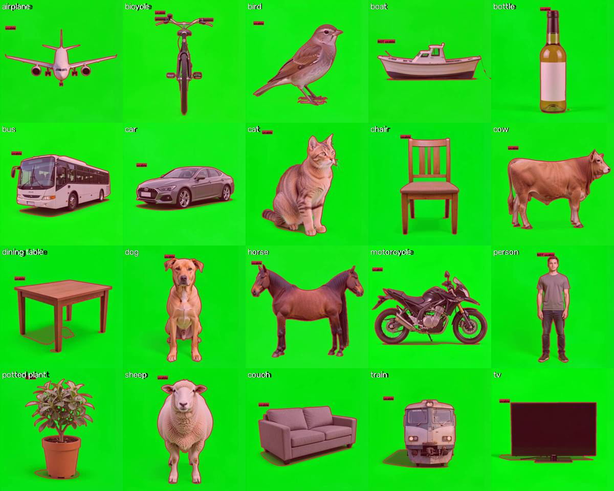

白(`results/samples/q1/white/{クラス}.jpg`):

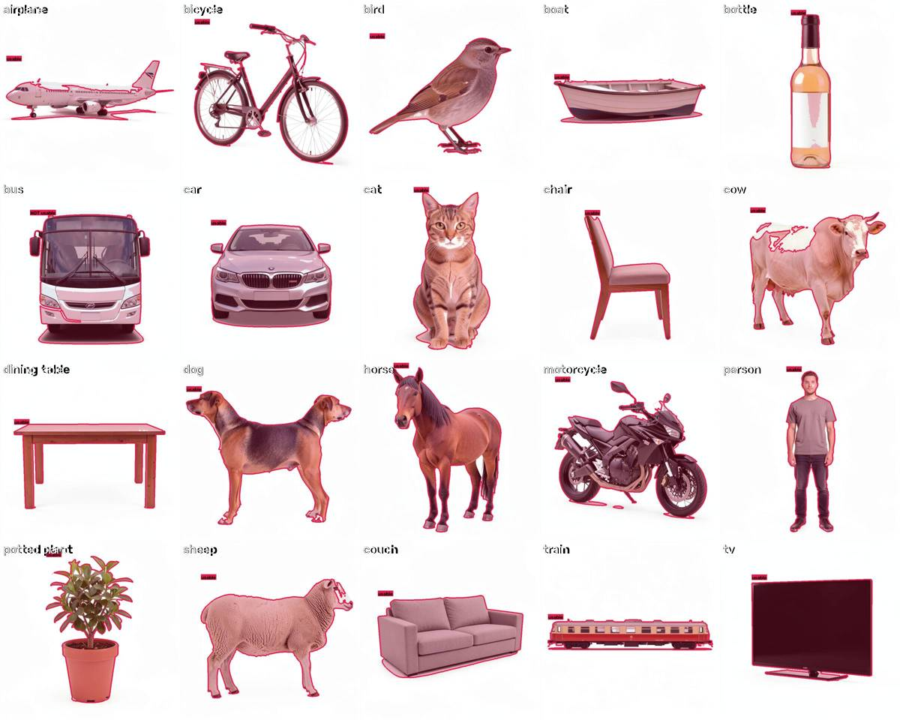

### Q1b: 影をマスクに入れないようにできるか(`q1b_shadow.py`)

グリーンバックで、抜き出しの規則(RGB の距離 / 緑の強さ)× プロンプト(今の文面 / 宙に浮かせ・地面をなくし・照明を平らにする文面)を比べた。

| プロンプト | 規則 | 使えると判定した割合 | 物体の面積の割合(中央値) |
|---|---|---|---|
| 今の文面 | RGB の距離 | 95% | 0.222 |
| 今の文面 | 緑の強さ | 97% | 0.209 |
| 宙に浮かせる文面 | RGB の距離 | 99% | 0.151 |
| 宙に浮かせる文面 | 緑の強さ | 98% | 0.144 |

- 見本を目で見た結果: **宙に浮かせる文面で、影の問題は解決できている**
- 決めたこと: 影を描かせない文面を使う。背景はクラスごとに使い分ける(基本はグリーンバック。緑になりやすいクラスは緑と離れた色)

今の文面(クラスごとの画像は `results/samples/q1b/prompt_current/{クラス}.jpg`):

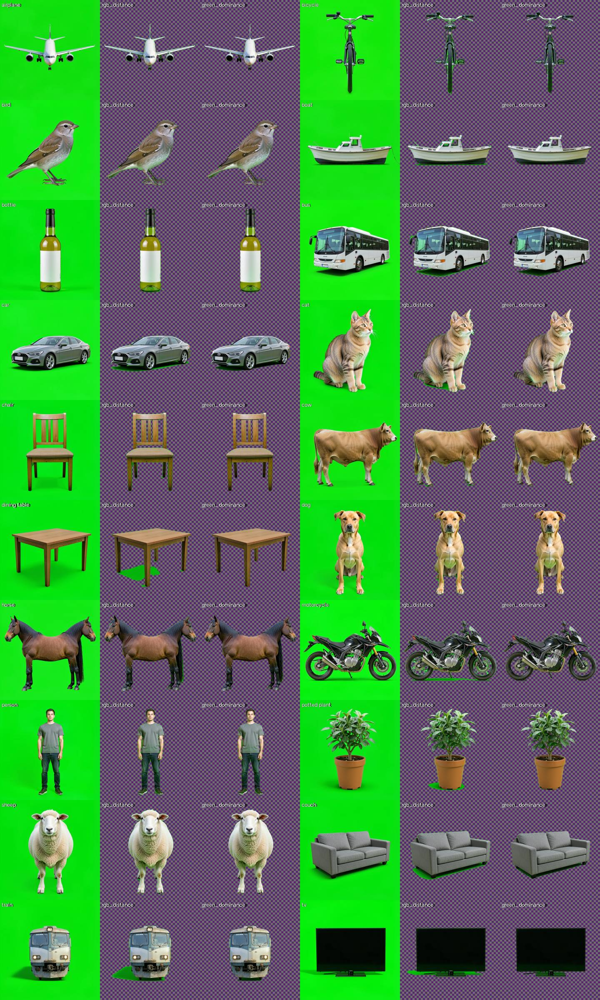

宙に浮かせる文面(`results/samples/q1b/prompt_no_shadow/{クラス}.jpg`):

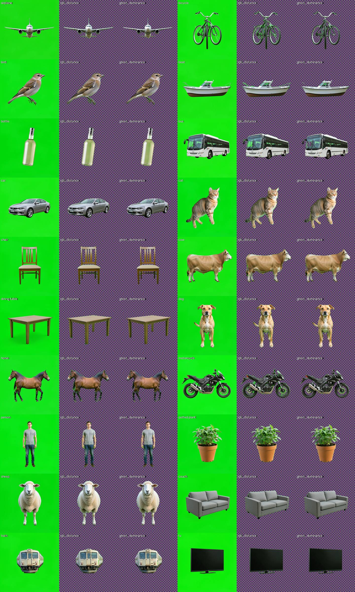

### Q1c: 多様な単一の物体を生成できるか(`q1c_diversity.py`)

20 クラス × 10 枚 × プロンプトの作り方 5 通り。どれも影を描かせない文面・クラスごとの背景の色(鉢植えだけマゼンタ)。
多様さの値は、規則で使えると判定した物体だけで、クラスごとに計算してクラスで平均した(認識モデルは使わない)。

| 作り方 | 中身 | 使える割合 | 色のばらつき(Lab の距離)↑ | 形の重なり(シルエットの IoU)↓ | 面積のばらつき ↑ | 縦横の比のばらつき ↑ |
|---|---|---|---|---|---|---|
| seed | 同じ文面のまま seed だけを変える | 96% | 19.3 | 0.640 | 0.168 | 0.311 |
| attribute | クラスごとの属性(種類・色・ポーズ)の一覧から組み合わせる | 95% | 53.8 | 0.576 | 0.171 | 0.334 |
| llm | ollama の LLM(qwen3.5:9b)にクラスごとの説明文を作らせる | 98% | **56.3** | 0.576 | **0.212** | **0.339** |
| llm_v2 | llm に、クラスの範囲(含めない物)と、物の種類に合った変える観点を渡す | 97.5% | 52.2 | 0.600 | 0.184 | 0.286 |
| llm_v3 | llm_v2 に加え、向き(動物・人はポーズ・動作も)をこちらで一覧から割り当てて守らせる | **98.5%** | 54.4 | **0.570** | 0.205 | 0.321 |

クラスごとの形の重なり(小さいほど多様): person は seed 0.57 / llm 0.59 / llm_v2 0.70 / **llm_v3 0.47**、horse は 0.51 / 0.48 / 0.55 / **0.41**。
dog・cat はどの作り方でもほぼ同じ(0.51〜0.57)。tv・car のような形の決まった物は、向きを変えてもシルエットが四角に近く、この値では差が小さい。

- **seed だけでは色がほとんど変わらない**(色のばらつきが他の 1/3)。属性・LLM でプロンプトを変えることが要る
- **llm(指示が素直なもの)は、クラスの外の物を書く**: bottle に「アルミのビール缶」、空想の「魔法の薬の瓶」、tv に「ゲーム用モニター風」が混じった。
  クラスの外の物は ① の中でも正解のクラスの誤りになるので、クラスの範囲(含めない物)を LLM に渡す(llm_v2)
- **LLM は、動物ではポーズ、無機物では様式・素材・時代と、物の種類に合わせて変える観点を選ぶ**。ただ、クラスの範囲を渡して文が細かくなると(llm_v2)、
  person がほぼ全部「まっすぐ立って正面」になり、形の多様さが落ちた。偏りやすい観点(向き・ポーズ)をこちらで割り当てる(llm_v3)と戻った
- 決めたこと: llm_v3 を使う(使える割合・形の多様さが一番よく、クラスの範囲も守る)。見本は `results/samples/q1c/{クラス}.jpg`(作り方 5 通り × 10 枚)
- **鉢植え(マゼンタの背景)だけ、影がマスクに入る画像が 4 割ほどあった**(見本を目で見て)。原因は、マゼンタの背景に RGB の距離の規則を使っていたこと
  (グリーンバックは緑の強さの規則なので影が抜けていた)。規則を「背景の色の強い色(緑 / 赤と青)が弱い色よりどれだけ強いか」に一般化した
  (lib_common/synthetic_data/chroma_key.py の dominance_key_mask。グリーンバックでは前の規則と画素単位で同じ)。鉢植えの 50 枚では、マスクの面積が 1〜2 ポイント
  小さくなり(影の分)、規則で使える数は多くの作り方で増えた(seed 6 → 9、llm 8 → 10、llm_v3 は 10 → 9)。
  見比べは `results/samples/q1c/potted_plant_magenta_rule_check.jpg`([元の画像 | RGB の距離 | マゼンタ用の規則])。上の表の値は、直す前の規則で計算したもの

見本の例(作り方 5 通り × 10 枚。ほかのクラスは `results/samples/q1c/{クラス}.jpg`)。person(形の重なりの差が大きかったクラス):

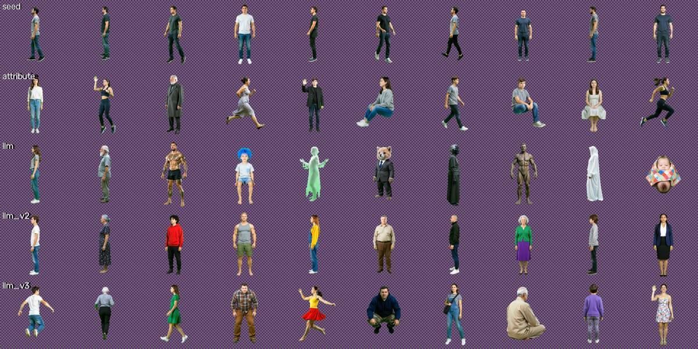

horse:

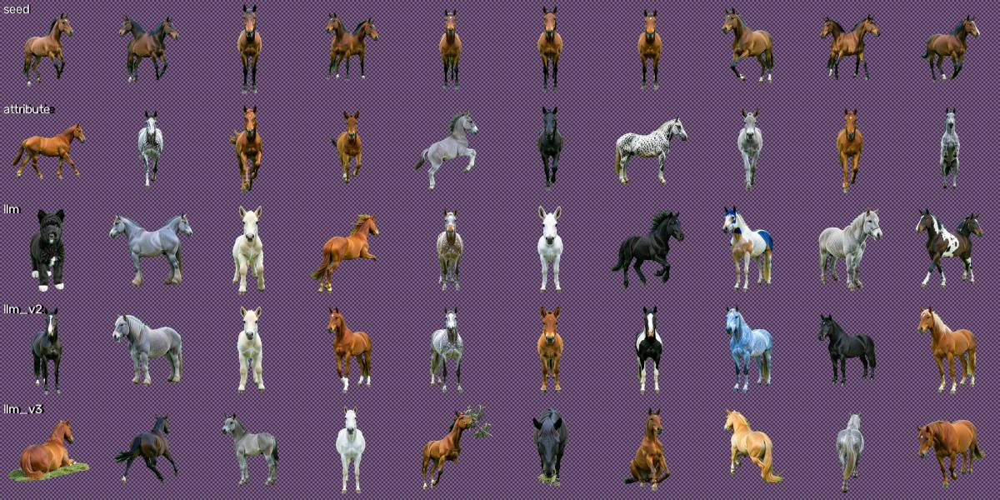

鉢植えの規則の見比べ([元の画像 | RGB の距離 | マゼンタ用の規則]):

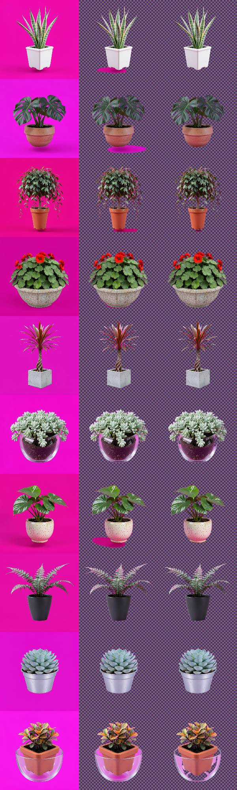

### Q2・Q3: 合成と、背景の作り方(`q2_compose.py`)

Q1c の llm_v3 の物体(直した規則で抜き出し直し、規則で使えると判定したもの)を、場所(公園・リビングなど)ごとに、その場所にいそうなクラスから
1〜4 個置いた 40 場面。背景は (paste) 場所だけを生成して貼る、(inpaint) paste の画像の物体以外を inpainting で描き直し、物体の画素を戻す、の 2 通り。
正解のマスクはどちらも同じ(貼った形。重なりは後から貼った物体が上)。

| 項目 | 値 |
|---|---|
| 1 場面あたりの物体の数(平均) | 1.8 個(ほとんど隠れた物体は外す) |
| 1 場面を作る時間 | 背景の生成 0.53 秒 + 合成 0.01 秒 + inpainting 1.0 秒 |
| inpainting が、戻す前に物体の画素を変えた量(0〜255 の値の差の平均) | 7.8(自転車・飛行機・船など細い物体で 17〜22) |
| GPU のメモリ(生成中の最大) | 10.0GB |

- **VRAM があふれた原因**: diffusers の `from_pipe` で inpainting のパイプラインを作ると、型を指定しないと共有している重みを float32 に変えてしまい、
  本体が約 8GB → 約 16GB になっていた(元のパイプラインの重みも float32 になる)。型を明示して直した。あわせて、プロンプトの文章の特徴を先にまとめて計算し、
  文章を読む部分(約 8GB)を CPU に退かせた([lib_common/synthetic_data/flux2_klein.py](../../../lib_common/synthetic_data/flux2_klein.py))
- 見本は `results/samples/q2/{番号}_{paste,inpaint_full_empty,inpaint_full_noclass}{,_gt}.jpg`(_gt は正解のマスクを重ねたもの。
  inpaint_full_empty は「場所だけ + 何もいない」、inpaint_full_noclass は「場所だけ + 全クラスを名前で否定」の文面)

場面 0000 の例(上: 画像、下: 正解のマスクを重ねたもの):

| paste | inpaint_full_empty | inpaint_full_noclass |
|---|---|---|
| 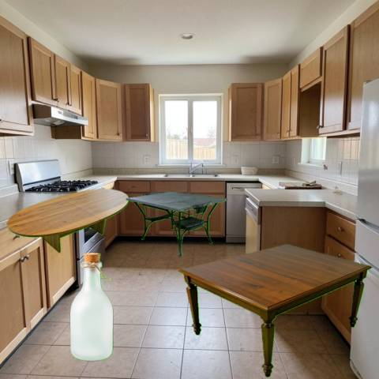 | 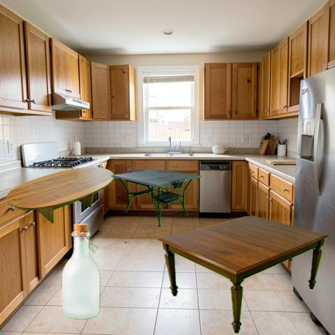 | 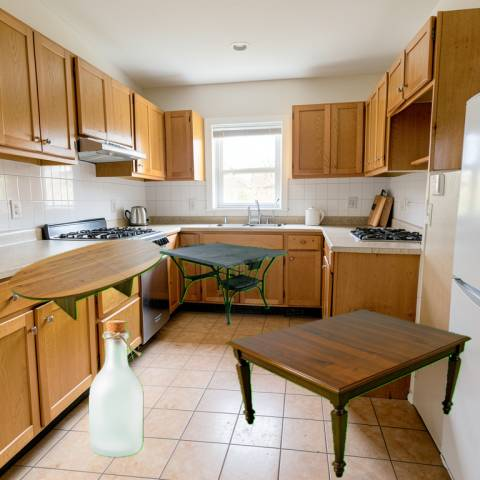 |
| 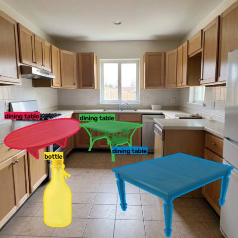 | 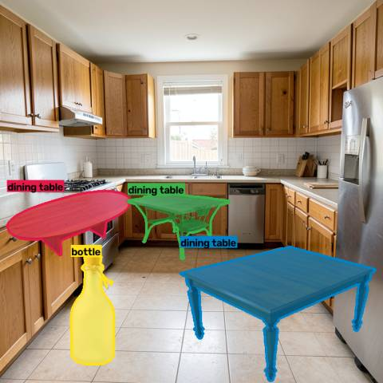 | 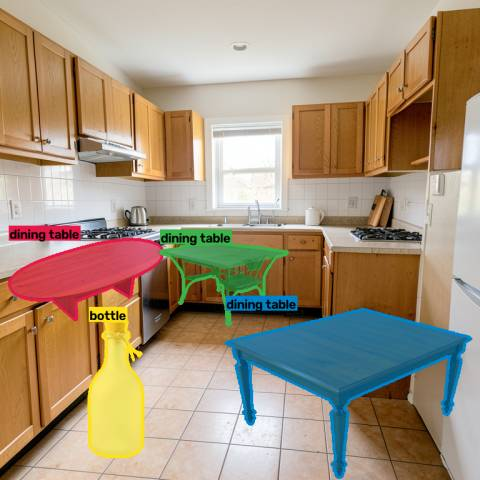 |

場面 0001:

| paste | inpaint_full_empty | inpaint_full_noclass |
|---|---|---|
| 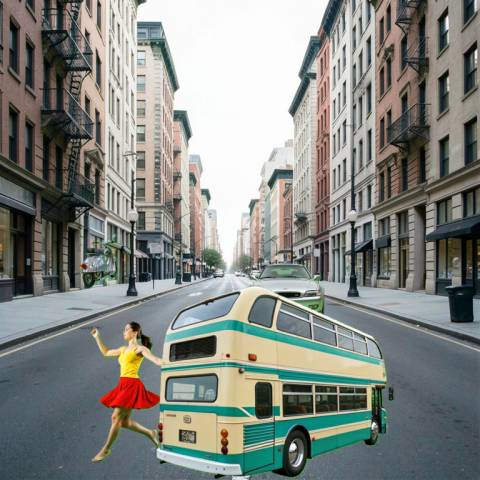 | 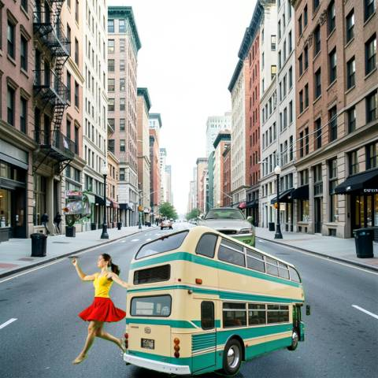 | 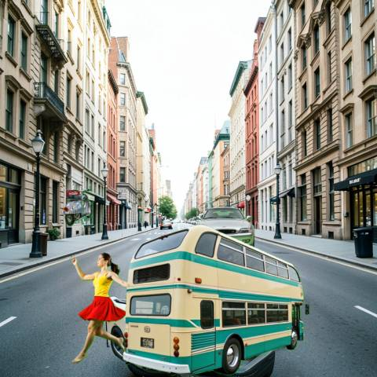 |
| 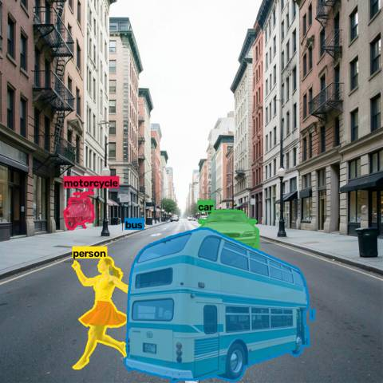 | 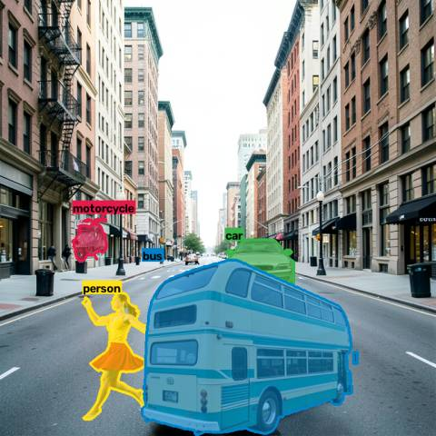 | 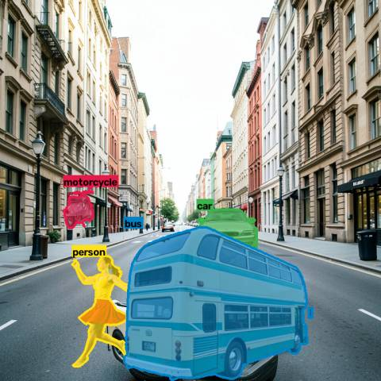 |

## 設定

- 画像の生成: FLUX.2 [klein] 4B(fp8 の本体を bf16 に戻したもの、[lib_common/synthetic_data/flux2_klein.py](../../../lib_common/synthetic_data/flux2_klein.py))、4 step
- クラス: VOC の 20 クラス。プロンプトは固定の文面の組み合わせ([lib_common/synthetic_data/prompts.py](../../../lib_common/synthetic_data/prompts.py)。LLM で多様にするのは exp00209)
