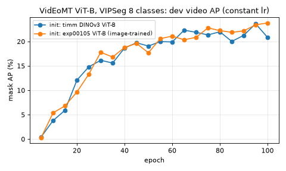

# exp00502: 動画インスタンスセグメンテーションの方式の比べ

## 対象にする方式

- **扱う**: 動画のセグメンテーションのモデル。各フレームのインスタンスセグメンテーション(物体を見つけてマスクとクラスを付けること)と、
  フレーム間の物体の対応付け(MOT の仕組み: 動画全体での物体の ID の管理・識別。隠れた後に再び出た物体は同じ ID、新しく出た物体は
  新しい ID)を 1 つのモデルの中に持ち、動画のデータで学習する方式
- **扱わない**: 画像のセグメンテーションのモデル + 別の追跡の手法(MOT)の 2 段の構成。これはトップの [mot/](../../../mot/) で扱う
- 例外(比べる基準として入れる):
  - MinVIS(画像のインスタンスセグメンテーション + 隣のフレームのクエリの照合。追跡を学習しない): 「追跡を学習する効果」を測る基準
  - 画像のモデル単体(フレームを独立に扱う。動画の AP は出せない): フレームごとの画像 AP の基準(動画のモデルとして有効かの判別用)

扱う動画のモデルと基準を、MOT の仕組みの形で分けると次の通り。動画の AP は動画全体の物体ごとに予測と正解を照らすので、予測の側にも
動画全体の ID が要る。MOT の仕組みを持たない画像のモデル単体は、動画の AP を出せない(フレームごとの画像 AP だけ)。

| | MOT の仕組みを持たない | MOT の仕組みを持つ: 学習して身に付ける形 | MOT の仕組みを持つ: 推論の規則・照合の形 |
|---|---|---|---|
| **動画のモデル**(この exp の対象) | — | VidEoMT(クエリを次のフレームに渡し、クエリの番号 = ID。学習の正解の割り当てで、物体は最初に写ったフレームのクエリにずっと割り当て、隠れているフレームもそのクエリのクラスの正解をその物体にし、物体を持つクエリは後から出た物体に使わない。これで再出現は同じクエリ・新しい物体は空いたクエリを学習する。推論には規則はなく、学習した振る舞いだけ。クエリを空きに戻す仕組みはなく、動画 1 本で区別できる物体はクエリの数(200)まで。学習の区間(5 フレーム)より長い隠れは学習に出てこない)。TrackFormer・MOTR も同じ形 | DVIS・DVIS++(公式のコードで確認: 固定した画像のモデルのクエリを隣のフレームと cos で照合して前のフレームの枠に並べ、学習する追跡の部が前のフレームの物体の情報を問いにして今のフレームの全部のクエリから同じ物体を探し直す。枠 = ID、物体の数はクエリの数まで。学習は VidEoMT と同じ割り当て(隠れても同じ枠が持ち続ける)。DVIS++ は学習中にわざと照合を乱して、追跡の部に直させる)、CTVIS(公式のコードで確認: 隣のフレームとの照合だけで、照合の埋め込みを、過去の埋め込みの記憶を正例にした対照学習で学ぶ)、DVIS-DAQ(公式のコードで確認: 追跡のクエリ + 新しい物体を探すクエリ 100 個。点数 0.01 を超えた新しいクエリを新しい ID として足し、点数の低いフレームが 8 フレーム続いた ID を終える。8 フレームまでの隠れは同じ ID に戻る。物体の数の上限なし)、IDOL・VISAGE(記憶のバンクとの照合)、LOMM(新しい物体と続く物体を分けて ID を付ける)、SAM 2・SAM 3 型(物体ごとの記憶で伝搬し、検出と照らして新しい物体を足し・照合のない物体を除く)、DEVA(公式のコードで確認: 全部の物体を 1 つの記憶で伝搬し、記憶の中の物体の番号 = ID。5 フレームごとに、先の 3 フレームの画像のモデルの結果を最初のフレームへ運んで投票で固め、伝搬したマスクと IoU > 0.5 なら同じ ID、合わない検出は新しい ID。検出と合わない回が 5 回を超えた ID を除く(6 回目の照合 = 約 30 フレーム)。それより短い隠れは記憶に残るので伝搬で同じ ID に戻れる。除いた後の再出現は新しい ID。物体の数の上限なし)。CAVIS(公式のコードで確認: DVIS と同じ形。固定した画像のモデルのクエリを直前のフレームと cos で照合して枠に並べ、追跡の部が前のフレームの物体の情報 + 周りの文脈を問いにして同じ物体を探し直す。再出現で同じ枠に戻る・新しい物体が空いた枠に入るのは、どちらも規則ではなく学習した振る舞いだけ(学習の割り当てが VidEoMT と同じ)。照合の基準は直前のフレームだけで記憶はなく、隠れている間に基準が物体のないクエリに置き換わるので、戻れるかは追跡の部の状態しだい。学習の区間は 5 フレームで、それより長い隠れは学習に出てこない。消えた物体の枠を新しい物体が取るのを防ぐ規則・ID を終える仕組みはない。物体の数はクエリの数まで) |
| **画像のモデル**(基準だけ) | 画像のモデル単体(これまでの画像の段階(exp001xx)のインスタンスセグメンテーションのモデル。フレームを独立に扱う。フレームごとの画像 AP の基準) | — | MinVIS(画像のモデル + 隣のフレームのクエリの埋め込みの照合。クエリの枠 = ID。追跡を学習する効果の基準)。画像のモデル + 別の MOT の手法の 2 段は扱わない([mot/](../../../mot/)) |

- 画像のモデルの行は、同じ評価で並べる基準にする(比べる対象は動画のモデルの行)
- ID の管理の誤り(再出現を別の ID にする、別の物体を同じ ID にまとめる)は、動画の AP を下げる(正解の物体が 2 つの予測に割れる・
  1 つの予測に 2 つの物体が混ざると、動画を通した IoU が下がる)。同じ予測をフレームごとに評価する画像 AP との差と、AssA・ID の
  入れ替わりの数(exp00501 の追跡の診断の指標)、長い動画・隠れの多い動画で、ID の管理の良し悪しを分けて見る
- **マスクを与えて追う方式(SAM 2・Cutie・XMem など)も扱う**: 基準のフレームで画像のインスタンスセグメンテーションをかけ、その出力の
  マスクを伝搬の入力にすれば、物体を全部見つけるタスクにそのまま使える(新しく出る物体は、間隔をおいた画像のインスタンスセグメンテーションで
  見つけて、伝搬している物体と照らして足す)。この組み立ては DEVA(画像のセグメンテーション + クラスによらない伝搬)・SAM 3 と同じ。
  オープンボキャブラリーの方式も、クラスの決め方以外(物体の見つけ方・伝搬・照合)は決まったクラスにそのまま流用する

## 目的

動画のセグメンテーションのデータで、動画のセグメンテーションのモデルをスクラッチで学習し、方式(特にフレーム間の情報のやり取りの
仕組み)ごとの精度・速さを同じ条件で比べる(画像の段階の exp00101 と同じ進め方)。

タスクは**動画インスタンスセグメンテーション**: 各フレームで物体を全部見つけてクラスとマスクを付け、同じ物体には動画を通して同じ
ID を付ける。クラスはデータセットのクラスをそのまま使う。

分類の軸(決まったクラスを主にする・フレーム間の情報をモデルの中でやり取りする方式を対象にする・online を主にするなど)、データセット、
評価の指標は [exp00501](../exp00501_video_eval_and_baselines/README.md)。

## 方式の調査(決まったクラス)

追跡の仕組み(軸 2 の (a) の中の分け方)ごとにまとめる。数値は各論文の自己申告の値で、条件(backbone・学習データ)が違うので直接は比べられない。

列の意味:
- **追跡を持つか**: 隣り合うフレームの間で、同じ物体どうしを対応付けて同じ ID を付ける仕組みを、方式の中に持つか
- **対応付けのやり方**: 何を手がかりに、どこで対応付けるか
- **学習するか**: 対応付けそのものを学習で身に付けるか(学習しない = 手で決めた規則・近さの計算だけ)
- **ID の決め方**: 前のフレームの物体の ID をどう引き継ぎ、新しく出た物体・消えた物体をどう扱うか

| 分け方 | 方式 | online / offline | 追跡を持つか | 対応付けのやり方 | 学習するか | ID の決め方 | 中身 |
|---|---|---|---|---|---|---|---|
| A. 画像のインスタンスセグメンテーション + 学習しない対応付け | MinVIS(NeurIPS 2022) | online | 持つ | 隣のフレームどうしで、物体のクエリの埋め込みの近さが最大になる組を選ぶ(ハンガリアン法) | しない(画像のインスタンスセグメンテーションの学習だけ) | 選んだ組で前のフレームの ID を引き継ぐ。クエリの数は決まっていて、クエリの枠 = ID | 動画の正解なしで学習できる |
| B. 画像のインスタンスセグメンテーション + 学習する追跡の部(分けた作り) | DVIS(ICCV 2023) | online(+ offline の仕上げ) | 持つ | まず MinVIS と同じく、隣のフレームのインスタンスセグメンテーションのクエリをハンガリアン法で組にし、それを初期値にする。追跡の部(referring tracker)が、前のフレームの物体のクエリを手がかりにした注意で、それを直す(論文では、最初の組み合わせを省いても少し下がるだけ) | 追跡の部は学習する | クエリの並びの番号 = ID。新しく出る・消える物体は特に扱わない(論文の限界の節で、今後の課題としている) | インスタンスセグメンテーションと追跡を分けて学習する |
| | DVIS++(TPAMI 2025) | 同上 | 持つ | DVIS と同じ | する(ノイズを入れた学習・対照学習を足す) | DVIS と同じ | |
| | DVIS-DAQ(ECCV 2024) | 同上 | 持つ | DVIS と同じ | する | 物体が新しく出る・消えるのに合わせて、クエリ(dynamic anchor queries)を足し引きする | |
| | CAVIS(ICCV 2025) | 同上 | 持つ | 物体の周りの文脈の特徴を足した注意で、前のフレームの物体と対応付ける | する | 前のフレームの物体の並びにそろえる(ハンガリアン法で並びを合わせる) | |
| | LOMM(ICCV 2025) | (論文で確認) | 持つ | 最新の物体の記憶(Latest Object Memory)と照らす | する | 新しく出た物体と続く物体を分けて ID を付ける(Decoupled Object Association) | |
| C. 対応付けの埋め込みの対照学習 + 記憶のバンク | IDOL(ECCV 2022)・CTVIS(ICCV 2023)・VISAGE(ECCV 2024) | online | 持つ | 今のフレームの物体の埋め込みと、過去の物体の記憶のバンクの埋め込みの近さで照合する | 埋め込みは学習する(対照学習)。照合の規則は(論文で確認) | 照合できた物体は ID を引き継ぎ、できない物体は新しい ID(閾値・記憶から消す規則は論文で確認) | VISAGE は見た目の特徴を足す |
| D. クエリをモデルの中で次のフレームに渡す | VidEoMT(2026) | online | 持つ | 前のフレームの物体のクエリを、ViT の最後の数層の入力にそのまま使う(モデルの中で引き継ぐ。別の照合はない) | する | クエリの番号 = ID。新しい物体は、別に持つ学習するクエリから出る | ViT の encoder だけでインスタンスセグメンテーションをする EoMT の動画版。追跡の部を別に持たない |
| | InsPro(2023)・GenVIS(CVPR 2023) | online / 区間ごと | 持つ | 物体のクエリと候補を次のフレーム(区間)に渡す | する | クエリの番号 = ID | |
| E. 過去の状態・記憶を使う | AUSM(CVPR 2026) | online | 持つ | 過去のフレームを Mamba(状態空間のモデル)と空間の注意で 1 つの状態に圧縮し、その状態から各物体の今のマスクを出す | する | 物体ごとの ID のベクトルを持ち回る。新しい物体は点数 0.5 以上の検出から足す | VIS・VOS を 1 つのモデルで扱う |
| | SAM 2 / SAM 3 / SAM 3.1 | online | 持つ | 物体ごとに、過去のフレームの特徴と物体の要約を記憶し、記憶との注意で今のフレームのマスクを出す(マスクの伝搬) | 伝搬は学習する。SAM 3 の検出と伝搬の照合は規則 | 伝搬する物体は ID が固定。SAM 3 は各フレームの検出と伝搬したマスクを照らし合わせて、新しい物体を足し、消えた物体を除く | SAM 3 はオープンボキャブラリーだが、この仕組みは決まったクラスでも使える |
| | SAM2BMP(2026)・EntitySAM(CVPR 2025) | (論文で確認) | 持つ | SAM 2 のマスクの伝搬で対応付ける | (論文で確認) | (論文で確認) | |
| | XMem(ECCV 2022)・Cutie(CVPR 2024) | online | 持つ | 与えたマスクの物体を、過去のフレームの特徴の記憶との注意で伝搬する(Cutie は物体ごとの記憶(object memory)も読む) | 伝搬は学習する(論文は DAVIS・YouTube-VOS・MOSE。ここでは VIPSeg の物体のマスクと ID で学習する) | 与えたマスクの物体の ID が固定 | Cutie は MOSE で XMem より J&F 8.7 高く、走る時間は同じくらい(論文)。基準のフレームのマスクを画像のインスタンスセグメンテーションで作れば、物体を全部見つけるタスクに使える |
| | DEVA(ICCV 2023) | online(先の数フレームも少し見る) | 持つ | 画像のセグメンテーションの結果(タスクごと)を、クラスによらない伝搬(XMem 系)で次のフレームに運び、数フレームごとに画像のセグメンテーションの結果と照らして、新しい物体を足す・ずれを直す | 伝搬だけを 1 回学習し、画像のモデルはタスクごとにそのまま使う | 伝搬している物体の ID を引き継ぐ。照らして合わない物体は新しい ID | VIPSeg で VPQ 55.0・STQ 52.2(Mask2Former Swin-B)。画像の段階のモデルをそのまま使える |
| F. 区間・動画の全体をまとめて見る | VITA(NeurIPS 2022)・Mask2Former-VIS・SeqFormer | offline | 区間の中は持たない(要らない) | 区間の全フレームを一度に入れ、1 つのクエリが区間の全フレームの同じ物体を表す | — | 区間の中はクエリの番号 = ID。区間より長い動画では、区間どうしを照合する仕組みが別に要る | |
| G. 古典 | MaskTrack R-CNN(2019) | online | 持つ | 追跡の head の埋め込みの近さで照合する(ほかの手がかりの足し方は論文で確認) | head は学習する | 照合できない物体は新しい ID | |
| | CrossVIS(2021) | online | 持つ | 前のフレームの物体の特徴で今のフレームのマスクを作る学習(照合のやり方は論文で確認) | する | (論文で確認) | |
| 汎用(複数のタスク) | UniVS(CVPR 2024)・TarViS(CVPR 2023) | (論文で確認) | 持つ | 前のフレームの物体をプロンプト(クエリ)として次のフレームに渡す | する | (論文で確認) | VIS・VPS・VOS を 1 つのモデルで |

大きい backbone での比べ(VidEoMT の論文の表。ViT-L は DINOv2 の事前学習。FPS は同じ GPU での値):

| 方式 | backbone | YTVIS21 AP | OVIS AP | VIPSeg VPQ | FPS(YTVIS21 / VIPSeg) |
|---|---|---|---|---|---|
| MinVIS | Swin-L | 55.3 | 39.4 | — | 30 / — |
| DVIS | Swin-L | 58.7 | 45.9 | 54.7 | 24 / 20 |
| DVIS++ | ViT-L | 62.3 | 49.6 | 56.0 | 17 / 13 |
| DVIS-DAQ | ViT-L | 62.4 | 54.3 | 57.4 | 10 / 4 |
| CAVIS | ViT-L | 64.6 | 53.2 | 56.9 | 15 / 10 |
| VidEoMT | ViT-L | 63.1 | 52.5 | 55.2 | 160 / 75 |

- 精度の最良は追跡の部を分けた作り(B: CAVIS・DVIS-DAQ)。VidEoMT(D)は精度が 1〜2 低い代わりに、10 倍前後速い
- AUSM(E)は Swin-B で YTVIS21 58.6・OVIS 45.5(論文の値)。分けた作りの専用の方式(DVIS など)よりは低い
- R50 での値(CAVIS の論文の表、YTVIS21 / OVIS): MaskTrack R-CNN 28.6 / 10.8、MinVIS 44.2 / 25.0、VITA(offline)45.7 / 19.6、
  DVIS 46.4 / 30.2、CTVIS 50.1 / 35.5、VISAGE 51.6 / 36.2、CAVIS 50.5 / 37.6
- 軽量・実時間の方式: InsPro(軽い版で YTVIS19 38.7・45.7 FPS)、RT-VIS(YTVIS19 42.2・22.6 FPS)、EfficientVIS(区間ごと、36 FPS)

## 方式の調査(オープンボキャブラリー、参考)

| 方式 | 作り | 追跡を持つか・やり方 | LV-VIS | 備考 |
|---|---|---|---|---|
| OV2Seg(2023) | LV-VIS の基準。Mask2Former + CLIP の文章の埋め込みでクラスを決める | 持つ(クエリで追跡。細かい規則は論文で確認) | — | LV-VIS の論文 |
| OVFormer(ECCV 2024) | クエリと CLIP の埋め込みを合わせる学習 | (論文で確認) | 21.9(R50)| OVFormer+ で 25.0 |
| BriVIS(2024) | 固定した VIS のモデルのクエリ + CLIP の特徴で、物体を時間方向の文章のように扱う | 持つ(固定した VIS のモデルの追跡を使う) | 27.7 | |
| TROY-VIS(WACV 2025) | 実時間のオープンボキャブラリー VIS | (論文で確認) | — | GLEE-Lite より 20 倍速い(25 FPS) |
| SegFS(2026) | 重いモデルは間引いたフレームだけ、間のフレームは軽い枝で物体の埋め込みからマスクを作る | 持つ(間引いたフレームの物体の埋め込みを MinVIS と同じ照合でつなぎ、間のフレームはその埋め込みを使い回す) | 15.2〜18.3 | 携帯の NPU で 23〜38 FPS |
| SAM 3 / SAM 3.1 | 上の表 | 持つ(上の表) | test 36.3 / 34.3 | |

## 候補

追跡の仕組みの A〜G から、それぞれ代表を選ぶ。どれもスクラッチで実装する。DVIS++・DVIS-DAQ・CAVIS などの部品(ノイズを入れた学習・
動的なクエリ・文脈の特徴)は、exp00503 で上位の方式に足して効き方を見る。

1 本の学習の時間が長いので、全部はやらずに優先度の順に進める。優先度は、(1) 有望さ(論文の精度・速さ)、(2) 今後ほかの exp で
使い回せるか(軽い構成・エッジ・オープンボキャブラリー・mot/ への流用)、(3) 学習の時間(ほかの候補と学習を分け合えるか)で決める。

| 優先度 | 候補 | 仕組み | 追跡(隣のフレームの物体の対応付け) | 実装の土台 | 優先度の理由 |
|---|---|---|---|---|---|
| 1 | VidEoMT | D | 持つ。クエリをモデルの中で引き継ぐ(学習する) | 画像の段階の自作の EoMT + クエリを次のフレームに渡す | 最上位(CAVIS・DVIS-DAQ)との差が 1〜2 で 10 倍前後速い(論文の値)。追跡の部を別に持たず作りが単純なので、軽い構成・書き出し・ブラウザに持っていきやすい。EoMT は画像の段階で実装済み |
| 1 | MinVIS | A | 持つ。クエリの近さの照合(学習しない) | 自作の Mask2Former をフレームの画像で学習 + 隣のフレームのクエリの照合 | 追跡を学習する効果を測る基準。インスタンスセグメンテーションのモデルは DVIS と共通にでき、追跡のために追加の学習が要らない(学習の時間がほぼ増えない) |
| 1 | DVIS | B | 持つ。学習する追跡の部 | MinVIS と同じインスタンスセグメンテーションのモデル + 追跡の部(referring tracker) | 精度の最上位の系統(DVIS++・DVIS-DAQ・CAVIS)の土台。追跡の部はどのインスタンスセグメンテーションのモデルにも付けられるので、GTR 系や軽いモデルにも流用できる。インスタンスセグメンテーションのモデルは MinVIS と共通で、追跡の部だけを学習する |
| 2 | 自作の GTR 系の動画版 | D・B | 持つ。クエリを次のフレームに引き継ぐ(+ 追跡の部) | 画像の段階の GTR 系(exp00103 の A)に、クエリを次のフレームに渡す仕組み(と追跡の部)を足す | 画像の段階で最良だった方式と軽い構成(exp00104・exp00105)をそのまま使える。優先度 1 の結果(D と B のどちらが効くか)を見て作りを決める |
| 2 | SAM 2・SAM 3 の記憶の追跡 | E | 持つ。記憶との注意でマスクを伝搬 + 検出との照合 | 基準のフレームで画像のインスタンスセグメンテーション(画像の段階のモデル)→ その出力のマスクを SAM 2 の記憶の注意(過去のフレームの特徴・物体の要約)で伝搬 → 間隔をおいた検出と伝搬した物体を照らして、新しい物体を足し・消えた物体を除く(SAM 3 の照合) | 隠れ・長い動画に強い作り。SAM 3 の仕組みはオープンボキャブラリー・mot/ にも流用できる。伝搬の部は VIPSeg で学習し、伝搬だけの出来も VIPSeg の val で J&F として測れる。記憶の分だけ重い |
| 2 | DEVA 型(画像のセグメンテーション + クラスによらない伝搬) | E | 持つ。伝搬 + 数フレームごとの画像のセグメンテーションとの照合 | 画像の段階のモデル(GTR 系など)をそのまま使い、伝搬の部(XMem・Cutie 系)だけを VIPSeg で学習する | 画像のモデルの学習が要らず、伝搬の部は 1 回の学習で使い回せる。VIPSeg の値(VPQ 55.0、Swin-B)は DVIS(54.7、Swin-L)と同じくらい(論文の値)。SAM 2 型と伝搬の部を共有できる |
| 3 | CTVIS | C | 持つ。学習した埋め込み + 記憶のバンクとの照合 | 同じインスタンスセグメンテーションのモデル + 対照学習の埋め込みと記憶のバンク | 対照学習は DVIS++ にも入っている部品なので、単独の方式としてより、exp00503 で優先度 1 の方式に足して見る方が学習が少なくて済む |
| 3 | AUSM | E | 持つ。圧縮した過去の状態 + ID のベクトル(学習する) | 過去の状態の圧縮(Mamba + 空間の注意) | 新しい(CVPR 2026)が、論文の値は B の専用の方式より低い。作りが複雑(Mamba)。公式のコードが公開されていない(2026-11 時点)ので、規則を確かめて実装することができず保留 |
| 4 | MaskTrack R-CNN | G | 持つ。追跡の head の埋め込みの照合 | 画像の段階の自作の Mask R-CNN + 対応付けの head | 古典の基準。論文の値が大きく低い(R50 で YTVIS21 28.6) |
| 4 | VITA | F | 区間の中は持たない(1 つのクエリが区間の全フレームの物体を表す)。区間どうしの照合は別に要る | offline の参考 | online を主にするので参考だけ |

進め方: 優先度 1 の 3 つ(VidEoMT・MinVIS・DVIS)を先に実装して比べ、その結果を見て優先度 2 以降を足すかを決める。MinVIS と DVIS は
インスタンスセグメンテーションのモデルの学習を 1 回で共有するので、優先度 1 の学習は実質 2 本 + 追跡の部の学習 1 本になる。

### 基準: 画像のモデルをフレーム独立に学習する

動画のモデルとしての優位性を見るために、同じ VIPSeg のデータで画像のインスタンスセグメンテーションのモデルを、フレームを独立の
画像として学習し、同じ評価で並べて基準にする。

- データ: `vipseg_frames_cls8_train`(`vipseg_vis_cls8_train` の全部のフレーム 48,234 枚を 1 枚ずつの画像にしたもの)
- 学習の量: 動画のモデル(VidEoMT の 100 エポック = 約 105 万フレーム)と同じ規模にする(全部のフレームを 22 回)。学習率は
  warmup の後は下げない。2 エポックごとに、dev のフレーム(`vipseg_frames_cls8_dev`)の全部で最良の重みを選び、val のフレーム
  (`vipseg_frames_cls8_val`)の全部でも評価して記録する
- 評価: val の全部のフレームを独立の画像として評価する、フレームごとの mask AP で、動画のモデルと並べる。動画のモデル(VidEoMT
  など)の予測も、フレームごとに同じ評価にかける(その部分を足す)

規模は動画のモデルに近いものにする(パラメータは全体の数。backbone より後ろは encoder・decoder・head):

| モデル | backbone | 全体 | backbone より後ろ | 状態 |
|---|---|---|---|---|
| (動画)VidEoMT | ViT-B/16(DINOv3) | 92.9M | 7.3M | 学習済み |
| GTR 系 G1(exp00104 の後段: dim 192・FFN 512) | ViT-B/16(DINOv3。adapter で 3 段) | 94.4M | 6.8M | 予定 |
| GTR 系 G0(exp00105 の精度重視の型の後段) | ViT-B/16(DINOv3。adapter で 3 段) | 99.8M | 12.2M | 予定 |
| GTR 系 G0 | ConvNeXt-B(DINOv3) | 99.6M | 12.1M | 予定 |
| Mask2Former(MinVIS・DVIS の土台) | ViT-B/16(DINOv3。adapter で 4 段) | 108.5M | 20.3M | 学習中 |
| Mask2Former | ConvNeXt-B(DINOv3) | 107.6M | 20.0M | 学習中 |

## 共通の条件(案)

- 学習: VIPSeg の画像の段階と同じ 8 クラス(`vipseg_vis_cls8_train`)。COCO などの画像のデータは学習に使わない(初期値の重みを除く)
- 評価: 学習の途中は `vipseg_vis_cls8_dev`(最良の重みの選択)、最後は `vipseg_vis_cls8_val`(公式の val。test の役)の動画の AP
  (YouTube-VIS と同じ計算: 物体のマスクの IoU を全フレームを通して計算する)
- backbone: 全部同じ(R50 から)。VidEoMT(ViT が必要)は timm の DINOv3 の ViT の学習済みの重みをそのまま初期値にする
  (VidEoMT の論文の表 8 で最良の事前学習。動画の自己教師ありの学習は exp00106 で、この比べの後に別の比べとして行う)
- VidEoMT の公式の学習は 2 段階: 段階 1 で画像のセグメンテーションだけを学習し(COCO のインスタンスセグメンテーションと、
  対象の動画のデータのフレーム)、段階 2 でフレーム間のクエリの受け渡しを足して動画で学習し直す。今の実装(`lib_common/video_train.py`)は
  段階 2 だけ
- 学習の区間のフレームの数・入力の大きさ・回数は、実装の後に決める

## 結果

### VidEoMT(ViT-B)・VIPSeg の 8 クラス・100 エポック・学習率を下げない(2 本)

> **この節の 2 本は、公式と違う実装で学習した結果(記録として残す)。** 公式(tue-mps/videomt)と比べて、次の 5 点が違った。
> 1. 正解の割り当て: 区間の全フレームのマスクをつないで 1 回だけ割り当てた(公式は、物体が最初に写ったフレームでだけ割り当て、
>    物体を持つクエリを後から出た物体に使わない)
> 2. 損失: クラスはフレームで平均した値にだけ、マスクは 5 フレームを縦につないだものにかけた(公式はフレームごと。隠れているフレームも
>    クラスの正解をその物体にする)。1・2 は、MOT の仕組み(再出現は同じクエリ・新しい物体は空いたクエリ)を学習させる部分
> 3. 区間の切り出し: 前後 10 フレームから飛び飛びに 5 枚(公式は連続した 5 枚)
> 4. norm_queries: なし(公式の VIPSeg・DINOv3 の設定はあり)
> 5. 動画ごとに残す予測: 30 個(val の 11 本は物体が 30 を超え、出し切れない)
>
> 直した実装で学習し直している(`*_officialmatch`)。結果が出たら、この節の後に別の節として書く。

学習の量が足りているか(精度が頭打ちになるか)を見るために、学習率を warmup の後は下げずに 100 エポック学習した。

- データ: VIPSeg の画像の段階と同じ 8 クラス(`vipseg_vis_cls8_*`。exp00501 の `make_sets_cls8.py`)。train 2,097 本、dev 200 本
  (公式の train から、各クラス 5 本以上になるように選んだ。学習の途中の評価と最良の重みの選択)、val 279 本(公式の val。test の役。
  最良の重みで最後に 1 回だけ評価)。どれも全部の動画・全部のフレームで評価する
- 1 エポック = 各動画から 5 フレームの区間を 1 つずつ(2,097 区間)。100 エポックで 26,200 step(batch 8 区間)
- ViT-B/16(DINOv3 の重みの形)、入力 512、micro-batch 1 × gradient accumulation steps 8、AdamW lr 1e-4・LLRD 0.6、warmup は公式と
  同じ 2 段(backbone 以外 500 step → backbone 1,000 step)、その後は一定。段階 1(画像のセグメンテーションの学習)はなし
- 2 本の違いは ViT の初期値だけ: A は timm の DINOv3 の重み、B は exp00105 で同じ 8 クラスの画像(`coco_train_cls8_2k`)で学習した
  GTR 系の ViT-B(`gtr_vitb_dinov3_cls8_2k_ep100`)の重み

| ViT の初期値 | dev の最良(エポック) | val AP | AP50 / AP75 | APs / APm / APl | AR1 / AR10 |
|---|---|---|---|---|---|
| A: timm の DINOv3 | 23.6(95) | 23.5 | 35.5 / 26.4 | 5.9 / 47.2 / 59.7 | 21.4 / 27.2 |
| B: exp00105 の画像で学習した ViT-B | 23.8(100) | 23.1 | 34.4 / 24.7 | 5.5 / 45.4 / 60.6 | 21.5 / 26.2 |

val のクラスごとの AP(A / B):

| person | bicycle | car | cat | dog | bottle_or_cup | chair_or_seat | screen_or_television |
|---|---|---|---|---|---|---|---|
| 24.0 / 25.1 | 24.3 / 23.5 | 11.0 / 9.7 | 54.1 / 51.2 | 54.6 / 57.5 | 2.6 / 1.9 | 3.1 / 2.7 | 14.0 / 13.0 |

dev の AP の推移(5 エポックごと):

- dev の AP は、A が 65 エポック以降 20.0〜23.6、B が 55 エポック以降 20.3〜23.8 で上下する。評価は毎回全部の動画・全部のフレームで
  同じ計算なので、上下は重みの違い(学習率を下げないので重みが動き続ける)と、dev の小ささ(本数の少ないクラスは 7 本)による
- A と B の val の差は 0.4 で、dev の上下(65〜100 エポックの標準偏差 約 1.1)より小さい。この 1 本ずつでは、画像で学習した ViT から
  始める効果は見えない
- クラスごとでは、bottle_or_cup・chair_or_seat が 2〜3、car が 10〜11 と低く、cat・dog は 51〜58
- 頭打ちかどうかを見るために、B の 100 エポック目の重みから同じ設定でさらに 100 エポック学習し、10 エポックごとに val でも評価している
  (`videomt_vitb_from00105_cls8_ep100_const_ft100`。optimizer の状態は引き継いでいない)

## 付録: backbone より後ろの作りの比べ

手元の自作の実装(`lib_common/models/gtr_seg.py`・`mask2former.py`・`videomt.py` と、それぞれの損失)で確かめた違い。GTR 系は
exp00105 の精度重視の型の後段(G0・hybrid encoder)。Mask2Former は MinVIS・DVIS の土台にする画像のモデル(pixel decoder は公式と
同じ deformable な注意の encoder)。DVIS の追跡の部はまだ実装していないので、論文で確かめていない値は書かない。

| 項目 | GTR 系(画像) | Mask2Former(画像。MinVIS・DVIS の土台) | VidEoMT(動画) | DVIS の追跡の部(動画。Mask2Former の上に足す) |
|---|---|---|---|---|
| 全体の作り | backbone → encoder → decoder → マスクの head | backbone → pixel decoder → transformer decoder → マスクの head | encoder-only: ViT の最後の 3 block にクエリを足し、backbone の中でクエリも処理する。backbone の後ろに encoder・decoder はない | フレームごとの Mask2Former の出力のクエリを受け取り、フレーム間で対応付ける部品を足す(Mask2Former は固定) |
| 使う特徴の段 | stride 8・16・32 の 3 段(ViT は adapter で作る) | stride 4・8・16・32 の 4 段(ViT は adapter で作る) | ViT の stride 16 の 1 段 | Mask2Former のクエリ(画像の特徴は Mask2Former の側) |
| encoder(多重解像度の特徴の融合) | hybrid encoder: stride 32 の段だけに自己注意(AIFI)、段どうしを畳み込みで混ぜる(CCFF) | pixel decoder: stride 8・16・32 に deformable な自己注意の encoder(6 層)、stride 4 は FPN で足す | なし | なし |
| **decoder** | 独立の 4 層: self-attention → 多重解像度の deformable cross-attention(段ごとに 3・6・3 点)→ Gate → FFN。denoising のクエリ(最大 100 個)も一緒に通す(学習だけ) | 独立の 9 層(3 段 × 3 回。粗い段から順): masked cross-attention(前の層のマスクの中だけに注意)→ self-attention → FFN | なし(ViT の最後の 3 block の self-attention で、クエリとパッチのトークンを同じ列に並べて注意する) | referring tracker: 前のフレームの追跡のクエリを参照にして、今のフレームのクエリを照らす cross-attention の層を重ねる(層の数は論文で確認) |
| クエリの作り方 | two-stage: encoder の全部の位置の上位 300 個。学習では 3 組(Group DETR) | 学習するクエリ 100 個 | 学習するクエリ 200 個。2 フレーム目からは前のフレームの出力のクエリ → Linear を足す | 前のフレームの追跡のクエリ |
| 枠(box) | 出す(4 辺までの距離の分布を層ごとに直す FDR、分布からクラスの値を補正する LQE) | 出さない(マスクだけ) | 出さない | 出さない |
| マスクの head | encoder の stride 8 の特徴を 1/4 に拡大し、層ごとのクエリとの内積 | クエリを MLP に通し、pixel decoder の stride 4 の特徴との内積 | クエリを MLP(3 層)に通し、パッチのトークンを転置畳み込み 2 回で 1/16 → 1/4 に拡大した特徴との内積 | Mask2Former と同じ head を、追跡したクエリで使う |
| クラスの head | 層ごとに Linear(sigmoid) | Linear(K + 物体なし。softmax) | Linear(K + 物体なし。softmax) | Mask2Former と同じ |
| 対応付け(学習の正解の割り当て) | ハンガリアン法: クラス(focal)2・枠 L1 1・GIoU 1・マスク BCE 5・Dice 5 | ハンガリアン法: クラス 2・マスク BCE 5・Dice 5(画像ごと) | ハンガリアン法: クラス 2・マスク BCE 5・Dice 5(区間の全フレームのマスクをまとめて 1 回) | 論文で確認 |
| 損失 | MAL 2、枠 L1 1・GIoU 1、FGL 0.15・DDF 1.5、マスク BCE 5・Dice 5 | クラスの交差エントロピー 2(物体なし 0.1)、マスク BCE 5・Dice 5(点を選んで計算) | Mask2Former と同じ | 論文で確認 |
| 補助の損失 | decoder の全層、最初の層の前、two-stage の候補、denoising | decoder の全層と、最初のクエリ | クエリを入れた 3 block の各 block の前 | 論文で確認 |
| フレーム間の対応(ID) | なし(画像のモデル) | MinVIS: 推論のときだけ、隣のフレームどうしでクエリの埋め込みの近さ(cosine)をハンガリアン法で照合する(学習しない) | クエリの番号 = 動画を通した物体の ID(前のフレームのクエリを引き継ぐ) | 追跡のクエリの番号 = ID(referring tracker で学習する) |
