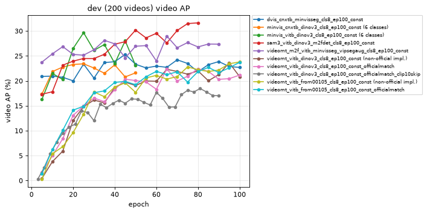
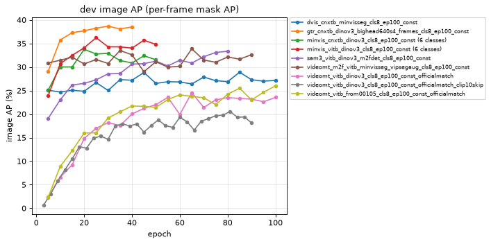

# exp00502: 動画インスタンスセグメンテーションの方式の比べ

## 対象にする方式

- **扱う**: 動画のセグメンテーションのモデル。各フレームのインスタンスセグメンテーション(物体を見つけてマスクとクラスを付けること)と、
  フレーム間の物体の対応付け(MOT の仕組み: 動画全体での物体の ID の管理・識別。隠れた後に再び出た物体は同じ ID、新しく出た物体は
  新しい ID)を 1 つのモデルの中に持ち、動画のデータで学習する方式
- **扱わない**: 画像のセグメンテーションのモデル + 別の追跡の手法(MOT)の 2 段の構成。これはトップの [mot/](../../../mot/) で扱う
- 例外(比べる基準として入れる):
  - MinVIS(画像のインスタンスセグメンテーション + 隣のフレームのクエリの照合。追跡を学習しない): 「追跡を学習する効果」を測る基準
  - 画像のモデル単体(フレームを独立に扱う。動画の AP は出せない): フレームごとの画像 AP の基準(動画のモデルとして有効かの判別用)

扱う動画のモデルと基準を、MOT の仕組みの形で分けると次の通り。動画の AP は動画全体の物体ごとに予測と正解を照らすので、予測の側にも
動画全体の ID が要る。MOT の仕組みを持たない画像のモデル単体は、動画の AP を出せない(フレームごとの画像 AP だけ)。

| | MOT の仕組みを持たない | MOT の仕組みを持つ: 学習して身に付ける形 | MOT の仕組みを持つ: 推論の規則・照合の形 |
|---|---|---|---|
| **動画のモデル**(この exp の対象) | — | VidEoMT(クエリを次のフレームに渡し、クエリの番号 = ID。学習の正解の割り当てで、物体は最初に写ったフレームのクエリにずっと割り当て、隠れているフレームもそのクエリのクラスの正解をその物体にし、物体を持つクエリは後から出た物体に使わない。これで再出現は同じクエリ・新しい物体は空いたクエリを学習する。推論には規則はなく、学習した振る舞いだけ。クエリを空きに戻す仕組みはなく、動画 1 本で区別できる物体はクエリの数(200)まで。学習の区間(5 フレーム)より長い隠れは学習に出てこない)。TrackFormer・MOTR も同じ形 | DVIS・DVIS++(公式のコードで確認: 固定した画像のモデルのクエリを隣のフレームと cos で照合して前のフレームの枠に並べ、学習する追跡の部が前のフレームの物体の情報を問いにして今のフレームの全部のクエリから同じ物体を探し直す。枠 = ID、物体の数はクエリの数まで。学習は VidEoMT と同じ割り当て(隠れても同じ枠が持ち続ける)。DVIS++ は学習中にわざと照合を乱して、追跡の部に直させる)、CTVIS(公式のコードで確認: 隣のフレームとの照合だけで、照合の埋め込みを、過去の埋め込みの記憶を正例にした対照学習で学ぶ)、DVIS-DAQ(公式のコードで確認: 追跡のクエリ + 新しい物体を探すクエリ 100 個。確信度(予測ごとの confidence score)0.01 を超えた新しいクエリを新しい ID として足し、確信度の低いフレームが 8 フレーム続いた ID を終える。8 フレームまでの隠れは同じ ID に戻る。物体の数の上限なし)、IDOL・VISAGE(記憶のバンクとの照合)、LOMM(新しい物体と続く物体を分けて ID を付ける)、SAM 2・SAM 3 型(物体ごとの記憶で伝搬し、検出と照らして新しい物体を足し・照合のない物体を除く)、DEVA(公式のコードで確認: 全部の物体を 1 つの記憶で伝搬し、記憶の中の物体の番号 = ID。5 フレームごとに、先の 3 フレームの画像のモデルの結果を最初のフレームへ運んで投票で固め、伝搬したマスクと IoU > 0.5 なら同じ ID、合わない検出は新しい ID。検出と合わない回が 5 回を超えた ID を除く(6 回目の照合 = 約 30 フレーム)。それより短い隠れは記憶に残るので伝搬で同じ ID に戻れる。除いた後の再出現は新しい ID。物体の数の上限なし)。CAVIS(公式のコードで確認: DVIS と同じ形。固定した画像のモデルのクエリを直前のフレームと cos で照合して枠に並べ、追跡の部が前のフレームの物体の情報 + 周りの文脈を問いにして同じ物体を探し直す。再出現で同じ枠に戻る・新しい物体が空いた枠に入るのは、どちらも規則ではなく学習した振る舞いだけ(学習の割り当てが VidEoMT と同じ)。照合の基準は直前のフレームだけで記憶はなく、隠れている間に基準が物体のないクエリに置き換わるので、戻れるかは追跡の部の状態しだい。学習の区間は 5 フレームで、それより長い隠れは学習に出てこない。消えた物体の枠を新しい物体が取るのを防ぐ規則・ID を終える仕組みはない。物体の数はクエリの数まで) |
| **画像のモデル**(基準だけ) | 画像のモデル単体(これまでの画像の段階(exp001xx)のインスタンスセグメンテーションのモデル。フレームを独立に扱う。フレームごとの画像 AP の基準) | — | MinVIS(画像のモデル + 隣のフレームのクエリの埋め込みの照合。クエリの枠 = ID。追跡を学習する効果の基準)。画像のモデル + 別の MOT の手法の 2 段は扱わない([mot/](../../../mot/)) |

- 画像のモデルの行は、同じ評価で並べる基準にする(比べる対象は動画のモデルの行)
- ID の管理の誤り(再出現を別の ID にする、別の物体を同じ ID にまとめる)は、動画の AP を下げる(正解の物体が 2 つの予測に割れる・
  1 つの予測に 2 つの物体が混ざると、動画を通した IoU が下がる)。同じ予測をフレームごとに評価する画像 AP との差と、AssA・ID の
  入れ替わりの数(exp00501 の追跡の診断の指標)、長い動画・隠れの多い動画で、ID の管理の良し悪しを分けて見る
- **マスクを与えて追う方式(SAM 2・Cutie・XMem など)も扱う**: 基準のフレームで画像のインスタンスセグメンテーションをかけ、その出力の
  マスクを伝搬の入力にすれば、物体を全部見つけるタスクにそのまま使える(新しく出る物体は、間隔をおいた画像のインスタンスセグメンテーションで
  見つけて、伝搬している物体と照らして足す)。この組み立ては DEVA(画像のセグメンテーション + クラスによらない伝搬)・SAM 3 と同じ。
  オープンボキャブラリーの方式も、クラスの決め方以外(物体の見つけ方・伝搬・照合)は決まったクラスにそのまま流用する

## 目的

動画のセグメンテーションのデータで、動画のセグメンテーションのモデルをスクラッチで学習し、方式(特にフレーム間の情報のやり取りの
仕組み)ごとの精度・速さを同じ条件で比べる(画像の段階の exp00101 と同じ進め方)。

タスクは**動画インスタンスセグメンテーション**: 各フレームで物体を全部見つけてクラスとマスクを付け、同じ物体には動画を通して同じ
ID を付ける。クラスはデータセットのクラスをそのまま使う。

分類の軸(決まったクラスを主にする・フレーム間の情報をモデルの中でやり取りする方式を対象にする・online を主にするなど)、データセット、
評価の指標は [exp00501](../exp00501_video_eval_and_baselines/README.md)。

## 方式の調査(決まったクラス)

追跡の仕組み(軸 2 の (a) の中の分け方)ごとにまとめる。数値は各論文の自己申告の値で、条件(backbone・学習データ)が違うので直接は比べられない。

列の意味:
- **追跡を持つか**: 隣り合うフレームの間で、同じ物体どうしを対応付けて同じ ID を付ける仕組みを、方式の中に持つか
- **対応付けのやり方**: 何を手がかりに、どこで対応付けるか
- **学習するか**: 対応付けそのものを学習で身に付けるか(学習しない = 手で決めた規則・近さの計算だけ)
- **ID の決め方**: 前のフレームの物体の ID をどう引き継ぎ、新しく出た物体・消えた物体をどう扱うか

| 分け方 | 方式 | online / offline | 追跡を持つか | 対応付けのやり方 | 学習するか | ID の決め方 | 中身 |
|---|---|---|---|---|---|---|---|
| A. 画像のインスタンスセグメンテーション + 学習しない対応付け | [MinVIS](https://arxiv.org/abs/2208.02245)(NeurIPS 2022) | online | 持つ | 隣のフレームどうしで、物体のクエリの埋め込みの近さが最大になる組を選ぶ(ハンガリアン法) | しない(画像のインスタンスセグメンテーションの学習だけ) | 選んだ組で前のフレームの ID を引き継ぐ。クエリの数は決まっていて、クエリの枠 = ID | 動画の正解なしで学習できる |
| B. 画像のインスタンスセグメンテーション + 学習する追跡の部(分けた作り) | [DVIS](https://arxiv.org/abs/2306.03413)(ICCV 2023) | online(+ offline の仕上げ) | 持つ | まず MinVIS と同じく、隣のフレームのインスタンスセグメンテーションのクエリをハンガリアン法で組にし、それを初期値にする。追跡の部(referring tracker)が、前のフレームの物体のクエリを手がかりにした注意で、それを直す(論文では、最初の組み合わせを省いても少し下がるだけ) | 追跡の部は学習する | クエリの並びの番号 = ID。新しく出る・消える物体は特に扱わない(論文の限界の節で、今後の課題としている) | インスタンスセグメンテーションと追跡を分けて学習する |
| | [DVIS++](https://arxiv.org/abs/2312.13305)(TPAMI 2025) | 同上 | 持つ | DVIS と同じ | する(ノイズを入れた学習・対照学習を足す) | DVIS と同じ | |
| | [DVIS-DAQ](https://arxiv.org/abs/2404.00086)(ECCV 2024) | 同上 | 持つ | DVIS と同じ | する | 物体が新しく出る・消えるのに合わせて、クエリ(dynamic anchor queries)を足し引きする | |
| | [CAVIS](https://arxiv.org/abs/2407.03010)(ICCV 2025) | 同上 | 持つ | 物体の周りの文脈の特徴を足した注意で、前のフレームの物体と対応付ける | する | 前のフレームの物体の並びにそろえる(ハンガリアン法で並びを合わせる) | |
| | [LOMM](https://arxiv.org/abs/2507.19754)(ICCV 2025) | (論文で確認) | 持つ | 最新の物体の記憶(Latest Object Memory)と照らす | する | 新しく出た物体と続く物体を分けて ID を付ける(Decoupled Object Association) | |
| C. 対応付けの埋め込みの対照学習 + 記憶のバンク | [IDOL](https://arxiv.org/abs/2207.10661)(ECCV 2022)・[CTVIS](https://arxiv.org/abs/2307.12616)(ICCV 2023)・[VISAGE](https://arxiv.org/abs/2312.04885)(ECCV 2024) | online | 持つ | 今のフレームの物体の埋め込みと、過去の物体の記憶のバンクの埋め込みの近さで照合する | 埋め込みは学習する(対照学習)。照合の規則は(論文で確認) | 照合できた物体は ID を引き継ぎ、できない物体は新しい ID(閾値・記憶から消す規則は論文で確認) | VISAGE は見た目の特徴を足す |
| D. クエリをモデルの中で次のフレームに渡す | [VidEoMT](https://arxiv.org/abs/2602.17807)(2026) | online | 持つ | 前のフレームの物体のクエリを、ViT の最後の数層の入力にそのまま使う(モデルの中で引き継ぐ。別の照合はない) | する | クエリの番号 = ID。新しい物体は、別に持つ学習するクエリから出る | ViT の encoder だけでインスタンスセグメンテーションをする EoMT の動画版。追跡の部を別に持たない |
| | [InsPro](https://arxiv.org/abs/2301.01882)(2023)・[GenVIS](https://arxiv.org/abs/2211.08834)(CVPR 2023) | online / 区間ごと | 持つ | 物体のクエリと候補を次のフレーム(区間)に渡す | する | クエリの番号 = ID | |
| E. 過去の状態・記憶を使う | [AUSM](https://arxiv.org/abs/2508.19242)(CVPR 2026) | online | 持つ | 過去のフレームを Mamba(状態空間のモデル)と空間の注意で 1 つの状態に圧縮し、その状態から各物体の今のマスクを出す | する | 物体ごとの ID のベクトルを持ち回る。新しい物体は確信度 0.5 以上の検出から足す | VIS・VOS を 1 つのモデルで扱う |
| | [SAM 2](https://arxiv.org/abs/2408.00714) / [SAM 3](https://arxiv.org/abs/2511.16719) / [SAM 3.1](https://ai.meta.com/blog/segment-anything-model-3/)(論文はなく、公式の告知) | online | 持つ | 物体ごとに、過去のフレームの特徴と物体の要約を記憶し、記憶との注意で今のフレームのマスクを出す(マスクの伝搬) | 伝搬は学習する。SAM 3 の検出と伝搬の照合は規則 | 伝搬する物体は ID が固定。SAM 3 は各フレームの検出と伝搬したマスクを照らし合わせて、新しい物体を足し、消えた物体を除く | SAM 3 はオープンボキャブラリーだが、この仕組みは決まったクラスでも使える |
| | SAM2BMP(2026。論文を見つけられていない)・[EntitySAM](https://openaccess.thecvf.com/content/CVPR2025/html/Ye_EntitySAM_Segment_Everything_in_Video_CVPR_2025_paper.html)(CVPR 2025) | (論文で確認) | 持つ | SAM 2 のマスクの伝搬で対応付ける | (論文で確認) | (論文で確認) | |
| | [XMem](https://arxiv.org/abs/2207.07115)(ECCV 2022)・[Cutie](https://arxiv.org/abs/2310.12982)(CVPR 2024) | online | 持つ | 与えたマスクの物体を、過去のフレームの特徴の記憶との注意で伝搬する(Cutie は物体ごとの記憶(object memory)も読む) | 伝搬は学習する(論文は DAVIS・YouTube-VOS・MOSE。ここでは VIPSeg の物体のマスクと ID で学習する) | 与えたマスクの物体の ID が固定 | Cutie は MOSE で XMem より J&F 8.7 高く、走る時間は同じくらい(論文)。基準のフレームのマスクを画像のインスタンスセグメンテーションで作れば、物体を全部見つけるタスクに使える |
| | [DEVA](https://arxiv.org/abs/2309.03903)(ICCV 2023) | online(先の数フレームも少し見る) | 持つ | 画像のセグメンテーションの結果(タスクごと)を、クラスによらない伝搬(XMem 系)で次のフレームに運び、数フレームごとに画像のセグメンテーションの結果と照らして、新しい物体を足す・ずれを直す | 伝搬だけを 1 回学習し、画像のモデルはタスクごとにそのまま使う | 伝搬している物体の ID を引き継ぐ。照らして合わない物体は新しい ID | VIPSeg で VPQ 55.0・STQ 52.2(Mask2Former Swin-B)。画像の段階のモデルをそのまま使える |
| F. 区間・動画の全体をまとめて見る | [VITA](https://arxiv.org/abs/2206.04403)(NeurIPS 2022)・[Mask2Former-VIS](https://arxiv.org/abs/2112.10764)・[SeqFormer](https://arxiv.org/abs/2112.08275) | offline | 区間の中は持たない(要らない) | 区間の全フレームを一度に入れ、1 つのクエリが区間の全フレームの同じ物体を表す | — | 区間の中はクエリの番号 = ID。区間より長い動画では、区間どうしを照合する仕組みが別に要る | |
| G. 古典 | [MaskTrack R-CNN](https://arxiv.org/abs/1905.04804)(2019) | online | 持つ | 追跡の head の埋め込みの近さで照合する(ほかの手がかりの足し方は論文で確認) | head は学習する | 照合できない物体は新しい ID | |
| | [CrossVIS](https://arxiv.org/abs/2104.05970)(2021) | online | 持つ | 前のフレームの物体の特徴で今のフレームのマスクを作る学習(照合のやり方は論文で確認) | する | (論文で確認) | |
| 汎用(複数のタスク) | [UniVS](https://arxiv.org/abs/2402.18115)(CVPR 2024)・[TarViS](https://arxiv.org/abs/2301.02657)(CVPR 2023) | (論文で確認) | 持つ | 前のフレームの物体をプロンプト(クエリ)として次のフレームに渡す | する | (論文で確認) | VIS・VPS・VOS を 1 つのモデルで |

大きい backbone での比べ(VidEoMT の論文の表。ViT-L は DINOv2 の事前学習。FPS は同じ GPU での値):

| 方式 | backbone | YTVIS21 AP | OVIS AP | VIPSeg VPQ | FPS(YTVIS21 / VIPSeg) |
|---|---|---|---|---|---|
| [MinVIS](https://arxiv.org/abs/2208.02245) | Swin-L | 55.3 | 39.4 | — | 30 / — |
| [DVIS](https://arxiv.org/abs/2306.03413) | Swin-L | 58.7 | 45.9 | 54.7 | 24 / 20 |
| [DVIS++](https://arxiv.org/abs/2312.13305) | ViT-L | 62.3 | 49.6 | 56.0 | 17 / 13 |
| [DVIS-DAQ](https://arxiv.org/abs/2404.00086) | ViT-L | 62.4 | 54.3 | 57.4 | 10 / 4 |
| [CAVIS](https://arxiv.org/abs/2407.03010) | ViT-L | 64.6 | 53.2 | 56.9 | 15 / 10 |
| [VidEoMT](https://arxiv.org/abs/2602.17807) | ViT-L | 63.1 | 52.5 | 55.2 | 160 / 75 |

- 精度の最良は追跡の部を分けた作り(B: CAVIS・DVIS-DAQ)。VidEoMT(D)は精度が 1〜2 低い代わりに、10 倍前後速い
- AUSM(E)は Swin-B で YTVIS21 58.6・OVIS 45.5(論文の値)。分けた作りの専用の方式(DVIS など)よりは低い
- R50 での値(CAVIS の論文の表、YTVIS21 / OVIS): MaskTrack R-CNN 28.6 / 10.8、MinVIS 44.2 / 25.0、VITA(offline)45.7 / 19.6、
  DVIS 46.4 / 30.2、CTVIS 50.1 / 35.5、VISAGE 51.6 / 36.2、CAVIS 50.5 / 37.6
- 軽量・実時間の方式: InsPro(軽い版で YTVIS19 38.7・45.7 FPS)、RT-VIS(YTVIS19 42.2・22.6 FPS)、EfficientVIS(区間ごと、36 FPS)

## 方式の調査(オープンボキャブラリー、参考)

| 方式 | 作り | 追跡を持つか・やり方 | LV-VIS | 備考 |
|---|---|---|---|---|
| [OV2Seg](https://arxiv.org/abs/2304.01715)(2023) | LV-VIS の基準。Mask2Former + CLIP の文章の埋め込みでクラスを決める | 持つ(クエリで追跡。細かい規則は論文で確認) | — | LV-VIS の論文 |
| [OVFormer](https://arxiv.org/abs/2407.07427)(ECCV 2024) | クエリと CLIP の埋め込みを合わせる学習 | (論文で確認) | 21.9(R50)| OVFormer+ で 25.0 |
| [BriVIS](https://arxiv.org/abs/2401.09732)(2024) | 固定した VIS のモデルのクエリ + CLIP の特徴で、物体を時間方向の文章のように扱う | 持つ(固定した VIS のモデルの追跡を使う) | 27.7 | |
| [TROY-VIS](https://arxiv.org/abs/2412.04434)(WACV 2025) | 実時間のオープンボキャブラリー VIS | (論文で確認) | — | GLEE-Lite より 20 倍速い(25 FPS) |
| [SegFS](https://arxiv.org/abs/2607.00124)(2026) | 重いモデルは間引いたフレームだけ、間のフレームは軽い枝で物体の埋め込みからマスクを作る | 持つ(間引いたフレームの物体の埋め込みを MinVIS と同じ照合でつなぎ、間のフレームはその埋め込みを使い回す) | 15.2〜18.3 | 携帯の NPU で 23〜38 FPS |
| [SAM 3](https://arxiv.org/abs/2511.16719) / [SAM 3.1](https://ai.meta.com/blog/segment-anything-model-3/) | 上の表 | 持つ(上の表) | test 36.3 / 34.3 | |

## 候補

追跡の仕組みの A〜G から、それぞれ代表を選ぶ。どれもスクラッチで実装する。DVIS++・DVIS-DAQ・CAVIS などの部品(ノイズを入れた学習・
動的なクエリ・文脈の特徴)は、exp00503 で上位の方式に足して効き方を見る。

1 本の学習の時間が長いので、全部はやらずに優先度の順に進める。優先度は、(1) 有望さ(論文の精度・速さ)、(2) 今後ほかの exp で
使い回せるか(軽い構成・エッジ・オープンボキャブラリー・mot/ への流用)、(3) 学習の時間(ほかの候補と学習を分け合えるか)で決める。

| 優先度 | 候補 | 画像セグメンテーションモデル(segmenter。作り / 画像で学習済みの segmenter で初期化するか / 動画の学習で固定するか) | 仕組み | 追跡(隣のフレームの物体の対応付け) | 実装の土台 | 優先度の理由 |
|---|---|---|---|---|---|---|
| 1 | [VidEoMT](https://arxiv.org/abs/2602.17807)(2026) | **作り**: 自作の EoMT(ViT-B/16。論文と同じ作り。画像のモデルの ViT がそのまま動画のモデル) / **初期化**: スクラッチ(A は backbone だけ timm の DINOv3 の重み、B は backbone だけ exp00105 で COCO の画像で学習した GTR 系の ViT-B の重み。どちらもクエリと head は初期の値。公式は画像で学習した segmenter から始める) / **固定**: しない(全体を学習) | D | 持つ。クエリをモデルの中で引き継ぐ(学習する) | 画像の段階の自作の EoMT + クエリを次のフレームに渡す | 最上位(CAVIS・DVIS-DAQ)との差が 1〜2 で 10 倍前後速い(論文の値)。追跡の部を別に持たず作りが単純なので、軽い構成・書き出し・ブラウザに持っていきやすい。EoMT は画像の段階で実装済み |
| 1 | [MinVIS](https://arxiv.org/abs/2208.02245)(2022) | **作り**: 自作の Mask2Former(論文と同じ作り。ConvNeXt-B・ViT-B/16) / **初期化**: スクラッチ(backbone だけ学習済みの重み)から、画像(VIPSeg)で学習 / **固定**: しない(segmenter の全部のパラメータを画像(VIPSeg)で学習する。動画の区間での学習はない) | A | 持つ。クエリの近さの照合(学習しない) | 自作の Mask2Former を画像(VIPSeg)で学習 + 隣のフレームのクエリの照合 | 追跡を学習する効果を測る基準。インスタンスセグメンテーションのモデルは DVIS と共通にでき、追跡のために追加の学習が要らない(学習の時間がほぼ増えない) |
| 1 | [DVIS](https://arxiv.org/abs/2306.03413)(2023) | **作り**: 自作の Mask2Former(論文と同じ作り) / **初期化**: 画像(VIPSeg)で学習済みの segmenter(MinVIS の ConvNeXt-B) / **固定**: する(追跡の部だけを学習) | B | 持つ。学習する追跡の部 | **学習済みの segmenter を固定し、追跡の部(tracker)だけを学習する構成**。segmenter は MinVIS で学習した画像の Mask2Former(DVIS の学習では重みを固定し、勾配を流さない。公式と同じ)。追跡の部は referring tracker(6 層の注意の層)で、クエリの枠 = ID。推論の規則はなく、学習した振る舞いだけで同じ物体を追う | 精度の最上位の系統(DVIS++・DVIS-DAQ・CAVIS)の土台。追跡の部はどのインスタンスセグメンテーションのモデルにも付けられるので、GTR 系や軽いモデルにも流用できる。インスタンスセグメンテーションのモデルは MinVIS と共通で、追跡の部だけを学習する |
| 1 | [DVIS++](https://arxiv.org/abs/2312.13305)(2025) | **作り**: 自作の Mask2Former(論文と同じ作り)+ reid の head(CTVIS) / **初期化**: 動画(VIPSeg の区間)で CTVIS として学習済みの segmenter(CTVIS 自体はスクラッチ(backbone だけ学習済みの重み)から学習) / **固定**: する(追跡の部だけを学習) | B | 持つ。DVIS と同じ referring tracker(クエリの枠 = ID)。学習中に照合をわざと乱し(ノイズ)、追跡の部に直させる | `models/video/dvis_plus.py`(実装済み・未実行)。先に CTVIS を学習し、それを固定して追跡の部を学習する | DVIS の系統の改良(TPAMI 2025)で、DVIS-DAQ・CAVIS の比べる相手 |
| 1 | [DVIS-DAQ](https://arxiv.org/abs/2404.00086)(2024) | **作り**: 自作の Mask2Former(論文と同じ作り)+ reid の head(CTVIS。公式と同じく DVIS++ と同じ segmenter) / **初期化**: 動画(VIPSeg の区間)で CTVIS として学習済みの segmenter / **固定**: する(追跡の部だけを学習) | B | 持つ。追跡のクエリ + 新しい物体を探すクエリ 100 個。確信度 0.01 を超えた新しいクエリを新しい ID として足し、確信度の低いフレームが 8 フレーム続いた ID を終える | `models/video/dvis_daq.py`(実装済み・未実行)。segmenter は DVIS++ と同じ CTVIS | ECCV 2024。物体の出入りを扱う、DVIS の系統の新しい方式 |
| 1 | [CAVIS](https://arxiv.org/abs/2407.03010)(2025) | **作り**: 自作の Mask2Former(論文と同じ作り)+ 文脈の特徴・reid の head / **初期化**: 動画(VIPSeg の区間)で CAVIS の segmenter として学習済み(この segmenter 自体はスクラッチ(backbone だけ学習済みの重み)から学習) / **固定**: する(追跡の部だけを学習) | B | 持つ。DVIS と同じ形(クエリの枠 = ID)で、物体の周りの文脈の特徴を足した注意で、前のフレームの物体と対応付ける | `models/video/cavis.py`(実装済み・未実行)。2 段階: 文脈の特徴と reid の head を持つ segmenter を学習し、それを固定して追跡の部を学習する | ICCV 2025。論文の値で DVIS++ を YouTube-VIS 2019・2021・OVIS で AP 1.1・1.4・3.7 上回る、DVIS の系統の最新 |
| 2 | 自作画像セグメンテーションモデルの動画版 | **作り**: 自作の GTR 系(ConvNeXt-B)か、自作の Mask2Former(ViT-B/16) / **初期化**: 画像(VIPSeg)で学習済みの segmenter(GTR 系は画像の GTR 系、Mask2Former は MinVIS の ViT-B/16) / **固定**: しない(全体を学習) | D・B | 持つ。クエリを次のフレームに引き継ぐ(+ 追跡の部) | 画像の段階の GTR 系(exp00103 の A)や Mask2Former 系(MinVIS の画像のモデル)に、クエリを次のフレームに渡す仕組み(と追跡の部)を足す | 画像の段階のモデル(GTR 系の最良の方式・軽い構成(exp00104・exp00105)、Mask2Former 系)をそのまま使える。やり方は複数ある: VidEoMT 型(画像のモデルの decoder に、前のフレームのクエリを引き継ぐ。Mask2Former 系は学習するクエリを持つので、VidEoMT の「query_updater(前のクエリ) + 学習するクエリ」がそのまま書ける。GTR 系は学習するクエリがなく、クエリを毎フレーム encoder の出力から選び直し、枠の位置も持つので、最初のフレームで選んだクエリを学習するクエリの代わりにし、前のフレームの予測の枠を参照の枠にする)、DVIS 型(画像のモデルを固定して tracker を足す)など。MOTIP 型(クエリの特徴から ID を予測する decoder)は mot/ の exp00202 で扱う |
| 2 | [SAM 2](https://arxiv.org/abs/2408.00714)(2024)・[SAM 3](https://arxiv.org/abs/2511.16719)(2025)の記憶の追跡 | **作り**: 自作の Mask2Former(ViT-B/16。論文の SAM 3 の検出器とは別の作り) / **初期化**: 画像(VIPSeg)で学習済みの segmenter(MinVIS の ViT-B/16) / **固定**: する(追跡の部分だけを学習。backbone は追跡の部分と共有) | E | 持つ。記憶との注意でマスクを伝搬 + 検出との照合 | **実装した SAM 3 型は、DVIS と同じく学習済みの segmenter を固定し、追跡の部分だけを学習する構成。DVIS との違いは追跡の部分の作りと ID の決め方**。segmenter は MinVIS の ViT-B/16 で学習した画像の Mask2Former(重みを固定。backbone は追跡の部分と共有する。SAM 3 の論文の 4 段目と同じく、検出の部分を学習した後に固定して追跡の部分を学習する)。追跡の部分は SAM 2 の部品(neck・記憶の注意・記憶を作る部分・マスクの decoder)で、物体ごとに過去のフレームの記憶から今のフレームのマスクを伝搬する。ID は推論の規則で決める(毎フレーム、伝搬したマスクと segmenter の検出をマスクの IoU で照合し、どの追跡とも合わない検出を新しい物体として足す。SAM 3 の照合)。DVIS の追跡の部はクエリの枠 = ID で、推論の規則はない | 隠れ・長い動画に強い作り。SAM 3 の仕組みはオープンボキャブラリー・mot/ にも流用できる。伝搬の部は VIPSeg で学習し、伝搬だけの出来も VIPSeg の val で J&F として測れる。記憶の分だけ重い |
| 2 | [DEVA](https://arxiv.org/abs/2309.03903)(2023)型(画像のセグメンテーション + クラスによらない伝搬) | **作り**: 自作の Mask2Former(ViT-B/16。論文の VIPSeg の評価も Mask2Former) / **初期化**: 画像(VIPSeg)で学習済みの segmenter(MinVIS の ViT-B/16) / **固定**: する(伝搬の部だけを学習) | E | 持つ。伝搬 + 数フレームごとの画像のセグメンテーションとの照合 | 画像のモデル(左の列)をそのまま使い、伝搬の部(XMem・Cutie 系)だけを VIPSeg で学習する。**伝搬の部の学習は公式と同じ 2 段階**: 1 段階目(公式の名前は stage 0)は、静止画 1 枚を少しずつ変形して作った 3 フレームの疑似の動画で、マスクを次のフレームへ運ぶ基本を学習する。2 段階目(公式の名前は stage 3。公式の stage 1・2 は前の XMem などの段階で、DEVA では使わない)は、1 段階目の重みから始め、本物の動画(VIPSeg の 8 フレームの区間)で学習する | 画像のモデルの学習が要らず、伝搬の部は 1 回の学習で使い回せる。VIPSeg の値(VPQ 55.0、Swin-B)は DVIS(54.7、Swin-L)と同じくらい(論文の値)。SAM 2 型と伝搬の部を共有できる |
| 3 | [CTVIS](https://arxiv.org/abs/2307.12616)(2023) | **作り**: 自作の Mask2Former(論文と同じ作り)+ reid の head / **初期化**: スクラッチ(backbone だけ学習済みの重み) / **固定**: しない(全体を動画の区間で学習) | C | 持つ。学習した埋め込み + 記憶のバンクとの照合 | 同じインスタンスセグメンテーションのモデル + 対照学習の埋め込みと記憶のバンク | 対照学習は DVIS++ にも入っている部品なので、単独の方式としてより、exp00503 で優先度 1 の方式に足して見る方が学習が少なくて済む |
| 3 | [AUSM](https://arxiv.org/abs/2508.19242)(2026) | 未実装(公式のコードがない) | E | 持つ。圧縮した過去の状態 + ID のベクトル(学習する) | 過去の状態の圧縮(Mamba + 空間の注意) | 新しい(CVPR 2026)が、論文の値は B の専用の方式より低い。作りが複雑(Mamba)。公式のコードが公開されていない(2026-11 時点)ので、規則を確かめて実装することができず保留 |
| 4 | [MaskTrack R-CNN](https://arxiv.org/abs/1905.04804)(2019) | **作り**: 自作の Mask R-CNN(論文と同じ作り) / **初期化**: スクラッチ(backbone だけ学習済みの重み) / **固定**: しない(追跡の head と一緒に学習) | G | 持つ。追跡の head の埋め込みの照合 | 画像の段階の自作の Mask R-CNN + 対応付けの head | 古典の基準。論文の値が大きく低い(R50 で YTVIS21 28.6) |
| 4 | [VITA](https://arxiv.org/abs/2206.04403)(2022) | 未実装(offline の参考) | F | 区間の中は持たない(1 つのクエリが区間の全フレームの物体を表す)。区間どうしの照合は別に要る | offline の参考 | online を主にするので参考だけ |

進め方: 優先度 1 の 3 つ(VidEoMT・MinVIS・DVIS)を先に実装して比べ、その結果を見て優先度 2 以降を足すかを決める。MinVIS と DVIS は
インスタンスセグメンテーションのモデルの学習を 1 回で共有するので、優先度 1 の学習は実質 2 本 + 追跡の部の学習 1 本になる。

### 基準: 画像のモデルをフレーム独立に学習する

動画のモデルとしての優位性を見るために、同じ VIPSeg のデータで画像のインスタンスセグメンテーションのモデルを、フレームを独立の
画像として学習し、同じ評価で並べて基準にする。

- データ: `vipseg_frames_cls8_train`(`vipseg_vis_cls8_train` の全部のフレーム 48,234 枚を 1 枚ずつの画像にしたもの)
- 学習の量: 動画のモデル(VidEoMT の 100 エポック = 約 105 万フレーム)と同じ規模にする(全部のフレームを 22 回)。学習率は
  warmup の後は下げない。2 エポックごとに、dev のフレーム(`vipseg_frames_cls8_dev`)の全部で最良の重みを選び、val のフレーム
  (`vipseg_frames_cls8_val`)の全部でも評価して記録する
- 評価: val の全部のフレームを独立の画像として評価する画像 AP で、動画のモデルと並べる。動画のモデル(VidEoMT
  など)の予測も、フレームごとに同じ評価にかける(その部分を足す)

規模は動画のモデルに近いものにする(パラメータは全体の数。backbone より後ろは encoder・decoder・head):

| モデル | backbone | 全体 | backbone より後ろ | 状態 |
|---|---|---|---|---|
| (動画)VidEoMT | ViT-B/16(DINOv3) | 92.9M | 7.3M | 学習済み |
| GTR 系 G1(exp00104 の後段: dim 192・FFN 512) | ViT-B/16(DINOv3。adapter で 3 段) | 94.4M | 6.8M | 予定 |
| GTR 系 G0(exp00105 の精度重視の型の後段) | ViT-B/16(DINOv3。adapter で 3 段) | 99.8M | 12.2M | 予定 |
| GTR 系 G0 | ConvNeXt-B(DINOv3) | 99.6M | 12.1M | 予定 |
| GTR 系(exp00105 の最良の構成: dim 384・FFN 2048・decoder 6 層・stride 4〜32、入力 640) | ConvNeXt-B(DINOv3) | — | — | 学習中 |
| Mask2Former(MinVIS・DVIS の土台) | ViT-B/16(DINOv3。adapter で 4 段) | 108.5M | 20.3M | 学習済み(50 エポックで停止) |
| Mask2Former | ConvNeXt-B(DINOv3) | 107.6M | 20.0M | 学習済み(50 エポックで停止) |

## 共通の条件(案)

- 学習: VIPSeg の画像の段階と同じ 8 クラス(`vipseg_vis_cls8_train`)。COCO などの画像のデータは学習に使わない(初期値の重みを除く)
- 評価: 学習の途中は `vipseg_vis_cls8_dev`(最良の重みの選択)、最後は `vipseg_vis_cls8_val`(公式の val。test の役)の動画の AP
  (YouTube-VIS と同じ計算: 物体のマスクの IoU を全フレームを通して計算する)
- backbone: 全部同じ(R50 から)。VidEoMT(ViT が必要)は timm の DINOv3 の ViT の学習済みの重みをそのまま初期値にする
  (VidEoMT の論文の表 8 で最良の事前学習。動画の自己教師ありの学習は exp00106 で、この比べの後に別の比べとして行う)
- VidEoMT の公式の学習は 2 段階: 段階 1 で画像のセグメンテーションだけを学習し(COCO のインスタンスセグメンテーションと、
  対象の動画のデータのフレーム)、段階 2 でフレーム間のクエリの受け渡しを足して動画で学習し直す。今の実装(`lib_common/video_train.py`)は
  段階 2 だけ
- 学習の区間のフレームの数・入力の大きさ・回数は、実装の後に決める

## 結果

### VIPSeg の 8 クラス: VidEoMT・MinVIS・DVIS・SAM 3 型・Mask2Former × VidEoMT 型

- データ: VidEoMT は `vipseg_vis_cls8_train`(2,097 本の動画)、MinVIS はその全部のフレーム(48,234 枚)を 1 枚ずつの画像にした
  `vipseg_frames_cls8_train`。どれも 1 エポック ≒ 1 万 500 フレーム(MinVIS は毎エポック全部のフレームからランダムに重複なしで 10,608 枚)、
  学習率は warmup の後は一定。dev 200 本(5 エポックごと。最良の重みの選択)・val 279 本(test の役)を、全部の動画・全部のフレームで評価
- VidEoMT: ViT-B/16、入力 512、100 エポック。A は timm の DINOv3、B は exp00105 で COCO の画像で学習した ViT-B から始める
- MinVIS: Mask2Former(画像のモデル。推論のときだけ隣のフレームのクエリの埋め込みを照合して ID をつなぐ)、入力 512。dev が 25 エポックより
  後に上がらないので 50 エポックで止めた
- DVIS: MinVIS ConvNeXt-B の Mask2Former(25 エポックの重み)を固定し、追跡の部(referring tracker、6 層)だけを `vipseg_vis_cls8_train`
  で学習(区間は連続 5 フレーム・batch 8・100 エポック。学習の前半は固定した Mask2Former の予測で正解の割り当てを決める。公式と同じ)
- SAM 3 型: MinVIS ViT-B/16 の Mask2Former(25 エポックの重み)を固定し(backbone は追跡の部分と共有)、SAM 2 の部品の追跡の部分を
  `vipseg_vis_cls8_train` で学習(区間は 8 フレーム、batch 8)。80 エポックで止めた
- Mask2Former × VidEoMT 型(自作画像セグメンテーションモデルの動画版): MinVIS ViT-B/16 の Mask2Former(25 エポックの重み)から始め、
  VidEoMT と同じくクエリを次のフレームに渡す形で全体を `vipseg_vis_cls8_train` で学習(区間は連続 5 フレーム・batch 8。lr 1e-4・
  backbone × 0.1・weight decay 0.05・clip 0.01、拡張は公式の VidEoMT の VIPSeg の拡張を 512 に縮めたもの)。90 エポックで止めた
- 画像のモデル単体(フレーム独立の基準): GTR 系(exp00105 の最良の構成。ConvNeXt-B、入力 640)を `vipseg_frames_cls8_train` で
  MinVIS と同じ量・同じ評価の間隔で学習。dev の画像 AP(1 枚ずつ予測)が 25 エポック以降 38.1〜38.7 で横ばいなので 40 エポックで止めた

| モデル | dev の最良(エポック) | val の動画の AP | AP50 / AP75 | APs / APm / APl | AR1 / AR10 | 画像 AP(動画の予測) | 画像 AP(1 枚ずつ予測) |
|---|---|---|---|---|---|---|---|
| VidEoMT A | 22.4(80) | 20.5 | 30.0 / 23.2 | 4.5 / 40.3 / 51.2 | 20.1 / 24.5 | 26.0 | 26.6 |
| VidEoMT B | 23.7(100) | 20.4 | 30.8 / 22.0 | 5.4 / 43.3 / 51.8 | 19.7 / 25.1 | 26.6 | 29.1 |
| VidEoMT A ※1 | 23.6(95) | 23.5 | 35.5 / 26.4 | 5.9 / 47.2 / 59.7 | 21.4 / 27.2 | 28.0 | 16.9 |
| VidEoMT B ※1 | 23.8(100) | 23.1 | 34.4 / 24.7 | 5.5 / 45.4 / 60.6 | 21.5 / 26.2 | 27.7 | 17.1 |
| MinVIS ConvNeXt-B | 24.5(25)※2 | 23.7 | 36.1 / 22.4 | 7.7 / 50.4 / 58.0 | 20.0 / 27.4 | 31.2 | 33.4 |
| MinVIS ViT-B/16 | 28.7(25)※2 | 23.7 | 37.0 / 24.3 | 7.8 / 53.3 / 63.6 | 20.9 / 28.0 | 32.0 | 33.3 |
| DVIS ConvNeXt-B(MinVIS ConvNeXt-B の Mask2Former を固定) | 25.3(45) | 23.0 | 35.3 / 26.0 | 6.9 / 45.1 / 57.7 | 20.6 / 26.7 | 29.5 | 31.5 |
| SAM 3 型 ViT-B/16(MinVIS ViT-B/16 の Mask2Former を固定)※4 | 31.6(80) | 23.0 | 39.2 / 22.1 | 8.2 / 47.1 / 60.4 | 21.7 / 29.1 | 28.3 | 31.6 |
| Mask2Former × VidEoMT 型 ViT-B/16(MinVIS ViT-B/16 の Mask2Former から全体を学習)※4 | 29.0(65) | **24.5** | 37.2 / 27.2 | 7.3 / 52.9 / 56.0 | 21.7 / 29.5 | 31.4 | 34.1 |
| 画像のモデル単体 GTR 系(ConvNeXt-B) + ByteTrack | 28.7(30)※3 | **26.0** | 39.7 / 26.9 | 11.2 / 51.3 / 52.7 | 21.8 / 31.6 | 35.7 | **38.7** |

| モデル | person | bicycle | car | cat | dog | bottle_or_cup | chair_or_seat | screen_or_television |
|---|---|---|---|---|---|---|---|---|
| VidEoMT A | 22.8 | 25.5 | 6.3 | 37.2 | 57.1 | 0.6 | 1.3 | 13.3 |
| VidEoMT B | 22.7 | 16.1 | 8.0 | 41.6 | 55.5 | 1.7 | 2.9 | 14.9 |
| VidEoMT A ※1 | 24.0 | 24.3 | 11.0 | 54.1 | 54.6 | 2.6 | 3.1 | 14.0 |
| VidEoMT B ※1 | 25.1 | 23.5 | 9.7 | 51.2 | 57.5 | 1.9 | 2.7 | 13.0 |
| MinVIS ConvNeXt-B | 25.7 | 25.5 | 11.6 | 52.8 | 42.3 | 3.4 | 4.0 | 24.3 |
| MinVIS ViT-B/16 | 24.8 | 20.7 | 12.3 | 51.3 | 44.6 | 5.8 | 5.9 | 24.2 |
| DVIS ConvNeXt-B(MinVIS ConvNeXt-B の Mask2Former を固定) | 24.4 | 22.0 | 10.5 | 51.7 | 52.4 | 2.5 | 3.9 | 16.6 |
| SAM 3 型 ViT-B/16(MinVIS ViT-B/16 の Mask2Former を固定) | 26.8 | 19.7 | 13.3 | 44.5 | 46.2 | 5.2 | 4.9 | 23.5 |
| Mask2Former × VidEoMT 型 ViT-B/16(MinVIS ViT-B/16 の Mask2Former から全体を学習) | 29.2 | 26.7 | 13.6 | 49.7 | 47.2 | 4.1 | 5.2 | 20.0 |
| 画像のモデル単体 GTR 系(ConvNeXt-B) + ByteTrack | 27.3 | 27.3 | 23.1 | 34.3 | 53.7 | 4.6 | 7.5 | 30.5 |

(val の動画の AP のクラスごと。動画の AP は、動画を通した物体ごとの時空間のマスクの AP。画像 AP は、各フレームを 1 枚の画像と
みなした画像のインスタンスセグメンテーションの mask AP で、予測の作り方が 2 通りある。「動画の予測」は、動画として予測した結果
(予測ごとの確信度(confidence score。AP の計算で予測を並べる順番)は動画全体で 1 つ・動画ごとに確信度の上位 100 個)を
フレームに分けたもの。「1 枚ずつ予測」は、val のフレームのセット `vipseg_frames_cls8_val` の各フレームを
1 枚ずつモデルに入れ、画像の段階と同じ後処理(確信度はそのフレームだけから付ける・画像ごとに上位 100 個)で予測したもの。VidEoMT・DVIS は
各フレームを 1 フレームの動画として入れるので、前のフレームのクエリの受け渡しがない(DVIS は追跡の部の出力)。動画のモデルの出力のクラスの
番号は動画のセットの並びなので、クラスの名前でフレームのセットの並びに並べ替えてから評価する)

dev の動画の AP の推移(MinVIS は ※2 の 6 クラスの平均):

dev の画像 AP の推移(MinVIS と画像のモデル単体は 1 枚ずつ予測、動画のモデル(VidEoMT・DVIS・SAM 3 型・Mask2Former × VidEoMT 型)は動画の予測。予測の作り方が違うので厳密には揃っていない):

- MinVIS(ID の照合を学習しない)が、VidEoMT A・B より val の動画の AP で 3.2〜3.3 高く、画像 AP(動画の予測)でも 4.6〜6.0
  高い。この条件では、追跡を学習する効果は見えない。画像 AP(1 枚ずつ予測)では、画像のモデル単体(GTR 系、38.7)が MinVIS の画像の
  モデル(33.3〜33.4)より高い
- 画像のモデル単体 GTR 系 + ByteTrack(追跡は学習しない規則の方式)の val の動画の AP は 26.0 で、この表で最も高い(MinVIS より 2.3、
  VidEoMT A・B より 5.5〜5.6 高い)。ただし画像のモデルの入力が 640 で、ほかの 512 と条件が違う
- DVIS(MinVIS ConvNeXt-B と同じ Mask2Former を固定して、追跡の部を学習)の val の動画の AP は 23.0 で、同じ Mask2Former に学習しない
  照合をかけた MinVIS ConvNeXt-B(23.7)より 0.7 低い。画像 AP(動画の予測)も 29.5 と 31.2 で 1.7 低い。この条件では、追跡の部を
  学習する効果は見えない。DVIS の dev は 5 エポックで 20.9、45 エポックで最良の 25.3、その後は 21.8〜24.2 で上下する
- Mask2Former × VidEoMT 型(MinVIS ViT-B/16 の Mask2Former から全体を学習)の val の動画の AP は 24.5 で、動画のモデルの中で最も高い。
  同じ Mask2Former に学習しない照合をかけた MinVIS ViT-B/16(23.7)より 0.8、VidEoMT A・B より 4.0〜4.1 高い。画像 AP(1 枚ずつ予測)も
  34.1 で、初期値の MinVIS ViT-B/16(33.3)より 0.8 高く、動画の学習で segmenter は崩れていない。画像 AP(動画の予測)は 31.4 で、
  MinVIS ViT-B/16(32.0)より 0.6 低い。dev は 5 エポックで 23.8、65 エポックで最良の 29.0、その後は 26.6〜27.7 で上下する
- SAM 3 型(MinVIS ViT-B/16 の Mask2Former を固定)の val の動画の AP は 23.0 で、同じ Mask2Former の MinVIS ViT-B/16(23.7)より 0.7 低い。
  画像 AP(動画の予測)は 28.3 で 3.7 低い。dev の最良は 31.6(80 エポック)とこの表で最も高いが、val は高くない(dev と val の差が 8.6)。
  画像 AP(1 枚ずつ予測)は 31.6 で、固定した Mask2Former そのもの(MinVIS ViT-B/16 の 33.3)より 1.7 低い(1 フレーム目の出力は追跡の
  部分のマスクの decoder を通したもの)
- MinVIS は 25 エポックで dev が最良になり、その後は上がらない。VidEoMT は 60 エポック以降も dev が 18.3〜23.7 で上下する
- VidEoMT の A と B の差は 0.1 で、COCO の画像で学習した ViT から始める効果は見えない
- どのモデルも car・bottle_or_cup・chair_or_seat が低い。推論の時間は、ほかの学習と GPU を分け合って測ったので比べない

表の VidEoMT A・B は、VidEoMT の実装の誤りの 1 回目の修正の後、2 回目の修正の前の結果(付録「VidEoMT の実装の誤りと修正」)。

※1 VidEoMT の実装の誤りを直す前(1 回目の修正の前)に学習した 2 本(`videomt_vitb_dinov3_cls8_ep100_const`・
`videomt_vitb_from00105_cls8_ep100_const`。誤りの中身は付録)。表の動画の AP〜AR10 は当時の評価(確信度の付け方が今と違う)の値で、
今の評価では動画の AP 23.4・23.2。画像 AP は 2 つとも今の評価の値。

※2 MinVIS の学習中の動画の評価は、画像のセットと動画のセットのクラスの並びの違いを直す前のコードで測っていて、person と car が
入れ替わっていた(どちらも 0.0)。ほかの 6 クラスは正しい(同じ重みで直す前と後が小数第 2 位まで一致)ので、推移は 6 クラスの平均で描いた。
表の dev の最良と val の値は、保存してある重み(25・50 エポック)を直した後のコードで測り直した 8 クラスの値
(dev は ConvNeXt-B 24.5 / 23.3、ViT-B/16 28.7 / 24.9)。

※3 画像のモデル単体は、フレームどうしで物体の ID をつながないので、動画の AP(ID をつないだ物体ごとに照らす)と画像 AP(動画の
予測)は、追跡に ByteTrack(mot/ の `mot/lib_common/trackers/bytetrack.py`)を使って ID をつないで測った(`eval_image_bytetrack.py`)。
各フレームを 1 枚ずつ画像のモデルにかけた検出(確信度 0.05 以上)に、クラスごとに ByteTrack をかけ、1 つの ID のマスクの並びを 1 つの
物体の予測にする(確信度は、追跡したフレームの検出の確信度の平均。動画ごとに確信度の上位 100 個)。ByteTrack の track_thresh は dev の
動画の AP で選んだ 0.2(候補 0.15〜0.7)、ほかは公式の値(歩行者向けの横長の枠を出さない条件は使わない)。dev の最良の列は、その dev の
動画の AP と、画像のモデルの重みを選んだエポック(dev の画像 AP(1 枚ずつ予測)が最良の 30 エポック。dev のフレームのセット
`vipseg_frames_cls8_dev`)。画像のモデルの入力は 640(VidEoMT・MinVIS は 512)。`gtr_cnxtb_dinov3_bighead640s4_frames_cls8_ep100_const`。

※4 途中で止めた学習(SAM 3 型は 80 エポック、Mask2Former × VidEoMT 型は 90 エポック)。val の値は、止めた後に dev の動画の AP が最良の
重みで測った(`finalize_video_stopped.py`。学習の最後の評価と同じ処理)。画像 AP(1 枚ずつ予測)は、val のフレームの各画像を 1 フレームの
動画として入れて測った(SAM 3 型は 1 フレームの動画として追跡の処理に通した出力)。

見本: `results/samples/{学習の名前}/vipseg_vis_cls8_val/`(val から 8 クラスそれぞれについて 1 本ずつ、正解と予測を並べた mp4 と JPEG)

## 付録: backbone より後ろの作りの比べ

手元の自作の実装(`lib_common/models/gtr_seg.py`・`mask2former.py`・`videomt.py` と、それぞれの損失)で確かめた違い。GTR 系は
exp00105 の精度重視の型の後段(G0・hybrid encoder)。Mask2Former は MinVIS・DVIS の土台にする画像のモデル(pixel decoder は公式と
同じ deformable な注意の encoder)。DVIS の追跡の部はまだ実装していないので、論文で確かめていない値は書かない。

| 項目 | GTR 系(画像) | Mask2Former(画像。MinVIS・DVIS の土台) | VidEoMT(動画) | DVIS の追跡の部(動画。Mask2Former の上に足す) |
|---|---|---|---|---|
| 全体の作り | backbone → encoder → decoder → マスクの head | backbone → pixel decoder → transformer decoder → マスクの head | encoder-only: ViT の最後の 3 block にクエリを足し、backbone の中でクエリも処理する。backbone の後ろに encoder・decoder はない | フレームごとの Mask2Former の出力のクエリを受け取り、フレーム間で対応付ける部品を足す(Mask2Former は固定) |
| 使う特徴の段 | stride 8・16・32 の 3 段(ViT は adapter で作る) | stride 4・8・16・32 の 4 段(ViT は adapter で作る) | ViT の stride 16 の 1 段 | Mask2Former のクエリ(画像の特徴は Mask2Former の側) |
| encoder(多重解像度の特徴の融合) | hybrid encoder: stride 32 の段だけに自己注意(AIFI)、段どうしを畳み込みで混ぜる(CCFF) | pixel decoder: stride 8・16・32 に deformable な自己注意の encoder(6 層)、stride 4 は FPN で足す | なし | なし |
| **decoder** | 独立の 4 層: self-attention → 多重解像度の deformable cross-attention(段ごとに 3・6・3 点)→ Gate → FFN。denoising のクエリ(最大 100 個)も一緒に通す(学習だけ) | 独立の 9 層(3 段 × 3 回。粗い段から順): masked cross-attention(前の層のマスクの中だけに注意)→ self-attention → FFN | なし(ViT の最後の 3 block の self-attention で、クエリとパッチのトークンを同じ列に並べて注意する) | referring tracker: 前のフレームの追跡のクエリを参照にして、今のフレームのクエリを照らす cross-attention の層を重ねる(層の数は論文で確認) |
| クエリの作り方 | two-stage: encoder の全部の位置の上位 300 個。学習では 3 組(Group DETR) | 学習するクエリ 100 個 | 学習するクエリ 200 個。2 フレーム目からは前のフレームの出力のクエリ → Linear を足す | 前のフレームの追跡のクエリ |
| 枠(box) | 出す(4 辺までの距離の分布を層ごとに直す FDR、分布からクラスの値を補正する LQE) | 出さない(マスクだけ) | 出さない | 出さない |
| マスクの head | encoder の stride 8 の特徴を 1/4 に拡大し、層ごとのクエリとの内積 | クエリを MLP に通し、pixel decoder の stride 4 の特徴との内積 | クエリを MLP(3 層)に通し、パッチのトークンを転置畳み込み 2 回で 1/16 → 1/4 に拡大した特徴との内積 | Mask2Former と同じ head を、追跡したクエリで使う |
| クラスの head | 層ごとに Linear(sigmoid) | Linear(K + 物体なし。softmax) | Linear(K + 物体なし。softmax) | Mask2Former と同じ |
| 対応付け(学習の正解の割り当て) | ハンガリアン法: クラス(focal)2・枠 L1 1・GIoU 1・マスク BCE 5・Dice 5 | ハンガリアン法: クラス 2・マスク BCE 5・Dice 5(画像ごと) | ハンガリアン法: クラス 2・マスク BCE 5・Dice 5(区間の全フレームのマスクをまとめて 1 回) | 論文で確認 |
| 損失 | MAL 2、枠 L1 1・GIoU 1、FGL 0.15・DDF 1.5、マスク BCE 5・Dice 5 | クラスの交差エントロピー 2(物体なし 0.1)、マスク BCE 5・Dice 5(点を選んで計算) | Mask2Former と同じ | 論文で確認 |
| 補助の損失 | decoder の全層、最初の層の前、two-stage の候補、denoising | decoder の全層と、最初のクエリ | クエリを入れた 3 block の各 block の前 | 論文で確認 |
| フレーム間の対応(ID) | なし(画像のモデル) | MinVIS: 推論のときだけ、隣のフレームどうしでクエリの埋め込みの近さ(cosine)をハンガリアン法で照合する(学習しない) | クエリの番号 = 動画を通した物体の ID(前のフレームのクエリを引き継ぐ) | 追跡のクエリの番号 = ID(referring tracker で学習する) |

## 付録: VidEoMT の実装の誤りと修正

VidEoMT の実装には、公式(tue-mps/videomt)と違う所が 2 回に分けて見つかり、そのたびに直した。どの結果がどの実装で学習したものかは
次の通り。

| 実装 | 学習した run | 結果の表の行 |
|---|---|---|
| 1 回目の修正の前 | `videomt_vitb_dinov3_cls8_ep100_const`・`videomt_vitb_from00105_cls8_ep100_const` | VidEoMT A ※1・B ※1 |
| 1 回目の修正の後(2 回目の修正の前) | `videomt_vitb_dinov3_cls8_ep100_const_officialmatch`・`videomt_vitb_from00105_cls8_ep100_const_officialmatch`(と、区間の取り方を変えた `…_officialmatch_clip10skip`) | VidEoMT A・B |
| 2 回目の修正の後 | まだ学習していない | — |

### 1 回目の修正

| 項目 | 修正の前(誤り) | 修正の後(公式と同じ) |
|---|---|---|
| 正解の割り当て | 区間の全フレームをまとめて 1 回だけ割り当てる | 物体が最初に写ったフレームで割り当てを決め、その組を区間の最後まで使う |
| 損失 | クラスの損失を、5 フレームで平均したクラスの出力にかける | フレームごとに損失をかける |
| 学習の区間の取り方 | 前後 10 フレームずつ(計 21 フレーム)の範囲から無作為に 5 枚 | 連続した 5 枚 |
| norm_queries | なし | あり(公式の DINOv3 の VIPSeg の設定) |
| 動画ごとに残す予測の数 | 30 個 | 100 個(ほかの方式とそろえる) |

#### 1 回目の修正の後に動画の AP が下がった理由の調査

公式のコードに合わせたのに val の動画の AP が 2.7〜3.0 下がったので、次を確かめた。

- 評価の処理の違いではない: 修正の前の 2 本は、動画全体の確信度の付け方(クラスの出力にフレームごとに softmax をかけてから平均)と
  残す予測の数(30)が今と違う。同じ重みを今の確信度の付け方(クラスの出力をフレームで平均してから softmax、公式と同じ)・予測 100 個で
  評価し直しても、動画の AP は 23.4・23.2(差 0.1 以内)。修正の後の A を予測 30 個で評価しても 20.5 で変わらない
- 実装の部品は公式と一致する、とこのときは確かめた: モデル(クエリの受け渡しの式・RoPE・norm_queries・最後の LayerNorm)、推論の
  後処理、正解の割り当て(同じ費用を与えて公式の手順と比べ、ランダムな 300 例で一致)、損失、区間の切り出し。ただし補助の損失の数の
  違いを見落としていた(2 回目の修正)
- 確信度の付け方の違いではない: 画像 AP(動画の予測)は、動画全体で 1 つの確信度(全フレームのクラスの出力の平均から付ける)を全
  フレームに使う。修正の前はクラスの損失をこの平均にかけて学習していたので、確信度の付き方だけが良い可能性を確かめた。同じ動画の予測の
  マスク(クエリの受け渡しあり)に、各フレームのクラスの出力だけで確信度を付け直して(画像の段階と同じ後処理)画像 AP を測っても、
  修正の前の方が 2.6 高い(29.3 と 26.7。下の表の「フレームごと」)
- 差は、クエリの受け渡しが始まった後のフレームで出る: val の各動画のフレームを先頭からの位置で分けると、受け渡しのない 1 枚目は
  修正の後の方が良く(フレームごとの確信度で 30.4 と 23.1)、受け渡しの後の 2 枚目以降はどの位置でも修正の前の方が約 3 高い。
  修正の後は 1 フレームのセグメンテーションは良いが、クエリの受け渡しを重ねる場面で修正の前に負ける。MinVIS も後ろのフレームほど
  下がる(後ろのフレームほど物体が多く難しいことなどによる)

| モデル(val の画像 AP) | 確信度 | 全体 | 1 枚目 | 2〜5 枚目 | 6〜10 枚目 | 11 枚目以降 |
|---|---|---|---|---|---|---|
| VidEoMT A(1 回目の修正の後) | 動画全体で 1 つ(動画の予測) | 26.0 | 31.8 | 30.9 | 26.9 | 24.4 |
| VidEoMT A(1 回目の修正の前) | 動画全体で 1 つ(動画の予測) | 28.0 | 31.5 | 32.6 | 30.0 | 26.3 |
| VidEoMT A(1 回目の修正の後) | フレームごと | 26.7 | 30.4 | 29.5 | 27.8 | 26.4 |
| VidEoMT A(1 回目の修正の前) | フレームごと | 29.3 | 23.1 | 33.2 | 30.5 | 29.6 |
| MinVIS ConvNeXt-B | 動画全体で 1 つ(動画の予測) | 31.2 | 35.8 | 35.5 | 33.4 | 29.4 |

- 修正の前のモデルは、受け渡したクエリに頼った形で学習されている: 1 枚目(受け渡しなし)だけの予測は弱く、画像 AP(1 枚ずつ予測)は
  16.9・17.1(修正の後は 26.6・29.1)。val の動画を全フレーム独立に(受け渡しなしで)予測させると、画像 AP(動画の予測)が 28.0 から
  19.0 に下がる(修正の後の A は 26.0 から 25.2)
- 受け渡しに強くなった原因の候補(切り分けはまだ): 修正の前と後の違いのうち、(1) 学習の区間の取り方(修正の前は区間の最初から最後の
  フレームまでの幅が平均約 10 フレーム、修正の後は 4 フレーム)と、(2) クラスの損失(修正の前は 5 フレームで平均したクラスの出力に
  かけていて、1 フレームのクラスの出力を直接学習しない。1 枚目が弱いことと合う)。(1) は、区間に入る時間の幅を広げた学習
  (`videomt_vitb_dinov3_cls8_ep100_const_officialmatch_clip10skip`: 損失は公式と同じまま、区間 10 枚、連続した 10 枚と 20 枚の範囲から
  1 枚おきの 10 枚を確率 0.5 ずつ)で確かめた。dev の最良は 18.5(81 エポック)で、連続した 5 枚の A(22.4、80 エポック)より低く、
  同じエポックの dev・val もどこでも低い(45 エポックで dev 15.5 と 20.3、80 エポック前後で val 17.7 と 20.5)ので、90 エポックで止めた。
  区間に入る時間の幅を広げても、修正の後の動画の AP は上がらない

### 2 回目の修正

1 回目の修正の後に残っていた違い。どれも VidEoMT 型のすべての run(ViT 版・自作画像セグメンテーションモデルの動画版)に共通する。

| 項目 | 1 回目の修正の後(表の A・B) | 公式 | 今のコード |
|---|---|---|---|
| 補助の損失 | クエリを入れた最後の 3 block の前の予測を、3 つとも損失に入れる | 損失の重みの表(`weight_dict`)の補助の損失は block の数 − 1 個で、最後の block の前の予測は損失から外れる(公式の `videomt/videomt.py` の `aux_weight_dict`) | **公式と同じに直した**(`lib_common/models/video/videomt.py`)。このため表の A・B は今のコードでは再現できない |
| gradient clip | 0.01 で clip する | clip しない(設定の `CLIP_GRADIENTS` 0.01 は、学習のコードの `train_net_video.py` の `build_optimizer` が AdamW をそのまま返すので使われない) | 既定は 0.01 のまま(表の A・B と同じ。学習済みの segmenter から始める学習で、学習の初めに segmenter が崩れる(GTR 系 × VidEoMT 型で起きた)のを防ぐため、意図して 0.01 にしている。GTR 系 × VidEoMT 型の経緯: 初めは 0.01 → 公式は 0.01 の設定を実際には使っていないとわかったので、意図して 0.4 に変えた → segmenter が学習の初めに崩れたことと、学習済みの segmenter から始めることを踏まえて、今の Mask2Former × VidEoMT 型で 0.01 に戻した) |
| 学習率 | 1e-4(ViT の層ごとに 0.6 倍ずつ下げる。LLRD 0.6) | 1e-4(LLRD 0.6) | 公式と同じ(ただし GTR 系 × VidEoMT 型では、公式の 1e-4 ではなく画像の GTR 系の学習の値 5e-4(backbone は × 0.03)を、確かめずに使っていた。segmenter が崩れた原因の候補の 1 つで、切り分けはしていない。今の Mask2Former × VidEoMT 型は 1e-4) |
| 学習率の変え方 | warmup の後は一定 | warmup の後に poly で下げる | 一定のまま(この exp のほかの方式とそろえるため) |
| 学習の拡張 | 長辺を 0.1〜2.0 倍にして 512 の正方形に切り抜く(lsj) | 短辺を 480〜800 から選び、切り抜きはしない | 公式を 512 に縮めた拡張を `--train-aug videomt_vipseg` で選べるようにした。既定は lsj のまま(表の A・B と同じ。表の結果を再現できるようにするため。今の Mask2Former × VidEoMT 型は `videomt_vipseg` を使う) |
| 2 段階の学習 | A は画像で学習した segmenter なしで動画の学習を始める(B は COCO で学習した GTR 系の ViT-B の backbone だけを読む) | 画像のセグメンテーションで学習した segmenter(段階 1)から、動画の学習(段階 2)を始める | まだ 2 段階で学習していない(今の Mask2Former × VidEoMT 型は、画像(VIPSeg)で学習した MinVIS の ViT-B/16 から始める) |
